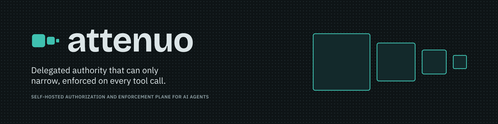

<p align="center"></p>

# attenuo

[](LICENSE)
[](Cargo.toml)
[](docs/spec/rfc-0001-attenuo.md)
<!-- TODO once published: crates.io and docs.rs badges for attenuo-core -->

When you give an AI agent access to your GitHub, your mail or your bank, it usually gets one broad token, and every tool call it makes after that is allowed. If a poisoned issue or web page talks the agent into something, nothing stands between the instruction and your data. attenuo is a self-hosted server and proxy for that gap. A user's login becomes a token for an agent, and the agent can hand a narrower token to each sub-agent it uses. Every tool call goes through attenuo, which checks it against what was delegated and against a Cedar policy that sees the call's arguments. You can revoke a running session, and every decision is written to a hash-chained audit log. It works with any OIDC identity provider and is written in Rust, with Python and TypeScript SDKs.

**Status: pre-alpha.** The design is in [RFC-0001](docs/spec/rfc-0001-attenuo.md) and is still open for comment. Nothing here is ready for production use and formats will change before 1.0. See [Status](#status) for what has and has not been tested.

## See it block the GitHub MCP leak

In May 2025 researchers showed that a malicious issue in a public repository could steer an AI assistant. Through the official GitHub MCP server it read the user's private repositories and published them ([write-up](https://invariantlabs.ai/blog/mcp-github-vulnerability)). The demo replays that against a fake GitHub MCP server, so it runs offline.

You need a Rust toolchain, `curl` and `python3`.

<!-- check: skip clones the repository over the network; run.sh itself runs in CI job demo -->
```sh
git clone https://github.com/attenuo-dev/attenuo.git
cd attenuo
examples/github-leak-demo/run.sh
```

No Rust toolchain? With Docker, the same scenario runs from the published image and compiles nothing:

<!-- check: skip needs Docker and the network; CI job docker-quickstart runs it -->
```sh
git clone https://github.com/attenuo-dev/attenuo.git
cd attenuo
examples/github-leak-demo/run-docker.sh
```

It pulls `ghcr.io/attenuo-dev/attenuo:0.1.0` and the stock Python image, which runs a small fake GitHub server ([details](examples/github-leak-demo/README.md#run-it-without-rust)).

With the Rust toolchain, the first run compiles the workspace: about a minute and a half on a 4-core machine, nearly all of it compiling (plus crate downloads if your cargo cache is empty). After that the script takes about a second ([measured](docs/design/bench/2026-10-24-vm-demo-cold-timing.md)). It starts attenuo and the fake server on free ports, plays nine steps with the `attenuo` CLI, and exits non-zero if any step comes out differently. In short:

- Alice's assistant gets a broad `github:*` token and hands its `coder` sub-agent `github:read_file` only.
- `coder` reads `alice/public-docs`: allowed.
- The injected call reads `alice/private-salaries`: `DENIED policy_deny`. The token allows `read_file`, but the policy only permits repos matching `alice/public-*`.
- The injected `create_issue` that would copy the data out: `DENIED capability_denied`, because it was never delegated.
- Alice revokes the assistant's lease. `coder`'s next call, even the legitimate one, is `DENIED lease_revoked`.
- The audit chain verifies (9 entries, one of them the `tool_result` record of the allowed read), and the fake GitHub server received exactly one call.


A recorded run is in [transcript.md](examples/github-leak-demo/transcript.md) (the recording above is [docs/demo](docs/demo/README.md), paced for reading), and the step table is in the [demo README](examples/github-leak-demo/README.md). The demo mints Alice's root token through a development-only endpoint. A real deployment mints it from an OIDC ID token, as shown in [getting started](docs/guides/getting-started.md) and [identity providers](docs/guides/identity-providers.md).

## Install

Prebuilt binaries for Linux (x86_64, aarch64) and macOS (Intel, Apple silicon):

<!-- check: skip downloads a release over the network; CI job install-script runs it -->
```sh
curl -fsSL https://raw.githubusercontent.com/attenuo-dev/attenuo/main/scripts/install.sh | sh
```

The script downloads the latest release's archive for your machine, checks its SHA-256 against the release's `SHA256SUMS`, and puts `attenuo` (the CLI) and `attenuo-server` in `~/.local/bin`. It does not use `sudo`. Set `ATTENUO_VERSION=v0.1.0` to pin a release and `ATTENUO_INSTALL_DIR` to choose the directory; [read the script](scripts/install.sh) first if you prefer. There is also a container image, `ghcr.io/attenuo-dev/attenuo`, and you can [build from source](CONTRIBUTING.md).

## How it works

```text
 user --login--> IdP --ID token--> orchestrator --exchange--> sub-agent
                                        |                        |
                       RFC 8693 token exchange at attenuo:      |
                       each hop gets a narrower token            |
                                        v                        v
                                  +---------------------------------+
     tools/call + bearer token    |        attenuo proxy           |
     ---------------------------> |  1. token and chain verify      |
                                  |  2. leases of every hop         |
                                  |  3. capability (tool, args)     |
                                  |  4. run limits of every hop     |
                                  |  5. Cedar policy, approvals     |
                                  |  6. audit record, then answer   |
                                  +----------------+----------------+
                                                   | allowed calls only
                                                   v
                                              MCP server
```

The user's ID token is exchanged once for a root token (RFC 8693) held by the orchestrator. The orchestrator exchanges that token again for each sub-agent. Each exchange can only shrink what the token allows: fewer tools, tighter argument constraints, a shorter lifetime, no more than the maximum depth. The whole chain, from the verified user to the current agent, is inside the token.

On every `tools/call`, attenuo verifies the token and its chain, then runs the checks below in order. The first failure denies the call, and the proxy answers with a JSON-RPC error carrying the reason and a decision id.

1. **Lease.** Every hop's lease must be live. Revoking any ancestor lease denies all of its descendants on their next call.
2. **Capability.** The tool and arguments must be covered by every hop's capability set.
3. **Run limits.** A capability can cap how many calls, how much in total, or how many destinations a run may use; a call that would go over any hop's limit is denied with `budget_exhausted` before policy runs. See [run limits](docs/design/run-limits.md) and [ADR-0010](docs/decisions/0010-run-limits.md).
4. **Policy.** A Cedar policy sees the originating user, the chain, the arguments, the run's remaining budget and whether the run has read untrusted tool output, and must explicitly permit the call. Deny is the default.
5. **Approval.** A policy can ask for a person instead of denying: the proxy answers `-32008` with an approval id, and once the user or an operator grants it, one identical retry goes through. See [output labelling](docs/design/output-labelling.md) and [ADR-0009](docs/decisions/0009-output-labelling.md).
6. **Audit.** The decision, allow or deny, is appended to a hash-chained log before the answer goes out.

Only allowed calls reach the MCP server, and an allowed call is charged against the run limits it matched in the same store transaction. More detail: [delegation chains](docs/concepts/delegation-chain.md), [capabilities and attenuation](docs/concepts/capabilities-and-attenuation.md), [leases](docs/concepts/leases-and-revocation.md), [the audit log](docs/concepts/audit-log.md), and [how it compares with the alternatives](docs/comparison.md).

## What it is not

- **Not a replacement for your API gateway.** It does not do routing or general traffic management. Its `[limits]` (an in-flight cap, request deadlines and optional per-caller rate limits) protect one attenuo process, not the services behind it, and run limits count calls per delegation run, not requests per second. It can sit behind a gateway as the decision point through its AuthZEN endpoint. One gateway adapter exists, for [agentgateway's external authorization](docs/guides/agentgateway.md); it has been run once against agentgateway v1.7.0, on one machine, on loopback.
- **Not a prompt-injection detector.** It never reads prompts or model output. It limits what an agent that has already been fooled can do with the authority it was given. In the [injection suite](docs/evaluation/injection-suite.md), 15 of 77 attack calls in the development split still went through the base configuration, because they used a tool and arguments the task legitimately needed. Output labelling and run limits narrow that, but only by asking a person or by a limit someone has to choose for the task.
- **Not a sandbox.** It only sees calls that go through it. If the agent also holds a direct API key or network path to the tool, attenuo sees nothing. See [what attenuo does not prevent](docs/spec/threat-model.md#what-attenuo-does-not-prevent).

**Not affiliated with Tenuo.** [Tenuo](https://github.com/tenuo-ai/tenuo) is a separate open-source project with a similar name and a related goal. The two are unrelated. In Tenuo the holder of a warrant narrows it offline; in attenuo every narrowing is a token exchange at a server you run (RFC 8693), so a running chain can be revoked at once. attenuo also applies a Cedar policy to each call and keeps a hash-chained log of every decision. The [comparison](docs/comparison.md) puts the two side by side.

## Numbers

All measured on a shared 4-core development container, so read them as indicative. Every figure, its caveats and its run are in [docs/numbers.md](docs/numbers.md).

- **With a model that follows attacks** (AgentDojo, local `qwen2.5:14b`, grants written by a planner model): 207 of 936 attacks landed alone and 25 of 936 behind attenuo. The cost: with no attack, 38 instead of 49 of 96 tasks finished. One model, one run per case ([details](docs/evaluation/agentdojo-local-model.md)).
- **Replay with no model** (AgentDojo's own attack calls): 592 of 609 attacks landed without attenuo, 13 of 609 with planner-written grants and the suite policy, keeping 75 of 97 benign tasks ([details](docs/evaluation/agentdojo-planner-grants.md)).
- **Own injection suite, held-out split:** 7 of 38 attack calls got through and 3 of 29 benign calls were refused. The cases and the policies have the same author, so this checks the corpus against the code and does not measure effectiveness ([details](docs/evaluation/injection-suite.md)).
- **Latency added:** about 0.4 to 0.8 ms at the median per proxied call with one client; a Cedar decision takes about 12 to 13 microseconds on a cache hit ([performance](docs/design/performance.md)).
- **Throughput:** 1,252 to 6,254 allowed calls per second at 1 to 32 clients, one hop, file-backed audit log at `durability = "normal"`.

## Status

attenuo is pre-alpha and has not been used in production. Release 0.1.0, the first, was tagged on 2026-11-19 ([release notes](docs/release/0.1.0.md)). The full account is in [docs/status.md](docs/status.md).

- **Tests and fuzzing.** Unit, property and integration tests in Rust and in both SDKs, the SDKs against a real server, and 22 fuzz targets with no open crash.
- **Proof.** A Lean model of the covering rule proves that delegation never widens authority in the model. The Rust code is not verified against it; a differential test finds the two in agreement on 31,500 generated cases.
- **Security review.** Twenty review passes recorded 138 findings; two Info findings are open (SR-117, SR-126), the rest are fixed or accepted with reasons. All passes were done by the project itself. There has been no outside audit.
- **Not tested.** Hosted identity providers (Auth0, Okta, Entra ID, Google), AWS S3, a production SPIRE or Keycloak, and the release workflow. No load test on reference hardware.

## Where to look

- [Guides](docs/guides/README.md): [getting started](docs/guides/getting-started.md), [deploying](docs/guides/deploying.md), [integrating MCP clients](docs/guides/integrating-mcp-clients.md), [identity providers](docs/guides/identity-providers.md) and [agentgateway as the enforcement point](docs/guides/agentgateway.md).
- [FAQ](docs/faq.md): why a proxy, how it differs from gateways and policy engines, what happens when it is down.
- [Comparison](docs/comparison.md): attenuo next to OAuth scopes, gateways, policy engines, IdP agent features and SPIFFE.
- [Numbers](docs/numbers.md) and [status](docs/status.md) in full.
- [RFC-0001: attenuo](docs/spec/rfc-0001-attenuo.md): what the system is, the token model, the policy and audit design.
- [docs/](docs/README.md): specifications, architecture decisions, and research notes.
- [Python SDK](sdk/python/README.md): `pip install -e sdk/python`, sync and async clients, an admin client, and an [agent example](examples/python-agent/agent.py).
- [TypeScript SDK](sdk/typescript/README.md): `@attenuo/sdk` (Node 20+, no runtime dependencies), the same API with promises, and an [agent example](examples/typescript-agent/agent.ts).
- [examples/github-leak-demo](examples/github-leak-demo/README.md): the demo from the top of this page.
- [examples/multi-hop-demo](examples/multi-hop-demo/README.md): alice, a planner and a coder, each exchange narrower than the last, a run limit, and one revocation of the whole chain by `chain_id`.
- [examples/idp-exchange-demo](examples/idp-exchange-demo/README.md): the chain starts at an identity provider: alice's OIDC ID token, from a local mock IdP, is exchanged at `POST /token` for the root token with the dev mint off, then narrowed for a coder.
- [examples/claude-agent-sdk](examples/claude-agent-sdk/README.md) and [examples/langchain-agent](examples/langchain-agent/README.md): an orchestrator delegating to a coder sub-agent in the Claude Agent SDK and in LangChain, each hop with its own token, through the proxy. A `run.sh` dry-run needs no API key. All examples are listed in [examples/README.md](examples/README.md).
- [docs/guides/writing-policies.md](docs/guides/writing-policies.md): writing Cedar policies for agents and testing them offline with `attenuo policy test` and `attenuo policy lint`, including a CI recipe.
- [CONTRIBUTING.md](CONTRIBUTING.md): how to build, test and submit changes.
- [SECURITY.md](SECURITY.md): how to report a vulnerability. Please do not file security issues publicly.
- [CHANGELOG.md](CHANGELOG.md), [GOVERNANCE.md](GOVERNANCE.md), [CODE_OF_CONDUCT.md](CODE_OF_CONDUCT.md).

## Crates

| Crate | Purpose |
| --- | --- |
| `attenuo-core` | Delegation chains, capability sets, attenuation, decision records |
| `attenuo-token` | Token encoding, signing and verification |
| `attenuo-policy` | Policy evaluation |
| `attenuo-audit` | Append-only, hash-chained audit log |
| `attenuo-proxy` | Enforcement in front of upstream services |
| `attenuo-server` | The standalone server binary |
| `attenuo-cli` | The `attenuo` command line: a client for a running server, plus offline `audit verify --file` and `policy test` / `policy lint` |
| `attenuo-bench` | End-to-end latency and throughput benchmark (`scripts/bench-e2e.sh`, results in `docs/design/bench/`) |

## Building

<!-- check: skip builds and tests the whole workspace, which CI job test does -->
```sh
cargo build --workspace
cargo test --workspace
```

See [CONTRIBUTING.md](CONTRIBUTING.md) for the full set of checks CI runs.

## Run the server yourself

<!-- scripts/check-doc-commands.sh README.md (CI job getting-started) runs every sh block of this page in order and compares its output with the text or json block right after it. Run it when you change a command or an output here. The "check:" comments before some blocks tell it how to run them. -->

Run the server with the example config. It generates an issuer key in `data/` on first start, keeps the audit log and lease registry in `data/attenuo.sqlite`, and proxies an MCP server expected at `http://127.0.0.1:3001/mcp` as `github` (edit `[[upstreams]]` to point at yours, or start the repository's fake one there, as below). Build the server, the CLI and the fake MCP server (the commands below run them from `target/debug/`; use `$CARGO_TARGET_DIR/debug/` if you set it):

<!-- check: build -->
```sh
cargo build -p attenuo-server
cargo build -p attenuo-cli
cargo build -p attenuo-proxy --features testing --example fake_mcp
```

The flows below start from a root token. A deployment mints it from the user's identity provider ([hop 0](#hop-0-from-your-identity-provider)). To try them without one, run a copy of the example config with the development-only root mint switched on ([development only](#development-only-a-root-token-without-an-idp)), and pick an admin token:

```sh
mkdir -p data
sed 's/^allow_root_mint = false/allow_root_mint = true/' config/example.toml > data/dev.toml
export ATTENUO_ADMIN_TOKEN=$(openssl rand -hex 32)   # the /admin bearer; overrides [admin] token
```

Start the fake MCP server in one terminal:

<!-- check: background -->
```sh
target/debug/examples/fake_mcp --port 3001
```

and attenuo in a second one, from the checkout, with the same `ATTENUO_ADMIN_TOKEN` exported:

<!-- check: background -->
```sh
target/debug/attenuo-server --config data/dev.toml   # or ATTENUO_CONFIG=data/dev.toml
```

With an identity provider, run `config/example.toml` as it ships instead. The example ships no admin token. On a loopback `listen` address a missing, short or placeholder token only produces a warning (and without one the admin routes answer 403); on any other address the server refuses to start unless the token is at least 32 bytes and not a published placeholder, or named operators with their own tokens and roles are configured instead (`[[admin.operators]]`, `attenuo admin operator new`). Revocations, policy reloads and dev root mints are written to the audit log as admin actions, under the operator who took them.

The flows below use `curl` and `jq`, in a third terminal with the same `ATTENUO_ADMIN_TOKEN`. [Getting started](docs/guides/getting-started.md) covers the same ground step by step.

```sh
SRV=http://127.0.0.1:8080
ADMIN=$ATTENUO_ADMIN_TOKEN   # as the server got it
curl -s $SRV/healthz
```

```json
{"status":"ok","version":"0.1.0"}
```

### Hop 0 from your identity provider

The first token in a chain is minted from a credential the user's IdP issued: an OIDC ID token, or an ID-JAG (draft-ietf-oauth-identity-assertion-authz-grant). Any OIDC issuer works. List it under `[[idps]]` (its JWKS is found through `/.well-known/openid-configuration` unless you set `jwks_url`), register the agent under `[[agents]]`, and cap what the agent may get for those users under `[[root_grants]]`:

```toml
[[idps]]
issuer = "https://your-tenant.example.com"   # exact `iss`
client_ids = { planner = "your-client-id" }   # agent id -> the `aud` its ID tokens carry

[[agents]]
id = "planner"
secret_sha256 = "..."                        # printf %s "$SECRET" | sha256sum

[[root_grants]]
issuer = "https://your-tenant.example.com"
agent = "planner"
capabilities = ["github:*"]
```

An ID token is accepted only from the agent whose `client_ids` entry its `aud` names (an agent without an entry must have a client id equal to its agent id). The agent exchanges the user's ID token for a root delegation token (RFC 8693), authenticating with its own client credentials. The token's originating user comes from the verified ID token: `sub`, `iss`, `auth_time`, the configured `attribute_claims`, and an `mfa` flag derived from `amr`.

<!-- check: skip needs an ID token from a real identity provider; the next section mints the root token without one -->
```sh
ID_TOKEN=...   # from your IdP's login flow

# 1. Exchange the user's ID token for a root token held by "planner".
ROOT=$(curl -s -X POST $SRV/token -u planner:planner-secret-change-me \
  --data-urlencode grant_type=urn:ietf:params:oauth:grant-type:token-exchange \
  --data-urlencode subject_token=$ID_TOKEN \
  --data-urlencode subject_token_type=urn:ietf:params:oauth:token-type:id_token \
  --data-urlencode scope=github:*)
ROOT_TOKEN=$(echo "$ROOT" | jq -r .access_token); ROOT_LEASE=$(echo "$ROOT" | jq -r .lease)
```

For an ID-JAG, send `subject_token_type=urn:ietf:params:oauth:token-type:id-jag` (or `grant_type=urn:ietf:params:oauth:grant-type:jwt-bearer` with `assertion=`). Its `aud` must be `[issuer] issuer` and its `client_id` must be the authenticated agent. The CLI sends the same exchange with `attenuo token exchange --subject-token-type id-token` (or `id-jag`; see the [CLI reference](docs/reference/cli.md#hop-0-from-an-id-token)). Failures come back as `invalid_client` (401), or as `invalid_grant` or `invalid_scope` (400), each with a stable `code` (also in `error_description`, deprecated as a machine field) such as `audience_mismatch`, `expired`, `unknown_kid` or `scope_exceeds_grant`.

### Development only: a root token without an IdP

`data/dev.toml` above sets `[dev] allow_root_mint = true` (`config/example.toml` ships with `false`). This mounts `POST /admin/root-token`, which mints a root token for whichever user the admin names. Nothing about that user is verified, so it is for local development only: the server logs a warning at startup, and refuses to start with the setting on when the admin API's listener (`[admin] listen` when set, else `[server] listen`) is not a loopback address. With the setting off (the default) the route does not exist and answers 404. Use it in place of step 1:

```sh
ROOT=$(curl -s -X POST $SRV/admin/root-token -H "Authorization: Bearer $ADMIN" \
  -H 'content-type: application/json' \
  -d '{"subject":"alice","issuer":"https://idp.example","agent":"planner","capabilities":["github:*"]}')
ROOT_TOKEN=$(echo "$ROOT" | jq -r .access_token); ROOT_LEASE=$(echo "$ROOT" | jq -r .lease)
```

### Delegate, call, revoke

RFC 8693 exchange: the planner delegates `read_file` only to a `coder` sub-agent. The coder authenticates as itself (`[[agents]]`); only it can receive a token in its name.

```sh
CHILD_TOKEN=$(curl -s -X POST $SRV/token -u coder:coder-secret-change-me \
  --data-urlencode grant_type=urn:ietf:params:oauth:grant-type:token-exchange \
  --data-urlencode subject_token=$ROOT_TOKEN \
  --data-urlencode subject_token_type=urn:ietf:params:oauth:token-type:jwt \
  --data-urlencode actor=coder \
  --data-urlencode scope=github:read_file | jq -r .access_token)
```

Call through the proxy: `read_file` is allowed and forwarded upstream.

```sh
mcp() { curl -s -X POST $SRV/mcp/github -H "Authorization: Bearer $CHILD_TOKEN" \
  -H 'content-type: application/json' -H 'accept: application/json, text/event-stream' -d "$1"; }
mcp '{"jsonrpc":"2.0","id":1,"method":"tools/call","params":{"name":"read_file","arguments":{"repo":"acme/api"}}}'
```

```json
{"id":1,"jsonrpc":"2.0","result":{"content":[{"text":"{\"arguments\":{\"repo\":\"acme/api\"},\"name\":\"read_file\"}","type":"text"}],"isError":false}}
```

The fake server echoes the call. The proxy records the answer in the audit log as untrusted output: an argument of a later call in the run that copies a value from it is listed in that call's `untrusted_args`, as in the next answer.

A denial: the coder was never delegated `create_issue`.

```sh
mcp '{"jsonrpc":"2.0","id":2,"method":"tools/call","params":{"name":"create_issue","arguments":{"repo":"acme/api","title":"x"}}}'
```

```json
{"jsonrpc":"2.0","id":2,"error":{"code":-32003,"message":"attenuo: denied: capability_denied","data":{"reason":"capability_denied","decision_id":"86bdd6bf-1cce-4b77-9d3d-fa6fc2b4f0e7","untrusted_args":[{"arg":"repo","seq":5,"kind":"leaf"},{"arg":"repo","seq":5,"kind":"entity"}],"code":"capability_denied"}}}
```

Revoke the root lease. The revocation cascades to the coder's lease, and the coder's next call is denied.

```sh
curl -s -X POST $SRV/admin/leases/$ROOT_LEASE/revoke -H "Authorization: Bearer $ADMIN" \
  -H 'content-type: application/json' -d '{"reason":"demo"}'
```

```json
{"lease_id":"3cdebe33-0a21-45ee-aadb-5badd8e77f24","revoked":2,"reason":"demo","audit_id":"4e1f2c18-a341-4e2b-a4a8-ccc0f7c996b8"}
```

```sh
mcp '{"jsonrpc":"2.0","id":3,"method":"tools/call","params":{"name":"read_file","arguments":{"repo":"acme/api"}}}'
```

```json
{"jsonrpc":"2.0","id":3,"error":{"code":-32003,"message":"attenuo: denied: lease_revoked","data":{"reason":"lease_revoked","decision_id":"88b41a87-13fe-4dbb-8b11-3af7f7dfd8f9","code":"lease_revoked"}}}
```

Every decision and issuance is in the hash-chained audit log.

```sh
curl -s $SRV/admin/audit/verify -H "Authorization: Bearer $ADMIN"
```

```json
{"entries":8,"ok":true,"first_bad_seq":null,"checkpoints":0,"last_signed_seq":null,"unsigned_tail":8,"bad_checkpoints":[]}
```

```sh
curl -s "$SRV/admin/audit?from=1&limit=20" -H "Authorization: Bearer $ADMIN" | jq -c '.entries[].record | {decision,reason,tool,agents}'
```

```json
{"decision":"allow","reason":"token_issued","tool":"token.root","agents":["planner"]}
{"decision":"allow","reason":"admin_action","tool":"admin.root_token","agents":[]}
{"decision":"allow","reason":"token_issued","tool":"token.exchange","agents":["planner","coder"]}
{"decision":"allow","reason":"policy_allow","tool":"read_file","agents":["planner","coder"]}
{"decision":"allow","reason":"tool_result","tool":"read_file","agents":["planner","coder"]}
{"decision":"deny","reason":"capability_denied","tool":"create_issue","agents":["planner","coder"]}
{"decision":"allow","reason":"admin_action","tool":"admin.lease.revoke","agents":[]}
{"decision":"deny","reason":"lease_revoked","tool":"read_file","agents":["planner","coder"]}
```

Other endpoints: `POST /token/renew` (extend your lease), `POST /access/v1/evaluation`, `/evaluations` and `/search/action` (AuthZEN, single, batch and action search; the delegation token as bearer is required unless `[authzen] allow_unsigned_chain` is set for authenticated `[[peps]]`), `GET /.well-known/jwks.json`, `GET /.well-known/authzen-configuration`, `POST /admin/policies/reload`, `GET /admin/leases/{id}`, `GET /admin/leases/{id}/tree`, `POST /approvals/{id}` (the user grants or declines with an ID token) and `/admin/approvals` (the operator does), `POST /admin/budgets/refund`, `GET /admin/audit/checkpoint` (signed), `GET /admin/audit/export`, `GET /healthz`, `GET /readyz`. The request pipeline is described in [docs/design/server.md](docs/design/server.md). Set `RUST_LOG=debug` for more logging, `[logging] format = "json"` (or `ATTENUO_LOG_FORMAT=json`) for one JSON object per line, and `[logging] redact_subjects = true` to write user subjects into log lines as a keyed digest ([config reference](docs/reference/config.md#logging)).

## Command line

`attenuo` (crate `attenuo-cli`) talks HTTP to a running server, so the quick start above becomes:

```sh
export ATTENUO_SERVER=http://127.0.0.1:8080   # and ATTENUO_ADMIN_TOKEN, as the server got it
export PATH=$PWD/target/debug:$PATH   # or $CARGO_TARGET_DIR/debug

# token root uses the dev mint: it needs [dev] allow_root_mint = true (data/dev.toml above; local
# development only). With the example config as shipped it gets a 404.
ROOT_JSON=$(attenuo --json token root --subject alice --issuer https://idp.example --agent planner --cap 'github:*')
ROOT_TOKEN=$(echo "$ROOT_JSON" | jq -r .access_token); ROOT_LEASE=$(echo "$ROOT_JSON" | jq -r .lease)
CHILD_TOKEN=$(printf '%s\n' coder-secret-change-me | ATTENUO_TOKEN="$ROOT_TOKEN" attenuo token exchange --actor coder --client-secret-stdin --cap github:read_file --print token)
attenuo token inspect "$CHILD_TOKEN" --verify      # the chain as a tree; --verify checks it against the server's JWKS
```

```text
user alice  (issuer https://idp.example)
  authenticated 2026-11-13T12:39:13Z
  attributes mfa=false
└─ agent planner
     can   github:*
     until 2026-11-13T12:54:13Z (in 14m 59s)
     lease 54cd811d-a767-4487-b875-61cf6ea785c1
   └─ agent coder  <- holds this token
        can   github:read_file
        until 2026-11-13T12:54:13Z (in 14m 59s)
        lease 6ef1b201-6aec-4c2c-8b86-1165773cf251

iss http://127.0.0.1:8080   aud attenuo   jti 41ef2119-6fd8-4ad8-b0c6-6aa5a7375bbf
kid SIGySX_YgqyWpmQNxea9Cw   ou_kid SIGySX_YgqyWpmQNxea9Cw
exp 2026-11-13T12:54:13Z (in 14m 59s)
may_act (absent): any authenticated agent may exchange this token
verified: signature, type, issuer, audience, expiry, chain
```

```sh
printf '%s\n' "$CHILD_TOKEN" | attenuo call --token - --upstream github --tool read_file --arg repo=acme/api
attenuo lease revoke "$ROOT_LEASE" --reason demo
attenuo audit verify
```

```text
ALLOWED
{"arguments":{"repo":"acme/api"},"name":"read_file"}
revoked 2 lease(s) starting at 54cd811d-a767-4487-b875-61cf6ea785c1 (reason: demo)
audit chain OK: 14 entries verified
checkpoints: none signed yet
```

The chain has 14 entries here because the `curl` flow above wrote the first 8. `audit tail` shows the newest; `--follow` keeps polling until Ctrl-C:

```sh
attenuo audit tail -n 3
```

```text
#12   2026-11-13T12:39:13.679764325Z  ALLOW github/read_file  planner > coder for alice  reason=policy_allow  id=ac0c...
#13   2026-11-13T12:39:13.687373923Z  tool_result  github/read_file  planner > coder for alice  decision=ac0c...  label=untrusted size=117  id=9f45...
#14   2026-11-13T12:39:13.698017447Z  ALLOW attenuo/admin.lease.revoke  by urn:attenuo:admin  reason=admin_action  id=12be...
```

Other subcommands: `tools` (`tools/list`), `lease show`, `lease tree` (the delegation tree under a lease, with each hop's run limits and what is left), `approval` (list, show, grant and decline approvals), `budget refund` (give back what one decision charged, for a call whose effect did not happen), `policy reload`, `authzen eval`, `authzen search` (AuthZEN action search), `health` (the container health check), `stdio-bridge` (serve a local STDIO MCP server over HTTP so attenuo can front it, [guide](docs/guides/stdio-servers.md)), `key gen` (DPoP and client keys) and `admin operator` (named admin credentials, offline). Output is for people by default and JSON with `--json`. Exit status is 0 on success, 1 on an error and 2 when the server said no (a denied call, a negative AuthZEN decision, a broken audit chain). Secrets stay out of the argument list: use the environment variables, `-stdin` flags or `-file` flags described in the [CLI reference](docs/reference/cli.md).

A `Dockerfile` and `docker-compose.yml` run the same pair of servers in containers: the release image for the server and a separate `demo` image for the fake GitHub server. `scripts/compose-smoke.sh` builds both and plays the scenario through them; see the [demo's README](examples/github-leak-demo/README.md#run-it-in-docker).

## Python SDK

[`sdk/python`](sdk/python/README.md) is a Python client (`pip install -e sdk/python`, Python 3.10 or newer, depends on `httpx`) for agents written in Python: token exchange with typed capabilities, constraints and run limits, calls through the proxy that raise `Denied(reason, decision_id)` on a denial and `ApprovalRequired` when a policy asks for an approval (`call_tool_with_approval` waits for it and retries once), lease renewal, a token refresher that renews leases and re-exchanges before `exp`, AuthZEN evaluation (single and batch), action search and discovery, granting or declining an approval as the run's user, closing a proxy session, token inspection, and an admin client for revocation, budget refunds and the audit log. A timeout raises `TransportTimeout`; a server refusing for its load raises `Unavailable` (503) or `RateLimited` (429), retried only with `max_retries`. There is an async variant of each client. [`examples/python-agent`](examples/python-agent/agent.py) shows a planner delegating to a coder, with a run limit and an approval, and a second script wires the official `mcp` client to the proxy.

```python
import os

from attenuo import AdminClient, Capability, Client, Denied, Prefix

admin = AdminClient("http://127.0.0.1:8080", os.environ["ATTENUO_ADMIN_TOKEN"])  # as the server got it
root = admin.mint_root_dev("alice", "https://idp.example", "planner", ["github:*"])   # dev only
with Client("http://127.0.0.1:8080") as ob:
    coder = ob.exchange(
        root, "coder", [Capability("github", "read_file", repo=Prefix("alice/public-"))],
        client_secret="coder-secret-change-me",   # the coder authenticates as itself
    )
    try:
        ob.call_tool(coder, "github", "create_issue", {"repo": "alice/public-docs", "title": "x"})
    except Denied as d:
        print(d.reason, d.decision_id)   # capability_denied <audit record id>
```

It is pre-alpha like the rest and is not published to PyPI.

## TypeScript SDK

[`sdk/typescript`](sdk/typescript/README.md) is the same client for Node 20 or newer as the npm package `@attenuo/sdk` (ESM and CJS, strict types, no runtime dependencies, global `fetch`, Ed25519 verification through WebCrypto): `AttenuoClient` for exchange (capabilities with `withLimits` for run limits), renew, `callTool` (throws `DeniedError` with `reason` and `decisionId`), `callToolWithApproval`, `listTools`, AuthZEN (`authzenEvaluate`, `authzenEvaluateBatch`, `authzenSearchAction`, `authzenSearchActionIter`, `authzenConfiguration`), `grantApproval` / `declineApproval` for the run's user, `closeSession` and `inspect`, and `AdminClient` for revocation, budget refunds, the audit log and policy reload. A timeout throws `TransportTimeoutError`; a server refusing for its load throws `UnavailableError` (503) or `RateLimitedError` (429), retried only with `maxRetries`. `TokenRefresher` keeps a token alive (lease renewal, re-exchange before `exp`). `mcpUrl` and `mcpHeaders` point the official `@modelcontextprotocol/sdk` client at the proxy. [`examples/typescript-agent`](examples/typescript-agent/agent.ts) shows a planner delegating to a coder, with a run limit and an approval.

```ts
import { AdminClient, DeniedError, AttenuoClient, capability, prefix } from "@attenuo/sdk";

const admin = new AdminClient("http://127.0.0.1:8080", process.env.ATTENUO_ADMIN_TOKEN!); // as the server got it
const root = await admin.mintRootDev("alice", "https://idp.example", "planner", {
  capabilities: ["github:*"], // dev only
});
const ob = new AttenuoClient("http://127.0.0.1:8080");
const coder = await ob.exchange(
  root,
  "coder",
  [capability("github", "read_file", { repo: prefix("alice/public-") })],
  { clientSecret: "coder-secret-change-me" }, // the coder authenticates as itself
);
try {
  await ob.callTool(coder, "github", "create_issue", { repo: "alice/public-docs", title: "x" });
} catch (e) {
  if (e instanceof DeniedError) console.log(e.reason, e.decisionId); // capability_denied <audit record id>
}
```

It is pre-alpha like the rest and is not published to npm.

## How this project is built

attenuo is written by one maintainer working with AI coding agents (Claude Code), and the git history shows it: most commits carry a `Co-Authored-By` trailer for the model that wrote them. Every change went through a branch, local tests and review before it was merged, and the maintainer decides what the project does. Some parts of the evaluation were also written by AI agents, including the injection-suite cases, their policies and the scripted approver; the [technical report](docs/report/attenuo-2026-11.md) treats that as a threat to validity. The security review passes in `docs/research/` were done the same way, which is one more reason they are not a substitute for an outside audit. Rules for AI-assisted contributions are in [CONTRIBUTING](CONTRIBUTING.md#ai-assisted-contributions).

## License

Apache-2.0. See [LICENSE](LICENSE).
