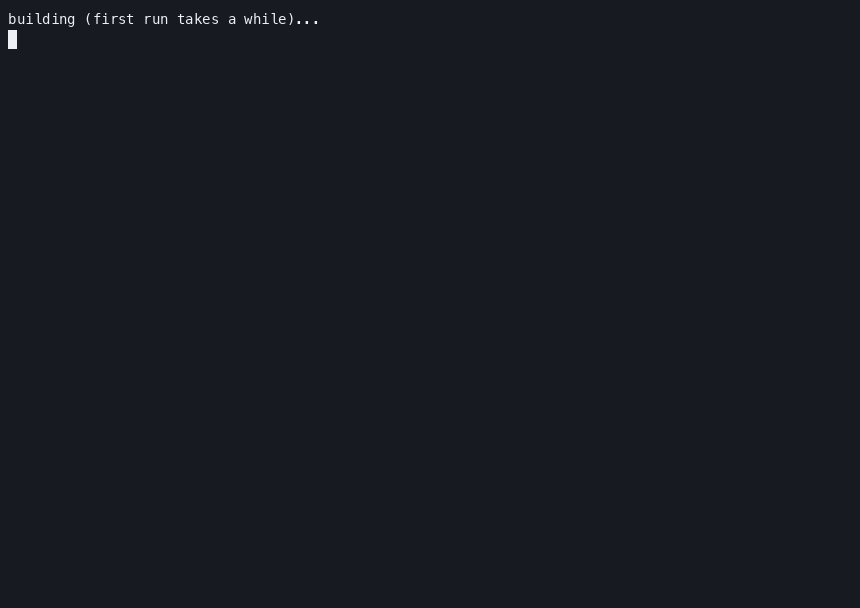

# Demo recordings

Terminal recordings of the two end-to-end demos. Both use a fake GitHub MCP server on loopback, with no model and no real GitHub. The credentials on screen are the fixture values from the demo configs.

## GitHub leak demo

A replay of the May 2025 GitHub MCP prompt-injection leak. A coder sub-agent holding only `read_file` reads a public repository, is refused the private one by policy and is refused `create_issue` because that tool was never delegated. Alice then revokes the assistant's lease, which cuts off the coder too. One `tools/call` reaches the upstream server and the audit chain verifies 9 entries.


```bash
bash examples/github-leak-demo/run.sh
asciinema play docs/demo/github-leak-demo.cast
```

## Multi-hop delegation demo

Delegation narrowing over alice, planner, coder and the GitHub tool. The coder is refused a wider token, a further hand-off to a reviewer, a push to `main`, `create_issue` and a read from a second repository. The operator then revokes the whole chain by `chain_id`. Two `tools/call` requests reach the upstream server and the audit chain verifies 14 entries.



```bash
bash examples/multi-hop-demo/run.sh
asciinema play docs/demo/multi-hop-demo.cast
```

## What the files are

| File | Size | Length | Timing |
| --- | --- | --- | --- |
| `github-leak-demo.cast` | 8.6 KB | 0.17 s | real time |
| `github-leak-demo.gif` | 1.3 MB | 57.5 s | retimed |
| `multi-hop-demo.cast` | 16.5 KB | 0.26 s | real time |
| `multi-hop-demo.gif` | 2.5 MB | 89.0 s | retimed |

The `.cast` files are the recordings as made. Each demo finishes in well under a second, so use `asciinema play --speed 0.01 FILE` to read one as it plays, or `cat` the demo's own [leak transcript](https://github.com/attenuo-dev/attenuo/blob/main/examples/github-leak-demo/transcript.md).

The GIFs have the same output in the same order, but the pauses are added. [`retime.py`](retime.py) waits 2.5 s before each section heading and 2 s before each command, and shows a command and its output in one frame. Don't read the GIF's length as the demo's run time.

## How they were made

From a fresh clone at commit `77cc0a4`, on macOS arm64 with Rust 1.89.0, asciinema 3.2.1 and agg 1.9.0, using the release binaries `scripts/reproduce.sh` had just built in that clone. The demos use those binaries, so the recording shows no compile.

```bash
ATTENUO_BIN_DIR=$PWD/target/release asciinema rec --window-size 100x30 --idle-time-limit 2 \
  --output-format asciicast-v2 -c "bash examples/github-leak-demo/run.sh" \
  docs/demo/github-leak-demo.cast
python3 docs/demo/retime.py docs/demo/github-leak-demo.cast /tmp/github-leak-demo.paced.cast
agg --theme github-dark --font-size 14 --last-frame-duration 6 \
  /tmp/github-leak-demo.paced.cast docs/demo/github-leak-demo.gif
```

The multi-hop recording uses the same commands with its own script and file names.
