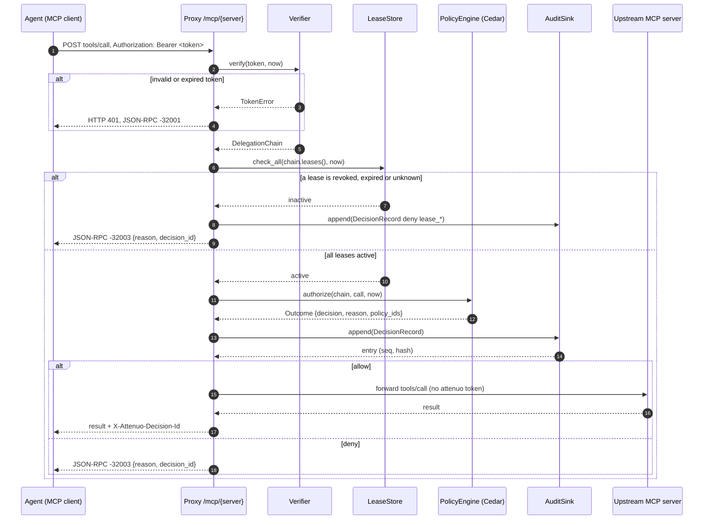
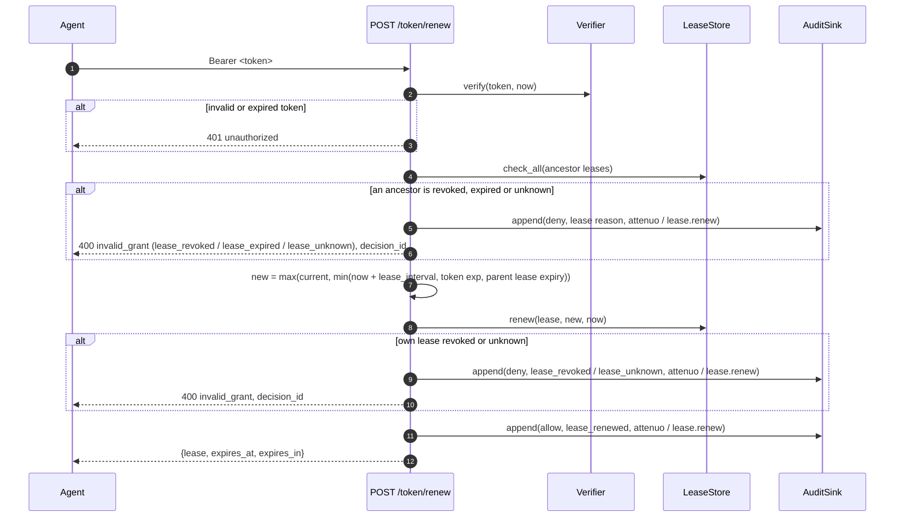

# attenuo-server: request pipeline

- Status: implemented (v0)
- Crate: `crates/attenuo-server`
- Related: [RFC-0001](../spec/rfc-0001-attenuo.md) §4–§7, [ADR-0004](../decisions/0004-rust-workspace-layout.md)

The server wires the crates together and holds what belongs to none of them: IdP intake (`idp/`), DPoP, replay, client and actor authentication, and the decision pipeline ([ADR-0004 amendment](../decisions/0004-rust-workspace-layout.md#amendment-2026-11-06)). Tokens come from `attenuo-token`, Cedar decisions from `attenuo-policy`, leases and the audit log from `attenuo-audit`, MCP framing from `attenuo-proxy`. The one piece of composition that matters for security is `authz::Pipeline`, and both enforcement paths go through it.

## Components in the process

| Piece | Type | Shared as |
|---|---|---|
| Issuer and verifier | `attenuo_token::Issuer`, `Verifier` | one signing Ed25519 key, loaded from or generated at `issuer.private_key_pem_path`, plus verify-only `issuer.previous_key_paths`; tokens carry a `kid` |
| Metrics | `metrics::Metrics` | `Arc`, incremented by the pipeline and token routes, served on `[metrics] listen` |
| Policy engine | `attenuo_policy::PolicyEngine` | `authz::SharedPolicy` (`RwLock<Arc<_>>`): each decision takes one snapshot; `POST /admin/policies/reload` compiles a new engine off-lock and swaps it in whole |
| Lease registry | `attenuo_audit::SqliteLeaseStore` | `Arc`, same SQLite file as the log |
| Audit log | `attenuo_audit::SqliteAudit` | `Arc`; signs checkpoints with the issuer key (`Issuer::detached_signer`) |
| Pipeline | `authz::Pipeline` (`authz/pipeline.rs`) | `Arc`, used by the proxy's `ServerAuthorizer` and by the AuthZEN handler |
| Proxy | `attenuo_proxy::router` | mounted at `/mcp/{server}` |
| IdP registry | `idp::IdpRegistry` | one `JwksCache` per `[[idps]]` entry, behind a `tokio::sync::Mutex` |
| Lease maintenance | `spawn_lease_maintenance` | one tokio task, every `[leases] maintenance_interval_seconds` (default 60) when `[leases] session_retention_seconds`, `retention_seconds` or `run_state_retention_seconds` is on: `prune_session_bindings`, then `prune_lease_registry`, then `prune_run_state` (run-limit counters, charge log and approvals of runs whose leases are gone), each in passes of `maintenance_batch_rows` rows (default 1,000) on the blocking pool, at most `maintenance_max_passes` passes each (default 100); a lease pass counts the leases it looks at, reads to decide a run and deletes, and carries a run wider than that over to the next passes (read to the end first, then deleted children before parents, the root last) |

## The decision pipeline

`Pipeline::decide(chain, call, now)` runs these steps for every `tools/call` and every AuthZEN evaluation. The chain has already been verified (token signature, originating-user signature, structure, expiry) by the caller.

1. **Leases.** `LeaseRegistry::check_all(chain.leases(), now)`. Every hop's lease must be known, unrevoked and `expires_at > now`, so a lease that its holder stopped renewing denies the call while the JWT is still valid. If not, the decision is deny, with reason `lease_revoked`, `lease_expired` or `lease_unknown` (checked in that order), or `lease_error` if the store cannot be read.
2. **Run labels and budgets.** `Pipeline::run_labels` reads the output labels of the call's delegation run from the lease store (`RunState::labels`, keyed by `chain_id`, the first hop's lease). A run with labels is tainted, and Cedar sees it as `context.session.tainted` and `context.session.tainted_by`. If the labels cannot be read, the run counts as tainted with no known source, and the reason is added to the decision's diagnostics. On a tainted run, `Pipeline::arg_taint` then matches the call's unpinned arguments against the run's span index (`RunState::find_spans`), which gives `context.args_contain_untrusted` and `context.untrusted_args`: for every call when a loaded policy reads either attribute (`PolicyEngine::reads_arg_taint`), and otherwise for a call to a destructive tool only (see [Output labelling](#output-labelling)). `Pipeline::budget_view` then finds every limited capability, in every hop, that matches the call (`attenuo_core::limits::charges_for`) and reads its counters (`RunLimits::budget_used`); see [Run limits](#run-limits). Unreadable counters make the limit check deny with `budget_error`, and an argument a limit cannot count with `limit_arg_invalid`.
3. **Approval.** `ApprovalStore::take_approval(chain_id, lease, call_hash, decision_id, now)` looks for a granted, unexpired approval bound to this run, the calling hop's lease and this call's `call_hash`, and marks it consumed by the decision about to be written. If it finds one, Cedar sees `context.approval.present == true` and `context.approval.by` (`user` or `operator`). The SQLite store reads first, without the write gate or a write transaction, and returns "none" when no usable grant matches, which is almost every call; only a match is taken in a `BEGIN IMMEDIATE` transaction that reads the lease and the row again, so the read never lets a call through, a grant that lands after it is left for the next call, and two calls racing for one grant still consume it once (audit finding A-4). See [Approvals](#approvals).
4. **Policy.** `PolicyEngine::authorize_labelled`: the capability stage (`capability_denied`, then the limit check: `budget_exhausted` when the call would take any matching counter past its `max`, or the step 2 refusal), then Cedar (`policy_allow`, `policy_deny`, `approval_required`, `policy_error`) with `context.budget`. `approval_required` replaces `policy_deny` when every forbid that applied carries `@obligation("approval")` and a permit would allow the call without those forbids (see [Output labelling](#output-labelling)). A token's limits are hard: a call over one is refused before any approval forbid is looked at.
5. **Charge.** For an allowed call that matched limits, `RunLimits::charge` re-checks and increments every matching counter in one `IMMEDIATE` transaction, all or none. If a concurrent call spent first, the decision becomes deny with `budget_exhausted`; if the store fails, `budget_error`. Denied calls are never charged.
6. **Audit.** `DecisionRecord::new(now, decision, reason, chain, call, policy_ids)` is appended to the hash-chained log, and its id becomes the decision id the client sees (`X-Attenuo-Decision-Id`, the JSON-RPC error's `data.decision_id`, or AuthZEN `context.decision_id`). A call on a tainted run also records `labels.tainted_by`, the audit `seq` of the first untrusted result of each source, and `labels.untrusted_args` when an argument matched. If the append fails, the decision becomes deny with reason `audit_error`: an action that cannot be recorded does not happen. When step 3 took an approval, the record carries `approval: {id, by}`. The approval is given back (`ApprovalStore::restore_approval`) when the decision is not allow or its record cannot be appended, so a grant is spent exactly when an allowed decision that names it is in the log. A call charged in step 5 records `budget.charged`, and the charge is refunded (`RunLimits::refund`) when the append fails.
7. **Pending approval.** For `approval_required`, the store keeps a pending approval for the call, or returns the one already pending for the same run, hop and call hash, and an `approval_request` record is appended when a new one is created. The agent gets `approval_id` and `expires_at` in the `-32008` error data. If the approval cannot be stored or its record cannot be appended, the call is still refused with `-32008`, without an `approval_id`.

After an allowed call, the proxy reports the upstream's answer through `Authorizer::record_result` before it relays it, and the server's `Pipeline::record_result` appends a `tool_result` record and, for an untrusted result, adds a label to the run. See [Output labelling](#output-labelling).

The admin dry run, `POST /admin/policies/evaluate`, runs step 4 alone through `Pipeline::evaluate_policy`, the function `decide` calls for that step, so its answer and the real one cannot drift apart. It skips the lease check and writes no audit record. It reads the run's labels from the store unless the request supplies a `session`, and reads the run's counters (step 2) but never charges them. The digest and load time of the policy text in force are kept next to the engine in `AppState::loaded_policies` (set at startup and by each successful reload, which swaps the engine while holding this lock for writing; `GET /admin/policies` takes its snapshot while holding it for reading) for `GET /admin/policies`.

**One policy set per decision (audit findings A-7, A-8).** `Pipeline::decide` takes one `Arc<PolicyEngine>` snapshot first and passes it to every stage that reads the policy: the run lock and usage inputs, per-user windows, argument matching and Cedar. A reload cannot reach a decision in progress, which finishes on the set it started with; before, each stage read the engine on its own and a reload between them could mix two sets. The dry run takes one snapshot for its stages too, and the list screen one per list. A reload reads the file, compiles the new engine on the blocking pool from a snapshot of the old one (`PolicyEngine::with_policies_reloaded`: same schema, catalog and settings, empty caches, the next generation), with no lock held, and then replaces the pointer; reloads are serialised by `AppState::policy_reload`. Narrowing imported from tool annotations is shared between the old and the new engine, so an import that lands during a reload is kept. `arc-swap` was not added: it is not in the dependency tree, and a `std` `RwLock` held only to clone the `Arc` costs one uncontended atomic per decision. Tests: `a_reload_mid_decision_does_not_mix_policy_sets` and `reloads_racing_decisions_never_yield_a_mixed_decision` (`crates/attenuo-server/src/authz/usage_tracking_tests.rs`), with two policy sets whose ids are disjoint and whose usage tracking differs, so a mixed decision shows as the ids of one set with the usage of the other.

**Blocking I/O.** SQLite calls are synchronous and take a lock, so they never run on an async worker. Handlers run their store-touching work through `AppState::blocking` (`tokio::task::spawn_blocking`), and `ServerAuthorizer` runs `Pipeline::decide`, `check_leases` and `record_rejection` the same way. Concurrent callers queue on the audit store's mutex inside an `IMMEDIATE` transaction that reads the head and inserts the next row, so appends stay strictly sequential and the chain cannot fork; the pool only decides which waiting caller goes next. Queries of a file-backed audit log (verify, export, search, lookups) run on a second, read-only connection with its own mutex, so they never hold the appends' mutex; verify walks a snapshot in pages (audit finding A-1, [performance](performance.md#long-audit-reads-and-the-append-path-2026-11-12)). This closes SR-22.

Lease and audit failures fail closed. Revocation reaches the next request: there is no lease cache in v0, so the TTL-bounded cache in RFC-0001 §6 is a later optimisation. Requests that carry no per-call decision (`tools/list`, `initialize`, `ping`, the other allowlisted methods, `GET`/`DELETE` session requests) run the same lease check through `Authorizer::check_active` and get HTTP 401 (JSON-RPC `-32001`, message ending in the reason, for example `lease inactive: lease_revoked`) instead of a decision. A failed check is audited: the proxy appends a `deny` record through `Authorizer::record_rejection`, with the lease reason (`lease_revoked`, `lease_expired`, `lease_unknown` or `lease_error`), the verified token's subject, agents, chain and leases, the proxied server, and tool set to the allowlisted method of the first refused message (`initialize`, `tools/list`, ...), `http.POST` for a notification or a client reply, or `http.GET` / `http.DELETE`; the 401 carries the record's id in `X-Attenuo-Decision-Id` and `data.decision_id`. A client that opens a session per call (LangChain's MCP adapter) meets revocation at `initialize`, so without the record the log would show the revocation and then nothing, not that the agent kept trying. Only tokens that verified are recorded (signature, audience, expiry and DPoP proof all passed): a token that fails verification is a log line, so an anonymous caller cannot write to the audit log (SR-18). The tool is a fixed name, never text from the request. The rate is bounded: the first refusal per delegation chain (digest), tool and reason is recorded, and later ones within the record window (`[proxy] record_window_seconds`, default 60 s, `ProxyConfig::record_window`; the same `RecordWindow` type and window as the listen-stream `stream.end` bound, with its own table) are still refused but only logged (`record_suppressed = true`) and counted in `audit_records_suppressed_total{tool,reason}`; their 401 names the window's record. So a client retrying `initialize` on a revoked token leaves one record per window per tool until the token expires and its requests fail verification, where it used to leave one per request. A full or poisoned table records (fails towards more records). A window opens only on a written record: the proxy records through `Authorizer::record_rejection_checked`, which the server's authorizer answers with `None` when the audit append failed; then the 401 names no decision id and the window is closed (`RecordWindow::forget`), so the next refusal is recorded (SR-81). `tools/call` with a revoked token is a decision and still recorded each time, as are refused exchanges and renewals. A batch that mixes a decided call with undecided messages gets the decision's record and one more for the undecided part.

Revocation also reaches responses that are still streaming (SR-28). The `GET` listen stream and a `POST` whose upstream answers with a streamed body (normally SSE, for example a long `tools/call` with progress notifications) are re-checked every `[proxy] stream_recheck_seconds` (default 2): the proxy compares the earliest `expires_at` of the chain's hops with the clock and calls `Authorizer::check_active`. At the first failure it ends the stream and drops the upstream connection. An SSE stream gets one last `message` event first, a JSON-RPC error with `id: null`, code `-32001` and `data.reason` `token_expired`, `lease_revoked`, `lease_expired` or `lease_unknown`; any other streamed body ends with a transport error, so a truncated JSON body cannot pass for a complete one. To be able to append that event, the proxy relays SSE bodies event by event (bytes unchanged), dropping a final event that has no terminating blank line and failing on an event over `[proxy] max_upstream_body_bytes` (default 16 MiB), as list filtering does. A revoked stream therefore ends within one interval of the revocation, and a stream never outlives its token by more than one interval. A passing re-check writes nothing. When the proxy ends a stream for a lease or token reason (`lease_revoked`, `lease_expired`, `lease_unknown`, `lease_error`, `token_expired`), it records the end through `Authorizer::record_rejection`: one `deny` record with the fixed tool `stream.end`, the reason, the proxied server, the token's chain and the session's hash tag, counted in `decisions_total{decision="deny",reason}`; the final SSE event carries its id in `data.decision_id`. The stream's token verified when it opened, so the record names a principal attenuo issued a token to (SR-18), and each stream is ended, and recorded, at most once. A stream that ends because the client went away is an `info` log line (`response stream closed by the client`) and one the upstream finished a `debug` line, not audit records: neither is a decision, and an MCP client opens and drops listen streams as a matter of course, so recording them would add a record per reconnect and say nothing about authorization. In the log, a session whose stream was cut by revocation therefore has a `stream.end` record (or is covered by its chain's record of that window, below), and a dropped one has none. On the `GET` listen stream (not a streamed `POST` answer) two things are added. Every stream is counted once when it ends, however it ends, in `proxy_streams_ended_total{cause}`: `token_expired`, `lease_revoked`, `lease_expired`, `lease_unknown`, `lease_error`, `lease_other`, `recheck_unavailable` and `recheck_failed` when the re-check cut it, `client_disconnect`, `upstream_eof` or `upstream_error` otherwise. The count is taken when the stream's state is dropped, which happens exactly once, so a client that goes away is counted too. And its `stream.end` records are bounded: at most one per delegation chain (the exact chain, by digest, so a sub-agent keeps its own) and reason per record window (`[proxy] record_window_seconds`, default 60 s, shared with the lease-refusal bound). The first end opens the window and is recorded; the first end after the window closes is recorded again. Ends in between still end their stream with the same final event, whose `data.decision_id` names the window's record, are logged (`warn`, with `record_suppressed`) and counted in `audit_records_suppressed_total{tool="stream.end",reason}`. Decision records have no free-text field, so how many ends a record stands for is in the metric and the proxy log (an `info` line when the next record is written), not in the record. What this bounds is several listen streams of one token (several sessions, or a client holding more than one stream) cut by the same expiry or revocation. Reconnecting with the expired token afterwards is refused at authentication (`401`, `token_expired`) and was never recorded; reconnecting on a revoked lease is a `deny` record of `http.GET` per request, which is not bounded. Tool-call decisions are never bounded. The window table is bounded too (`[proxy] record_window_max_keys`, default 10,000 chain and reason pairs); when it is full of open windows a further end is recorded, so the bound can fail towards more records, never fewer. An end whose record could not be written opens no window and its final event names no decision id, as for lease refusals (SR-81).

`Mcp-Session-Id` is bound to the principal it was assigned to (SR-11). When an upstream response carries a session id, the proxy records it against the caller's originating user (subject and issuer) and root lease, in an in-memory, bounded registry (`[proxy] session_ttl_seconds`, default one hour idle; `max_sessions`, default 100,000). The registry keeps an index ordered by last use, so expired bindings are reclaimed oldest first as new ones arrive, without scanning. When every slot holds a live binding, the response that would bind a new session is replaced by HTTP 503, JSON-RPC `-32006`, reason `session_registry_full`, with `Retry-After: 30`; no live binding is evicted to make room, so one principal opening sessions cannot push other users out of theirs (SR-36). One principal, the root lease, holds at most `[proxy] max_sessions_per_principal` live bindings (default 64; the registry keeps a count per root lease, kept in step as bindings are added, removed and reclaimed); one more is replaced by HTTP 429, JSON-RPC `-32007`, reason `too_many_sessions`, `Retry-After: 30`, so one user cannot fill the registry and lock everyone else out with 503 (SR-49). In either refusal the proxy sends the upstream an MCP `DELETE` with the refused `Mcp-Session-Id` (5-second timeout, best effort: a failure is logged and the refusal stands), so refused attempts leave no session open there. Every agent of one delegation run shares the root lease and so the session; another user, or another run of the same user, does not. A `POST`, `GET` (listen stream) or `DELETE` carrying a session id bound to someone else gets HTTP 403, JSON-RPC `-32003` with reason `session_mismatch`, and a `deny` record (tool `http.POST`, `http.GET` or `http.DELETE`) through `Authorizer::record_rejection`. An unknown or expired id gets 404, which MCP clients answer by starting a new session; a proxy restart therefore ends every session. A successful `DELETE` ends the binding, and a response that names a session id bound to another principal has the header removed. The gate and the upstream must see the same id (SR-27): a request with more than one `Mcp-Session-Id` header, or one whose value is not visible ASCII (`0x21`-`0x7E`, the spec's charset), gets HTTP 400 (`-32600`) on `POST`, `GET` and `DELETE`, and the proxy never copies the client's session header: it inserts the single value it checked. An upstream response with more than one session id, or an invalid one, has the header removed and binds nothing, so a client never sees two. Logs, policy context and decision records carry a 12-hex-digit SHA-256 prefix of the id instead of the id.

## Output labelling

Phase 1 of output labelling (design note on the `docs/output-labelling-design` branch, ADR-0009) tracks which delegation runs have read untrusted tool output, so a policy can ask for approval before such a run does something destructive.

**Catalog.** Each tool has `destructive` (default: not `readonly`) and `output`, `untrusted` (default) or `trusted`. With `[policy] import_annotations = "narrowing"`, the MCP annotations in a `tools/list` answer can make a catalog tool more restricted, never less: an explicit `readOnlyHint: false` clears `readonly`, and `destructiveHint: true` sets `destructive`. Other hints, and tools missing from the catalog, are ignored. A narrowing stays in force until the server restarts (`PolicyEngine::import_annotations`). The default, `never`, ignores annotations.

**Recording results.** The proxy keeps the id of every allowed `tools/call`, `resources/read`, `prompts/get` and `completion/complete` request in a message. Each response that answers one of them, JSON or SSE event by event and including a JSON-RPC error from the upstream, goes through `Authorizer::record_result` before it is relayed. The server computes SHA-256 and the length of the RFC 8785 canonical JSON of the `result` member (or the `error` member), appends a `tool_result` record with the call's `decision_id`, and, unless the catalog marks the tool's output `trusted`, adds a label `{source, decision_id, seq, at}` to the run, where `source` is `"<server>/<tool>"` and `seq` is the `tool_result` record's. The store keeps the first label of each source. If either write fails, the response is replaced by a JSON-RPC `-32003` error with reason `label_error` and the call's `decision_id`: the agent does not see a result that was not recorded. A denied call reaches no upstream and labels nothing.

**Argument matching (phase 2).** For an untrusted result, `ServerAuthorizer::record_result` also computes its fingerprints (`attenuo_core::fingerprint::fingerprints`: string leaves of 8 characters or more, entities, winnowed k-grams of text of 31 characters or more, after NFKC, lower-casing and whitespace collapsing; at most 2,000 from the first 1 MiB) and `Pipeline::record_result` stores them in the run's span index under the `tool_result` record's `seq` (`RunState::add_spans`; the SQLite table `run_spans`, keyed by an HMAC-SHA-256 of each fingerprint under a per-store key kept in `budget_meta`). The record keeps only the count, `fingerprints`. A failed index write is a `label_error`, like a failed label. A run holds at most 20,000 hashes (`MAX_SPANS_PER_RUN`): a new result evicts the oldest whole results first, and the run's taint, kept separately, never shrinks. The index is deleted with the run's leases on revocation; an expired run keeps it. Before Cedar, `Pipeline::arg_taint` handles a call on a tainted run when some loaded policy reads `context.args_contain_untrusted` or `context.untrusted_args` (`PolicyEngine::reads_arg_taint`, decided at load and on every reload by the walk that decides usage tracking), and otherwise a call to a destructive tool (or one not in the catalog): every argument that no hop's capability that permits the call pins with `equals` or `one_of` (`fingerprint::pinned_arguments`) is fingerprinted the same way, nested values under the top-level name, and looked up. Each hit is `{arg, seq, kind}`. A fingerprint that several arguments carry is looked up once and reported for each; the store returns at most 8 results per fingerprint, lowest `seq` first (`MAX_SEQS_PER_PROBE`). If the index cannot be read, or the arguments carry more than 8,000 fingerprints in all (`MAX_ARG_PROBES`, counted before duplicates are merged; nothing is then looked up), every unpinned argument with a fingerprint counts as matched, with kind `unreadable` and no `seq` (SR-91). The matches go to Cedar, the decision record (at most 64), the `-32008` or `-32003` data, the AuthZEN context and the pending approval.

**Approval required.** A `forbid` annotated `@obligation("approval")` asks for approval instead of refusing. When every forbid that decided a deny carries it, the reason is `approval_required` and the proxy answers JSON-RPC `-32008` with `data: {reason, decision_id, call_hash, approval_id, expires_at}`, where `call_hash` is SHA-256 over the canonical JSON of `{server, tool, arguments}` (`ToolCall::call_hash`). The call is not forwarded. AuthZEN answers carry `call_hash`, `approval_id` and `expires_at` in `context`, and `approval: {id, by}` when the evaluation used a grant. Any other forbid gives `policy_deny`, and so does a call that no permit would allow once the approval forbids are set aside, since an approval could never unlock it. An unknown `@obligation` value, or one on a `permit`, fails the policy load. How an approval is decided and used is described [below](#approvals).

**Answers on the listen stream.** An upstream may answer an allowed call on the `GET` listen stream instead of in the `POST`'s body: after answering the `POST` with `202`, or when the client resumes a broken-off `POST` stream with `Last-Event-ID`. Before forwarding a `POST`, the proxy remembers each of its allowed mediated calls (request id, call, `decision_id` and chain) under the upstream, the `Mcp-Session-Id` and the run's `chain_id` (`label::AwaitedResults`). An answer in the `POST`'s own body strikes the entry. On a listen stream, which passes the same session gate, an event whose response id matches an entry of the same upstream, session and run claims it and goes through `record_result` before it is relayed, with the call's chain and `decision_id`; if that fails, the event is replaced by the same `-32003` `label_error` error, carrying the request id, on the stream. The body of a later `POST` of the same upstream, session and run is read the same way (SR-85): clients route a response by its id whatever body it arrives in, so an answer to an earlier call there claims its entry too, and a `POST` that forwards a request but has no allowed call of its own is buffered or framed for this while entries of its scope are awaited. A claimed entry is gone, so a second answer to the same id is not recorded. Responses that match no entry and all notifications and server requests pass through unchanged. The map is in memory and bounded: an entry lives at most 10 minutes (`AWAITED_RESULT_TTL`), one session and run holds at most 256 (`MAX_AWAITED_RESULTS_PER_SESSION`, the oldest is dropped), and all of them together at most 10,000 (`MAX_AWAITED_RESULTS`; expired entries go first, then the oldest entry of the run that holds the most, so one run cannot push out the others' entries, SR-86). These are constants, not configuration.

**Limits.** An answer on the listen stream that arrives after its entry expired or was evicted, or a second answer to an already answered id, is relayed unrecorded. A `GET` answered with a success status but not `text/event-stream` is refused (see [list filtering](#list-filtering)), so no listen-stream answer bypasses the labeller that way. Every `tool_result` is one more audit append on the path of an allowed call (measured in [performance](performance.md#output-labelling-result-append-2026-10-24)).

### Approvals

An approval is a row in the lease store (the SQLite table `approvals`, or the memory store), next to the leases, so the lease check and the change to the approval happen in one transaction. It holds `approval_id`, `chain_id`, the calling hop's `lease`, `call_hash`, the call (`server`, `tool`, `arguments`), the run's labels when it was opened (`source` and `seq` of each), the id of the gated decision, the chain, `created_at`, `expires_at`, the state (`pending`, `granted`, `declined` or `consumed`) and, once decided, the approver `{subject, method}` and `decided_at`. `expires_at` is the earliest of `created_at` plus `[approvals] ttl_seconds` (default 120, the design's default), the calling hop's token expiry and its lease expiry. The arguments are kept so that the person deciding sees the exact call; the audit log still keeps only their digest.

**Who decides.** Never the agent.

- `POST /approvals/{id}` with `{"decision": "grant" | "decline"}` and an OIDC ID token of the run's originating user as the bearer. The token is checked as hop-0 intake checks it (signature from a `[[idps]]` issuer, `aud` and `azp`, expiry). Its audience must be `[approvals] client_id` when that is set, else the client id intake expects for the run's root agent. Its `sub` and `iss` must equal the chain's originating user, or the answer is 403 `wrong_user`. It is used once, through the replay cache that makes intake credentials single use, so the ID token an agent redeemed at hop 0 cannot approve that agent's calls. Single use is the only thing that limits one ID token to one approval: the token is not bound to an approval id, so the same token presented against two approvals would decide the first and be refused on the second as a replay, and the replay cache is per database file: it survives a restart but is not shared between replicas on different files ([multi-replica readiness](multi-replica.md)). With an approval policy loaded and `client_id` unset, the server warns at startup and on reload, and refuses to start off a loopback listener unless `[approvals] allow_unset_client_id` is set (SR-64). A delegation token gets 403 `agent_token_refused`. The approver is recorded with method `id_token` and `by = "user"`.
- `POST /admin/approvals/{id}` with the admin bearer, on the admin API's listener (`[admin] listen` when set, else the main listener), or on the console listener when `[admin_ui] allow_write = true`. The approver is `urn:attenuo:admin`, method `admin_token`, `by = "operator"`.

A decision is accepted only while the approval is pending and unexpired and its lease is live; otherwise the answer is 409 `approval_not_pending`, `approval_expired` or `lease_revoked`. The store changes first, then an `approval_grant` record is appended: decision `allow` with reason `approval_granted`, or `deny` with `approval_declined`. If that append fails, the approval is deleted, so no grant exists that the log does not show, and the agent's next retry asks again.

**Retry.** The agent retries the identical call with a token of the same hop. Step 3 of the pipeline finds the grant by run, lease and call hash and moves it from granted to consumed, with `consumed_by` set to the new decision's id, in one transaction. A grant is used once: a second retry is gated again and opens a new approval. A different call hash, another hop of the same run, or another run does not match. A DPoP-bound token needs its proof before any of this, as for every call. Revoking the lease, or an ancestor (a revoke covers the subtree), ends every approval bound to it: step 1 denies the retry, and the approval can no longer be decided.

**Two stores, no shared transaction.** The lease store and the audit log are separate SQLite connections, often separate files, so consuming the grant and appending the decision cannot share one transaction. The grant is taken first and given back if the decision is not allow or its record cannot be appended. A crash between the two leaves the approval consumed with no allowed decision naming it, which fails closed: the agent asks again.

**Reading.** `GET /approvals/{id}` returns the approval to the originating user (ID token; a read does not use it up) or to an agent of the same run (its delegation token, with a DPoP proof when bound); anyone else gets 404. `GET /admin/approvals?chain_id=&state=&limit=` (newest first, at most 500) and `GET /admin/approvals/{id}` serve the console and `attenuo approval`.

**Notifier (`[approvals.notify]`).** `notify.rs` tells a webhook the deployment owns when an approval becomes pending, and again when it is decided or expires, so that an operator does not have to keep the console open. The pending notice is queued in `Pipeline::request_approval` after the new approval and its `approval_request` record are written, the decided notice in `routes/approvals.rs` `decide` after the `approval_grant` record is, and the expired notice by a watcher thread that keeps pending approvals by expiry (at most 10,000), reads each from the lease store once it is due and queues a notice only if it is still pending. Delivery runs on the checkpoint sink's queue (`sink::Queue`, generic over the item since this change): bounded, oldest dropped when full, one thread with its own runtime, jittered exponential backoff, its own metrics and a `/readyz` `degraded` flag. The one difference is that a notice is given up after `max_attempts`, where a checkpoint never is, because a checkpoint covers the log and must arrive while a notice about an approval that expired minutes ago is noise, and a dead receiver would otherwise hold the queue for good. It is best effort by design: the queueing calls take a mutex and return, so a receiver that is slow or down cannot delay or change a call or a decision, and the approval itself stays in the store, the audit log and the console whether or not anyone was told. The body carries identifiers, names, times and the call hash, never a token or argument values, and is signed with HMAC-SHA-256 under a secret read from the environment (`X-Attenuo-Signature: t=<unix>,v1=<hex>` over `<t>.<body>`), because the checkpoint sink has no request signature to reuse (a shipped checkpoint is signed by the issuer key, its delivery is not). The URL must be `http(s)` with a host and no user info, redirects are not followed, and log lines name its host only. Notices are persisted in an outbox: each one is a row of the lease store's `notice_outbox` table (event id, type, approval id, the body as sent, created time, attempts, next try, delivered or given-up time), inserted by the producer right after the approval change and its audit record, before it is queued. That is one local insert under the lease store's write gate on a thread that has just made two other writes, never the network, so "never delays a call or a decision" now reads "never waits on the receiver". The insert is not in the approval's own transaction because the approval is written before its audit record and removed again when the append fails; the notice must follow the record. The queue still delivers from memory, and a hook it gained for this (`sink::Settle`) marks the row delivered or given up and records each failed attempt and the next try, on the delivery thread before the counters move. On start the notifier delivers the rows still open, oldest first, with their attempts so far (they count towards `max_attempts`). It notes the newest row open at start before its queue starts, and the delivery thread reads the rows up to that one from the outbox in batches of at most half of `queue_capacity`, through the same hook (`Settle::refill`), each time it finds the queue empty (the other half is room for notices that arrive while a batch is delivered, so they do not push the batch out of a full queue, SR-98): a backlog longer than the queue is delivered whole instead of being given up for lack of room (SR-93), and a notice stored since, which has a higher row id and is queued when it is stored, is never read a second time. It also watches every approval the store still holds as pending, so one that expired while the server was down gets `approval.expired` at once. The `event_id` is a UUID derived from the approval id and the type, unique in the table: an approval gets at most one notice of each type, so an expiry found again on a later start inserts nothing and sends nothing. Delivered and given-up rows are deleted `outbox_retention_seconds` (7 days) after they settled, by the watcher thread once an hour; an approval that expired longer ago than that is not looked at on start, since its notice may already be gone. Delivery is at least once, not exactly once: a crash between the receiver's 2xx and the delivered mark sends the notice again after the restart, with the same `event_id`, which is what receivers deduplicate by. When the insert fails the notice is queued in memory only and logged; when a mark fails the row stays open and is sent again after the next restart. A notice dropped from a full queue is marked given up, as before. What one run can put in the queue is bounded where the notices come from: `create_approval` refuses a run's 33rd pending, unexpired approval (`MAX_PENDING_APPROVALS_PER_RUN`, 32, in `attenuo-audit`), counting only approvals of hops whose lease is not revoked, so revoking a child that filled the run's places frees them at once (SR-97), and the pipeline then denies the gated call `approval_required` as it does when the store fails, with no approval to grant and the diagnostic `too many pending approvals for this run` (SR-92). A repeat of a call that already waits reuses its approval and is not refused. Pending approvals are a queue for people, used once and expiring after `ttl_seconds`, so a run with more than a few dozen waiting at once is not one an operator can follow; the cap keeps one run from pushing other runs' notices out of the queue or filling the expiry watcher. `attenuo_approval_notify_outbox_rows` counts the open rows. See [`[approvals.notify]`](../reference/config.md#approvalsnotify).

**Not built.** The signed approval token of the design (`attenuo-approval+jwt`, section 3.7): a grant lives in the store only. A channel for agents with no user at hand: today a person decides with their ID token, or the operator does. Whether `approval_required` should move to `-32003` with its own reason (design open question 10) is still open; it stays `-32008`.

## Run limits

Phase 1 of [run limits](run-limits.md) (ADR-0010) lets a capability carry `limits`: `calls` (at most this many matched calls), `sum: {arg, max}` (a total over one integer argument) and `calls_per: {arg, max}` (at most `max` calls per value of one argument; a list value counts each distinct element). A child's limits narrow its parent's in `covers`, so `validate_at` rejects a chain whose child has a missing or larger limit. `CapabilitySet::attenuate_with` fills in or clamps the child's limits instead of refusing, and `/token` clamps a child's `calls` and `sum` to what the parent hop has left (`clamp_to_remaining`); the exchange record keeps the capabilities the client asked for.

**Counters.** Every allowed call is charged against every limited capability, in every hop of the chain, that matches it. A counter is keyed by the hop's lease (hop 0's is the `chain_id`, so a root limit is the run's budget), the capability's index, the kind, the argument and, for `calls_per`, HMAC-SHA-256 of the RFC 8785 JSON of the value under a server key kept in the store (`budget_meta`), so the store holds no recipient addresses. SQLite tables `budget_counters` and `budget_charges` (one row per charged decision and counter, for refunds) sit next to the leases; the memory store keeps the same in maps. A transaction that charges a `sum` commits with `synchronous=FULL`, as revocations do (SR-48). When the lease store and the audit log are the same file (the server's default), the charge commits at the store's level instead and the decision's append commits with `synchronous=FULL`, which syncs the WAL holding both before the call is answered or forwarded: one `fsync` per call, shared by concurrent calls through group commit.

**What Cedar sees.** `context.budget` is always present: `limited` (some limit matched), `calls_remaining` and `amount_remaining` (before this call, the smallest `max - used` over every matching `calls` and `sum` limit; `i64::MAX` when none) and `destination_new` (no matching `calls_per` counter has seen this value). An unlimited call sees `false`, `i64::MAX`, `i64::MAX`, `true`. A policy can ask for approval on the last call of a budget with `@obligation("approval")` (`config/policies/run-limits.cedar`).

**What callers see.** A `budget_exhausted` denial carries `data.limit: {hop, kind, arg, max, used}` in the `-32003` error, and AuthZEN answers carry it as `context.limit`; AuthZEN answers about a limited call also carry `context.budget` and, when charged, `context.charged`. The decision record carries `budget: {charged: [{hop, cap, kind, arg, used_after, max}]}`, omitted when nothing was charged, so records of unlimited calls hash as before.

**Refund.** An upstream failure is not refunded: the call was allowed and may have had an effect. `POST /admin/budgets/refund {decision_id, reason}` returns what one decision charged, at most once (404 when it charged nothing or is unknown, 409 `already_refunded`, 410 `charge_pruned` when its audit record shows a charge the charge log no longer has), and appends an `admin` record with tool `admin.budget.refund`. As with a revocation, the refund stands if that record cannot be appended.

**Two stores again.** The charge and the decision's audit append are in different SQLite connections, like approvals. The charge commits first and is refunded if the append fails; a crash between the two leaves a charge with no allowed decision naming it, which over-counts and so fails closed (design open question 8).

**Run usage (phase 2, first slice).** For a call to a destructive tool, `Pipeline::budget_view` adds the run's usage counters (`attenuo_core::limits::usage_charges`: calls, the catalog's `amount` input summed, keyed hashes of its `destination` input, all under the `chain_id` and the tool) to the same read and the same charge. Cedar sees them as `context.usage.{calls, amount, destination_seen}`, the decision record as `usage`, the `-32008` / `-32003` data and AuthZEN answers as `usage`. Usage never refuses by itself and saturates instead of overflowing; with no limit matching, unreadable usage is the worst case and a failed charge of usage alone keeps the decision. Revoking the run's root lease deletes it. Usage is kept only when something can read it (`PolicyEngine::tracks_usage`, decided at load and on every reload): a loaded policy references `context.usage`, the catalog names `amount` or `destination`, or `[policy] track_usage = true`. Otherwise `budget_view` adds no usage counters, so an allowed destructive call with no limit makes no lease-store write and carries no `usage`. Details in the [design](run-limits.md#as-built-run-usage-and-soft-limits) and [Usage kept only when something can read it](run-limits.md#usage-kept-only-when-something-can-read-it-2026-10-24).

**`distinct` and derived values (phase 2, second slice).** `distinct: {arg, max}` allows at most `max` distinct values of `arg` across the run (each list element counted). The store keeps a keyed-hash row per value seen and a count row per limit; the charge adds 1 to the count only for a new value, in the same transaction, so `used` is the number of values. `calls_per` and `distinct` take `"derive": "host"` to count the host of a URL argument; records and errors name it `url#host`, and a value with no host is `limit_arg_invalid`. A catalog `destination = "url#host"` does the same for run usage. `register_issued` keeps each issued hop's limited capabilities in the lease store (`hop_limits`, display only), and `GET /admin/leases/{id}/tree` reports every node's limits with what is used and left (`budget`). Details in the [design](run-limits.md#as-built-distinct-and-derived-destinations).

**Not built (phase 2 and later).** `distinct`; derived destinations; time windows and per-user windows; reservations; SDK helpers that mint child tokens with limits; budgets on the console.

## MCP method coverage

The proxy turns every request that can read data or cause an effect into a `ToolCall` and sends it through `Pipeline::decide`, so capabilities, Cedar policy and the audit log treat a resource read like a tool call. `server` is always the `/mcp/{server}` name.

| JSON-RPC method | `ToolCall.tool` | `ToolCall.arguments` |
|---|---|---|
| `tools/call` | `params.name` | `params.arguments` (or `{}`) |
| `resources/read` | `resources/read` | `{ "uri": params.uri }` |
| `resources/subscribe` | `resources/subscribe` | `{ "uri": params.uri }` |
| `prompts/get` | `prompts/get` | `{ "name": params.name, "arguments": params.arguments or {} }` |
| `completion/complete` | `completion/complete` | `params` as sent |
| any other method outside the allowlist | the method name | `params` as sent (or `{}`) |

Forwarded after authentication and the lease check, with no decision: `initialize`, `ping`, `tools/list`, `resources/list`, `resources/templates/list` and `prompts/list` (the four list responses are filtered, below), `resources/unsubscribe`, `logging/setLevel`, `notifications/*`, and messages without a `method` (client replies to server requests). A failed lease check of any of them is a `deny` record under the method's name (`http.POST` for a notification or reply). The default is deny: an unknown method such as `sampling/createMessage` passes only if a capability and the policy permit a tool named after it.

`resources/unsubscribe` is allowlisted (decided on `feat/proxy-stream-followups`). `resources/subscribe` is decided like `resources/read`, because a subscription asks the upstream for something: notifications about a resource the agent may not be allowed to watch. Unsubscribing only gives that up. It cannot reach data, cause an effect upstream beyond ending the agent's own subscription in its own session (the session is bound to the run, SR-11), or widen anything, so a capability for it would only make an agent that lost `resources/subscribe` unable to clean up. It therefore needs a live lease and no capability, like the list methods, and a refusal for a revoked, expired or unknown lease is recorded as a `deny` of tool `resources/unsubscribe`; an allowed one is not recorded, as an allowed `tools/list` is not. Policies that named `resources/unsubscribe` as a tool, or capabilities that granted it, no longer have any effect on it. A request missing `params.name` or `params.uri` where the mapping needs one is answered with `-32602` and is not forwarded.

A capability grants these like a tool: `github:resources/read` with constraint `uri` prefix `file:///public/` allows reads under that prefix; `github:prompts/get` allows prompts. A broad `github:*` capability covers all of them, which is a reason to prefer narrow grants. The Cedar action is the server and the method name, `Action::"github/resources/read"`, so catalog entries use the method name as the tool (`[policy.catalog.github."resources/read"]`).

### List filtering

A list result only shows what the chain could ever be permitted to use. Each entry is mapped to the request that would use it, exactly as the table above maps requests, and kept when some capability in `chain.effective_capabilities()` could permit that request. A chain with no capabilities lists nothing.

| List method | Result member | Entry key | Kept when a capability matches server and tool pattern... | and its constraint on... (if any) accepts the key |
|---|---|---|---|---|
| `tools/list` | `tools` | `name` | the tool name | none (arguments unknown) |
| `resources/list` | `resources` | `uri` | `resources/read` | `uri` |
| `resources/templates/list` | `resourceTemplates` | `uriTemplate` | `resources/read` | none (a template is not a URI) |
| `prompts/list` | `prompts` | `name` | `prompts/get` | `name` |

Constraints on any other argument are ignored, as they are for tools: the question is "could this ever be allowed", not "is this call allowed". An entry without its key is dropped. By default Cedar policy is not consulted; a listed entry can still be denied when used. `nextCursor` and every other member pass through unchanged, and the request's `cursor` is forwarded as sent. A page can therefore be empty and still carry a `nextCursor`, which clients must follow ([MCP pagination](https://modelcontextprotocol.io/specification/2025-06-18/server/utilities/pagination): a missing `nextCursor` marks the end, page size is the server's choice).

The filter applies wherever the response arrives ([Streamable HTTP, 2025-06-18](https://modelcontextprotocol.io/specification/2025-06-18/basic/transports)): in an `application/json` body, in a JSON-RPC batch response (the 2025-03-26 revision allows batches, 2025-06-18 removed them; the proxy accepts them), and in a `text/event-stream` body, where the proxy parses events incrementally (LF, CRLF and CR line ends, multi-line `data:`, events split across reads) and re-serializes every event that carries JSON, whether it holds one message or a batch. The server may put requests and notifications before the response on the stream; those are forwarded as they are. Only a message with no `method` and an `id` that matches a list request of this HTTP request is treated as a list response, so a notification or request carrying a `result` member never is. An earlier list request of the same upstream, `Mcp-Session-Id` and run counts too (SR-87): before forwarding, the proxy remembers each list request (id and kind) in the same bounded, expiring map as allowed calls (`label::AwaitedResults`, see [answers on the listen stream](#output-labelling)), so a `tools/list` the upstream answers with `202` and then answers in the body of a later `POST` (to a `ping`, say) is claimed there and filtered, and screened under `list_filter = "policy"`, like an answer in its own body. An answer in the request's own body or on the listen stream strikes the entry, and a claimed entry is gone, so a second answer to the same id in yet another body is not filtered there. While a list request of its scope is awaited, a `POST` that forwards a request has its answer read for this, with the fail-closed rules below. The `GET` listen stream is the exception: the proxy did not see the requests answered there (an upstream replays the buffered events of a broken `POST` stream on it when the client resumes with `Last-Event-ID`, and may answer there after a `202`), so on it every response, a message with no `method` and an `id`, whose `result` holds `tools`, `resources`, `resourceTemplates` or `prompts` as an array is filtered as that list for the chain holding the stream (`filter::list_kinds_by_shape`), through the same `ListFilter` as a `POST` answer, and its tools are recorded for `require_listed_tools` the same way. This keeps no state, so it also holds after a proxy restart. A non-list response that happens to carry such a member loses the entries the chain could not use; nothing is ever added. A `GET` answered with a success status (`2xx`) whose `Content-Type` is not `text/event-stream` is refused with `502`, JSON-RPC `-32005` and `data.reason` `upstream_not_event_stream`; the status and content type are logged and the body is dropped unread. MCP allows only an SSE stream or `405` there, so such an answer is a protocol violation, and relaying it would be the one path on which a list answer reaches the client unfiltered (and an answer to an allowed call unlabelled). `405` and error statuses are relayed as before. The per-event cost of parsing and re-serializing the listen stream was measured at about 1.5 us for a notification-sized event and is not worth a cheaper path ([performance](performance.md#listen-stream-list-filter-2026-10-24)). Fail closed: a list request answered with a body that is neither JSON nor SSE (other than `202`/`204`), with JSON that does not parse, or with an SSE event that is oversized (16 MiB) or not UTF-8 gets `502` or a broken stream, and a final SSE event with no terminating blank line is dropped, as a client would drop it.

**Policy screen (`[proxy] list_filter = "policy"`, [ADR-0011](../decisions/0011-cedar-aware-list-filtering.md)).** With the default, `"capabilities"`, the table above is the whole filter. With `"policy"`, the `tools/list` entries it keeps then go to `Authorizer::screen_tools` (`crates/attenuo-proxy/src/screen.rs`), once per answer, wherever it arrives: a JSON body or batch (after `ListFilter::apply`), an SSE answer to a `POST` and the `GET` listen stream (a stage after the capability rewrite that re-emits only an event that lost entries, its other lines kept). The server's authorizer runs `PolicyEngine::screen_tools` on the blocking pool. For each tool it hides the entry only when the answer holds for every call: the name breaks the name rule (`invalid_name`), the catalog lacks the tool under `unknown_tools = "deny"` (`not_in_catalog`), an originating-user attribute has the wrong type, or Cedar partial evaluation (cedar-policy's experimental `partial-eval`) of the policy set without the `@obligation("approval")` forbids returns a definite `Deny` with the chain's facts concrete (principal, hops, leases, originating user, the tool's catalog attributes after any imported narrowing) and the call-time members unknown (`input`, `now_unix`, `session`, `args_contain_untrusted`, `untrusted_args`, `approval`, `budget`, `usage`). `session_id` is optional in a call's context, so when a policy reads it the tool must be denied both with it unknown and with it absent. An allow, a residual or an evaluation error keeps the entry. Lifting the approval forbids keeps approval-gated tools listed, since their pending approval is created by a denied call. The screen is sound, not complete: residuals are not checked for satisfiability, so a tool whose every permit needs contradictory arguments stays listed. It writes no audit record, takes no approval, charges nothing and reads no run state (no lease store, no taint, no counters); run limits are not screened. Verdicts are memoised in the engine per (chain digest, policy generation, server, tool, attributes), at most 16,384, and a successful `POST /admin/policies/reload` installs a new engine with the next generation and an empty memo; the `tools/call` path never reads it. Hidden entries are counted in `proxy_list_entries_hidden_total{reason}` (`policy`, `not_in_catalog`, `invalid_name`). Names are still learned for `require_listed_tools` before any filtering. Resources, templates and prompts are not screened. Cost, end to end: 5 to 8 ms more on a chain's first 200-tool list, 0.4 to 0.8 ms more on a repeated one ([performance](performance.md#list-screen-partial-evaluation-2026-11-05)). Tests: `crates/attenuo-policy/tests/list_screen.rs` (examples and the soundness proptest `every_hidden_tool_is_denied_for_generated_calls`), `crates/attenuo-proxy/tests/list_screen.rs`, `crates/attenuo-server/tests/list_screen.rs`.

`notifications/tools/list_changed`, `notifications/resources/list_changed`, `notifications/prompts/list_changed` and `notifications/resources/updated` carry no list data and pass through (`202`, no body). Clients re-list after one and get a filtered list.

Every decided call also has to name a `(server, tool)` pair that is in the tool catalog. `[policy] unknown_tools` sets what happens otherwise: `"deny"` (the default) denies after the capability stage with reason `tool_not_in_catalog`, recorded in the audit log like any decision; `"sensitive"` evaluates the call with `resource.sensitive = true`, so MFA-style `forbid` rules apply; `"allow"` evaluates it with default attributes, which is how v0 behaved and lets `forbid ... when { resource.sensitive }` fail open (SR-12). Methods decided as tools (`resources/read`, `prompts/get` and the rest) need catalog entries under their method name too. Names follow one rule (`attenuo_core::names`): a server name, or a tool name as `tools/call` carries it, is 1 to 128 ASCII letters, digits, `_`, `.` or `-`; a decided method name is such segments joined by `/`. With no `/` in a server name, the Cedar ids `Action::"<server>/<tool>"` and `Tool::"<server>/<tool>"` split one way (SR-13), and a permit for `github`'s `read_file` does not match another upstream's. The server refuses to start when an upstream, catalog entry or root grant breaks the rule; the engine denies a call that does with reason `invalid_name`.

Before the decision the proxy checks the `tools/call` name itself (SR-25). A name outside the rule is denied with reason `invalid_name`; this also keeps a tool named `resources/read` from posing as that method. With `[proxy] require_listed_tools` (default on), a name that the upstream never returned from `tools/list` and the catalog does not hold (`Authorizer::knows_tool`) is denied with reason `tool_not_listed`. The proxy learns names from every `tools/list` result that passes through it, JSON or SSE, before filtering, across sessions (up to 10,000 per upstream). Names are compared exactly and never normalized, so against an upstream that resolves `Delete_Repo` to `delete_repo`, the variant is refused instead of reaching a decision that looks at a different name. Both refusals are `deny` records through `Authorizer::record_rejection`.

Bodies are bounded (SR-36): a request body over `[proxy] max_request_body_bytes` (default 4 MiB, read only after authentication) gets 413 with reason `request_too_large`; an upstream JSON body the proxy must buffer over `max_upstream_body_bytes` (default 16 MiB) gets 502, JSON-RPC `-32005`, reason `upstream_body_too_large`. Bodies the proxy relays without inspecting are streamed and not buffered.



`POST /access/v1/evaluations` takes a list: top-level `subject`, `action`, `resource` and `context` are defaults, each entry of `evaluations` overrides what it names, and each entry is decided and audited like a single evaluation. More than `[authzen] max_batch` entries (default 64) is refused with 400 `batch_too_large` before anything is decided, so an oversized batch cannot flood the audit log (SR-22); the `options.evaluations_semantic` of AuthZEN 1.0 section 7.1.2.1 is `execute_all` (default), `deny_on_first_deny` or `permit_on_first_permit`, and the last two stop after the first deny (a failed entry counts) or permit, so the entries after it are neither decided nor audited and are left out of the answer. `POST /access/v1/evaluation` takes the same path from step 3 onward. By default it requires a bearer token, and the chain comes from the verified token (a chain also present in the body must match it); without a bearer the answer is 401. With `[authzen] allow_unsigned_chain = true`, a request without a bearer may carry the chain in `subject.properties.chain` if it authenticates as a `[[peps]]` entry (HTTP Basic, or `pep_id`/`pep_secret`). Such a chain is checked structurally (`validate_at`) and then hop by hop against what was issued: at issuance every lease is bound to the digest of the chain up to its hop (`LeaseRegistry::bind`), and each hop of the body chain must reproduce that digest. A mismatch is a 403 `chain_not_issued` and writes no audit record, so lease ids, which every token prints, are not enough to forge a user, attributes, capabilities or an agent (SR-08).

## Token issuance

```mermaid
sequenceDiagram
    autonumber
    participant C as Parent agent
    participant T as POST /token
    participant V as Verifier
    participant L as LeaseStore
    participant I as Issuer
    participant G as AuditSink

    C->>T: RFC 8693 exchange (form or JSON): subject_token, actor, authorization_details, client credentials and/or actor_token
    T->>T: verify actor_token against [[actor_trust]] (JWKS); mapped agent must equal actor
    T->>T: authenticate client against [[agents]]; client id must equal actor
    alt no or wrong credentials / bad actor_token / other actor
        T-->>C: 401 invalid_client, or 400 invalid_request actor_mismatch / actor_token_*
    end
    T->>V: verify(subject_token)
    V-->>T: parent chain (or 400 invalid_grant)
    T->>L: check_all(parent leases)
    alt parent lease inactive
        T-->>C: 400 invalid_grant "subject token cannot delegate: lease_revoked"
    end
    T->>T: actor already in the parent chain? 400 invalid_request duplicate_actor
    T->>I: ExchangeRequest::execute_until (may_act, attenuation, depth, expiry clamp to parent and actor token)
    I-->>T: child token (or 400 invalid_scope / invalid_grant / invalid_request actor_not_permitted)
    T->>T: replay cache: actor token used before? (parent jti, actor) used before? 400 invalid_grant replayed, child dropped
    T->>L: register(child lease, parent = parent's last lease, expires_at), bind(child lease, chain digest)
    T->>G: append(allow, token_issued, attenuo / token.exchange)
    T-->>C: {access_token, issued_token_type, token_type, expires_in, lease}
```

### Actor authentication

`[token] actor_auth` picks the accepted methods: `secret` (`[[agents]]` client credentials: a secret, or a client assertion for an entry with `jwks`), `actor_token` (a JWT from an `[[actor_trust]]` issuer) or `either` (default; when both are sent, both are checked). With `require_actor_auth = true` one accepted method is mandatory.

An actor token is checked in this order (module `actor`): the header `typ` must not name another kind of token (`attenuo+jwt`, `oauth-id-jag+jwt`, `at+jwt`); the unverified `iss` and `sub` select the `[[actor_trust]]` entry (an entry with `issuer` needs that `iss`, an entry with `spiffe_trust_domain` needs `sub` in that trust domain), so unknown issuers are refused before any network call; `alg` must be allowed; the key is looked up by `kid` in the entry's JWKS (the same cache as for `[[idps]]`, reading `jwks_url` or the SPIRE bundle endpoint, never discovered); then the signature, `iss`, `aud`, `exp` (required), `nbf` and `iat`, all with the entry's clock skew; `sub` (a strictly parsed SPIFFE ID for a trust-domain entry); and `subject_to_agent` maps `sub` to the agent id that must equal `actor`. The token is used once (replay key: entry and `jti`, or the SHA-256 of the signing input) and the child's expiry is capped at its `exp`. A parent token that carries `may_act` can only be exchanged by an actor it lists.

Client credentials are checked by module `clientauth` (`Clients`, one for `[[agents]]` and one for `[[peps]]`), whichever endpoint takes them. A secret is compared by SHA-256 in constant time. A client assertion (`private_key_jwt`, RFC 7523, [ADR-0017](../decisions/0017-private-key-jwt.md)) is checked in this order: the header `typ` must not name another kind of token; `iss` and `sub` must both be the client id (and equal `client_id` when sent); the entry must hold `jwks`; `alg` must be RS256, ES256 or EdDSA and the alg of the key the `kid` names (no `kid` only for a one-key entry); then the signature; `aud` must be `[issuer] issuer` and nothing else; `exp` and `jti` are required, `exp` at most `[token] client_assertion_max_lifetime_seconds` ahead, `nbf` and `iat` not in the future, with `client_assertion_clock_skew_seconds` of leeway. The `jti` goes in the `ReplayCache` (key `client-assertion`, client kind, id, `jti`; kept until `exp` plus the skew, persisted in `used_credentials`) as soon as the client authenticates, through `Authenticated::commit`, so the assertion is spent even when the request is then refused, and a second use is `client_assertion_replayed`. An AuthZEN request spends one assertion for the whole batch. The keys are parsed at startup (`parse_client_jwks`), which refuses private members, symmetric keys, RSA under 2048 bits, curves other than P-256 and Ed25519, an `alg` that does not fit the key, and duplicate or missing `kid`s in a set of several.

Because the child lease is registered under the parent's, revoking any lease revokes every lease delegated from it, and the child's next call fails the lease step. Even without the cascade, the child's chain lists every ancestor lease, so a revoked ancestor is caught directly.

`POST /admin/leases/revoke` revokes by selector (`LeaseRegistry::revoke_selected`): a `user` is looked up in `lease_subjects` (the originating subject, written once by `register_issued` next to the chain binding; indexed on `subject`; the table is created at open, so a store from before it has no rows for its older leases), a `chain_id` is the root of a parent-link subtree. Every unrevoked match gets the single-lease cascade, all in one `IMMEDIATE` transaction committed with `synchronous=FULL`, and `?preview=true` runs the same reads without the writes (`preview_selected`).

`GET /admin/leases/{id}/tree` previews that cascade without writing (`SqliteLeaseStore::subtree`): it reads the subtree with the recursive query the revocation's `UPDATE` uses, counts its unrevoked rows as `would_revoke`, and lists at most `max_nodes` of them breadth-first plus the ancestors up to the root. Agents and issuance times come from the chain's `root_token` and `exchange` records, found through the `chain_id` index (the root lease); the hop a record issued is its last lease.

### Checkpoints, export and verification

`SqliteAudit::with_checkpointing(signer, every)` makes `append` sign `(seq, head_hash)` and insert a row into `checkpoints` inside the append's transaction whenever `seq` is a multiple of `every`, so a checkpoint never refers to a head that was not committed. `lib::spawn_checkpointer` (started by `serve` when `[audit] checkpoint_interval_seconds` is positive) calls `checkpoint_if_new` on a timer, which signs the head only if it moved past the newest checkpoint. `checkpoint_signed` backs `GET /admin/audit/checkpoint`: it returns the existing checkpoint for an unchanged head and refuses to sign when a stored checkpoint at that `seq` disagrees with the log.

The signed bytes are `len(context) as u32 big-endian || "attenuo-checkpoint-v1" || JCS [seq, head_hash, at, kid]` (RFC 8785 canonical JSON, `attenuo_core::jcs`), signed by `attenuo_token::DetachedSigner` and checked by `attenuo_token::verify_detached`. `attenuo_audit::CheckpointKeys::from_jwks` turns the published JWKS into the verifier. `verify_chain_signed` (the body of `GET /admin/audit/verify`) reads the newest seq and every checkpoint in one read transaction, then walks the chain up to that seq once, in pages of 1,000 rows on the reader connection, remembers the entry hash at each checkpointed `seq`, then checks every checkpoint's signature and head hash. The report keeps `entries`, `ok` and `first_bad_seq` and adds `checkpoints`, `last_signed_seq`, `unsigned_tail` and `bad_checkpoints`.

`GET /admin/audit` reads through `SqliteAudit::entries_matching(lo, hi, &EntryFilter, Order, limit)`. The SQL narrows rows by the `seq` range and by the denormalized columns with `=`; `agent` and `lease` use an escaped `LIKE` on the quoted JSON string (as `by_lease` does) and the time window `julianday` with a one-second margin, and every returned row is decoded, cross-checked and tested again with `EntryFilter::matches`, which is the authority. Rows come in batches of `limit` with the lock released between batches. A filtered page reads at most `MAX_AUDIT_SCAN` (50,000) seqs and returns `next` or `prev` so the client goes on. `EntryFilter` is deliberately not `RecordFilter`: the latter is the `filter` member of an export header, a file format. `GET /admin/audit/records/{id}` uses the expression index `audit_record_id_idx` on `json_extract(record_json, '$.id')` (guarded by `json_valid`, so a damaged row cannot fail the open), created with `IF NOT EXISTS` at open after the hash-version check. An index is a separate b-tree, so creating it on an existing log changes no row and no hash. `GET /admin/audit/checkpoints` is `checkpoints_before`, a plain read of the `checkpoints` table. A middleware on the admin routes (`admin::admin_response_headers`, outside `require_admin`) adds `Cache-Control: no-store` and `X-Content-Type-Options: nosniff` to every admin answer.

`GET /admin/audit/export?from&to` streams `application/x-ndjson`: a header line, the entries in pages of 500 (each page on the blocking pool), then the checkpoints in range. `attenuo_audit::export` parses that format (or the single-object JSON form) and `verify_export` checks it offline: the same walk with the first entry as the anchor for a window, plus checks that the file covers the range its header names, holds nothing outside it, and has no entries after its last valid checkpoint (`verify_export_with` and `VerifyOptions { allow_unsigned_tail }` relax the last one). The format id is `attenuo-audit-export-v2`; lines are RFC 8785 canonical JSON, and a header is required.

### Audit convention for issuance

The audit crate stores decision records only. An issuance is recorded as a decision record with:

| Field | Value |
|---|---|
| `decision` | `allow` |
| `reason` | `token_issued` |
| `server` | `attenuo` |
| `tool` | `token.exchange` for a hop n+1 exchange, `token.root` for hop 0 (IdP intake or the dev root mint) |
| `kind` | `exchange` for `token.exchange`, `root_token` for `token.root` (renewals: `lease_renew`; admin revocation: `lease_revoke`; other admin actions: `admin`; every authorization decision: `decision`; the recorded answer to an allowed call: `tool_result`) |
| `chain_id` | the lease of the new chain's first hop, the same for every record of the run |
| chain fields | the **new** chain, so `agents` and `leases` include the new hop |
| `arguments_digest` | digest of `{actor, requested, parent_lease}`; IdP intake: `{agent, requested, credential, idp}`; dev mint: `{agent, requested}` |

If that append fails, the new lease is revoked before the error is returned, so an unrecorded token is unusable.

A refused exchange is audited once its subject token verified (signature through chain) and the DPoP check passed: `exchange_sync` verifies the parent and runs `bind_exchange` first, then `exchange_verified` returns either the response or a refusal with a fixed reason (`EXCHANGE_REFUSAL_REASONS` in `routes::token`: `exchange_widening`, `exchange_too_deep`, `exchange_actor_not_permitted`, `exchange_actor_mismatch`, `exchange_duplicate_actor`, `exchange_reserved_agent`, `exchange_no_lifetime_left`, `exchange_replayed`, `exchange_invalid_capability`, `exchange_refused`, or the parent's `lease_revoked` / `lease_expired` / `lease_unknown`), which goes through `Pipeline::record_rejection`: a `deny` record of kind `decision` with the **parent** chain, server `attenuo`, tool `token.exchange`, and the digest of `{actor, requested, parent_lease, actor_auth, dpop_bound}`. The 400 carries its id (`X-Attenuo-Decision-Id`, `decision_id`). So that an actor mismatch is audited too, it is decided after the parent verified (client authentication itself still comes first). Malformed requests, failed client or actor-token authentication, subject tokens or DPoP proofs that fail, and server errors are not recorded (SR-18). A refused exchange takes no replay slot (the parent-per-actor and actor-token keys are written only on success) and charges nothing; its DPoP proof `jti` is spent. A TTL beyond the parent is clamped, not refused.

## Hop 0: intake from an identity provider

The root token of every chain is minted at `POST /token` from a user credential issued by a trusted IdP (module `idp`). The handler recognises intake by `subject_token_type` and runs, in this order:

1. **Agent authentication.** `client_id`/`client_secret` in the form, or HTTP Basic (not both), checked against `[[agents]] { id, secret_sha256 }` by SHA-256 and a constant-time compare; or a client assertion (`private_key_jwt`) checked against the entry's `jwks` (module `clientauth`, see [Actor authentication](#actor-authentication)). Failure is `401 invalid_client`, before the credential is looked at, so an unauthenticated caller cannot make the server fetch anything. An empty `[[agents]]` rejects all intake. `actor`, if sent, must equal the client id.
2. **Requested capabilities**, from `authorization_details` or `scope`, must be non-empty.
3. **Credential verification** (`IdpRegistry::verify`). The header `typ` is checked first: an ID-JAG must be `oauth-id-jag+jwt`, and an ID token must not carry any other explicit `…+jwt` type. The unverified `iss` selects the `[[idps]]` entry (unknown issuer: rejected without a network call). `alg` must be one of the entry's `allowed_algs` (RS256, ES256 and EdDSA by default; HMAC is refused at config load). The key comes from the entry's JWKS cache by `kid`. Then the signature, and `iss`, `aud`, `exp`, `iat`, `nbf` and `sub` against the request time with `clock_skew_seconds` (60) of leeway. `aud` is checked against the presenting agent's `[[idps]] client_ids` entry for an ID token (SR-37; `azp` too when `aud` has several values) and is `[issuer] issuer` for an ID-JAG.
4. **ID-JAG claims** (`idp::claims::map_id_jag`, the one place that depends on the draft's claim names): `client_id` is required and must be the authenticated agent.
5. **Originating user** (`idp::claims::originating_user`): `subject` = `sub`, `issuer` = `iss`, `authenticated_at` = `auth_time`, else `iat`; `attributes` = the claims listed in `attribute_claims` (default `email`, `groups`, `amr`) plus `mfa: bool`, true when `amr` contains `mfa`, `otp`, `hwk` or `swk` (RFC 8176 values for a second factor or a key; `pwd`, `sms` and the rest do not count on their own).
6. **Root grant.** The `[[root_grants]]` entry for (issuer, agent), preferring one whose `subject` equals `sub`, is the ceiling; `CapabilitySet::attenuate(requested)` must succeed. No entry: `invalid_scope` / `no_root_grant`. Wider than the entry: `invalid_scope` / `scope_exceeds_grant`.
7. **Lifetime and one-time use.** The root token's TTL (requested, else the issuer default) is capped at the credential's remaining lifetime, `exp - now`; a credential inside the clock skew after its `exp` has none left and gets `invalid_grant` / `credential_expired`. Once the root token is minted, the credential is recorded in the replay cache (module `replay`) under (`iss`, `jti`), or the SHA-256 of the credential when it has no `jti`, until `exp` plus the skew; a request refused earlier does not use the credential up. A second presentation, by any agent, is `invalid_grant` / `replayed`, and the token minted for it is dropped before its lease is registered.
8. **Issue, register, audit**: `Issuer::issue_root`, a lease with no parent, and an audit record `token.root` / `token_issued`. If the audit append fails the lease is revoked and the request fails.

`nonce` is ignored on purpose: it binds an ID token to the browser session that requested it, and the agent presenting it here is not that session. What stops someone who has only a leaked ID token is step 1; what limits an agent that has one is steps 6 and 7.

The replay cache also covers exchanges: a parent token delegates to a given actor once, keyed by (parent `jti`, actor) until the parent's `exp`. Delegating to another agent is unaffected; a holder that wants a child to live longer renews its lease instead of exchanging again. The cache keeps its markers in the lease store's file, the `used_credentials` table of schema version 3 (`attenuo_audit::ReplayStore`, `crates/attenuo-audit/src/sqlite/replay.rs`), so a restart on the same file forgets nothing: a credential redeemed before it is `replayed` after it.

- **Where the decision is made.** In the database. One call takes the file's write gate and a `BEGIN IMMEDIATE` transaction and, for each key, runs `INSERT ... ON CONFLICT (key) DO UPDATE SET expires_at = excluded.expires_at WHERE expires_at <= now`: a key with no marker, or an expired one, is written; a live marker changes no row, and that is the refusal, which rolls back every key of the request. So of two requests with one credential exactly one commits, and the credential is acted on (its token registered, the approval decided) only after that commit and in a later transaction on the same file, which a crash or power loss cannot keep while losing the marker. There is no in-memory copy in front of the table. A cache of keys already seen would only speed up refusing replays, which are rare, and a first use must reach the table anyway; one source of truth also cannot disagree with the file. Rejected: an in-memory map with write-behind, which reopens the window between the decision and the write.
- **Keys.** The SHA-256 of the replay key (`iss` and `jti`, the credential's digest, the actor-trust entry and actor token `jti`, or parent `jti` and actor), 32 bytes, so the table holds no issuer, subject or agent id. The expiry is in Unix seconds: the credential's `exp` plus the skew, or the parent's `exp`.
- **Bounds.** At most 100 000 markers. Every call first deletes up to 64 expired markers (or as many as it has keys, if more), oldest first, through the index on the expiry, so the work per call is bounded and dead rows do not pile up while credentials keep arriving. A call that would leave more than 100 000 markers is refused with `503 temporarily_unavailable` / `replay_cache_full` and records nothing. Since a call deletes at least as many expired markers as it adds whenever that many have expired, it is refused only when the markers left are live. There is no separate timer: without new credentials the table does not grow, and it holds at most the capacity.
- **Fail closed.** A marker that cannot be written (a database error, a poisoned lock) refuses the credential with `503 temporarily_unavailable` / `replay_store_unavailable`, which the client may retry; nothing is issued or decided.
- **Durability.** The commit runs at `[audit] durability`, like a lease registration. With `normal`, a power failure can lose the newest commits, but never a marker while keeping a later commit: a lost marker takes the lease registered after it with it, so the token minted for it is refused as `lease_unknown`, and the credential can mint one replacement.
- **Cost.** One small write transaction per hop-0 intake, exchange or approval decision, through the same write gate as audit appends. Proxied calls do not touch the table.
- **What stays per process.** The DPoP proof `jti` cache (`crate::dpop`) stays in memory. It is checked on every proxied call with a bound token, so persisting it would add a database write to the per-call path, and a proof is accepted only for `[token] dpop_max_age_seconds` after its `iat`; a restart forgets the proofs of that window, so one captured with its access token can be replayed once more until its `iat` is too old. Server nonces do not close that window, since they are derived from the issuer key and the time and survive the restart. With `sqlite_path = ":memory:"` the markers go with the process, like the rest of the store. A second replica on another file shares nothing; one on the same file is refused by the single-writer fence.

```mermaid
sequenceDiagram
    autonumber
    participant A as Agent (client)
    participant T as POST /token
    participant R as IdpRegistry
    participant J as JWKS cache
    participant D as IdP (discovery, JWKS)
    participant I as Issuer
    participant G as Audit / leases

    A->>T: token exchange: subject_token=<ID token or ID-JAG>, client_id/secret, scope
    T->>T: authenticate agent ([[agents]])
    alt unknown agent or wrong secret
        T-->>A: 401 invalid_client
    end
    T->>R: verify(token, kind, now)
    R->>R: typ, iss -> [[idps]] entry, alg
    R->>J: key_for(kid, alg)
    opt cache empty, stale, or kid unknown (once per 30 s)
        J->>D: GET /.well-known/openid-configuration, GET jwks_uri
        D-->>J: keys
    end
    J-->>R: key (or unknown_kid)
    R->>R: signature, iss, aud, exp, iat, nbf, sub
    R-->>T: verified claims (or 400 invalid_grant + error_description)
    T->>T: OriginatingUser; root grant; attenuate (or 400 invalid_scope)
    T->>I: issue_root(user, agent, capabilities)
    T->>G: register lease; append token.root
    T-->>A: {access_token, issued_token_type, token_type, expires_in, lease}
```

### JWKS cache

One cache per IdP (and per `[[actor_trust]]` entry, which uses the same code with an explicit URL and no discovery; SPIFFE bundle keys with `use` = `jwt-svid` are kept). The JWKS location is `jwks_url`, or `jwks_uri` from `<issuer>/.well-known/openid-configuration`, whose `issuer` must equal the configured one. A fetched set is used for `jwks_ttl_seconds` (300). A `kid` that is not in the set causes one refetch, then `unknown_kid`; a second unknown `kid` within 30 seconds does not refetch. Bodies over 256 KiB are refused, at most 32 keys are kept, and symmetric keys, encryption keys and unparseable keys are skipped. Fetches time out after 5 seconds, use `https://` only (plain `http://` only to a loopback host, for development and tests) and follow no redirects: a 3xx answer fails the fetch with an error naming its `Location` (audit S-8). A configured URL that breaks the scheme rule refuses to start; a discovered `jwks_uri` that breaks it fails the refresh. If a refresh fails, the old keys are dropped and the request fails with `503 temporarily_unavailable` / `jwks_unavailable`: no stale keys.

### Error codes

Each answer also carries `code`, the `error_description` below where there is one and `error` otherwise; every code is listed under [Errors](../reference/http-api.md#errors) in the HTTP reference.

| `error` | Status | `error_description` |
|---|---|---|
| `invalid_client` | 401 | `client_auth_missing`, `client_authentication_failed`, `malformed_client_auth`, `no_agents_configured` |
| `invalid_grant` | 400 | `malformed_token`, `typ_mismatch`, `untrusted_issuer`, `unsupported_alg`, `missing_kid`, `unknown_kid`, `bad_signature`, `audience_mismatch` (ID-JAG), `credential_audience_mismatch` (ID token not issued to the presenting agent), `expired`, `not_yet_valid`, `missing_claim`, `client_id_mismatch`, `tenant_mismatch` (ID-JAG, `[[idps]] tenant`), `credential_pop_required` and `credential_pop_mismatch` (ID-JAG with `cnf`), `credential_expired`, `replayed` (also for a repeated exchange or a reused actor token), `reserved_subject` (the user's `sub` starts with `urn:attenuo:`, kept for the server's own audit records) |
| `invalid_request` | 400 | `actor_mismatch`, `duplicate_actor` (exchange), `reserved_agent` (an exchange `actor` of `attenuo`, SR-45), `multiple_client_auth`, `no_capabilities_requested`, `unsupported_token_type`, `malformed_request`, `may_act_exceeds_grant` |
| `invalid_request` | 400 | Exchange actor authentication: `actor_not_permitted` (parent's `may_act`), `actor_token_required`, `actor_token_not_accepted`, `client_auth_not_accepted`, `actor_token_type_unsupported`, `actor_token_malformed`, `actor_token_typ_mismatch`, `actor_token_untrusted_issuer`, `actor_token_unsupported_alg`, `actor_token_missing_kid`, `actor_token_unknown_kid`, `actor_token_bad_signature`, `actor_token_audience_mismatch`, `actor_token_expired`, `actor_token_not_yet_valid`, `actor_token_missing_claim`, `actor_token_invalid_spiffe_id`, `actor_token_unmapped_subject` |
| `invalid_scope` | 400 | `no_root_grant`, `scope_exceeds_grant` |
| `dpop_required` | 401 | `dpop_required`: a bound subject token without a proof, an exchange that would not bind the child of a bound parent, a new key for the child without `subject_token_dpop`, or `[token] dpop = "required"` and no proof (SR-24) |
| `invalid_dpop_proof` | 401 | `invalid_dpop_proof`: a `DPoP` header or `subject_token_dpop` that fails a check (signature, `typ`, `alg`, `htm`, `htu`, `iat`, `ath`, key, replayed `jti`, several headers), or a `subject_token_dpop` whose `child_jkt` and `child_actor` do not name the new key and `actor` (SR-40) |
| `use_dpop_nonce` | 401 | `use_dpop_nonce`: with `[token] dpop_nonce = "required"`, a `DPoP` header proof that is otherwise valid but has no current server nonce. The response carries `DPoP-Nonce` |
| `temporarily_unavailable` | 503 | `jwks_unavailable` (IdP or `[[actor_trust]]` keys), `replay_cache_full`, `replay_store_unavailable`, `dpop_replay_cache_full` |
| `invalid_cursor` | 400 | none. The `cursor` of a list route (`GET /admin/audit`, `/admin/audit/checkpoints`, `/admin/approvals`) is malformed, of another format version, from another list route or for the other `order`. `detail` says which and never repeats the cursor ([Paging](../reference/http-api.md#paging)) |
| `server_error` | 500 | none. `detail` is always "internal error; the details are in the server log": a storage or I/O error, which can name a file, is logged and never returned (SR-43) |

These codes are stable; `detail` is prose and may change.

### The dev root mint

`POST /admin/root-token` (module `routes::dev_root`) mints a root token for a user the admin asserts; nothing about the user is verified. It is mounted only when `[dev] allow_root_mint = true` (default `false`, so the route answers 404), the server logs a warning at startup when it is and refuses to start with it when `[server] listen` is not loopback unless the demo-only `[dev] allow_root_mint_off_loopback` is set (audit S-3), and it still needs the admin bearer and, when `[[root_grants]]` is non-empty, a matching grant. It exists for local trials and for the end-to-end tests of later hops.

## Lease renewal

`POST /token/renew` with `Authorization: Bearer <delegation token>` and no body extends the lease of the token's last hop.



Own-lease expiry is not an error: a lapsed but unrevoked lease is revived, provided the token has not expired and the ancestors are live. If the audit append fails the previous expiry is restored and the call fails. `[issuer] lease_interval_seconds` (default 300, must be positive) sets the interval used at issuance and renewal. Agents should renew at a fraction of it, for example every interval / 3.

A refused renewal is audited once the token verified and its DPoP proof passed: `renew_sync` verifies both, then `renew_verified` returns the response or a refusal with a lease reason (`RENEW_REFUSAL_REASONS` in `routes::renew`), which goes through `Pipeline::record_rejection` as a `deny` record of kind `decision` with the token's chain, server `attenuo`, tool `lease.renew`, and the digest of `{lease, ancestor, dpop_bound}`. The 400 carries its id. Tokens or proofs that fail verification and lease store errors are not recorded (SR-18).

## Operations

- **Shutdown.** `serve` binds `[server] listen` and calls `run` with SIGINT or SIGTERM as the shutdown future (an embedder calls `run` with its own). On shutdown every listener (main, `[admin] listen` when set, metrics, console) stops accepting connections and gives in-flight requests `DRAIN_TIMEOUT` (10 s) to finish; after a clean drain `run` also waits until every copy of each router is dropped, since axum reports a connection done a moment before its task drops its copy. The checkpoint timer and lease maintenance stop between ticks (never in the middle of a blocking call) and are awaited, then `[audit.sink]` and `[approvals.notify]` get `SINK_SHUTDOWN_GRACE`, then the final WAL checkpoint runs. When `run` returns nothing it started holds the state. `serve` then drops its own reference and waits up to `RELEASE_GRACE` (2 s) for `AppState::released`, which resolves once the state, so the stores and the single-writer fence, is gone; only a request abandoned after the drain can still hold it, and that is logged. So a supervisor or an in-process restart never meets the fence of the server that just stopped.
- **Readiness.** `GET /readyz` reads `AuditSink::head` and one `SqliteLeaseStore::get`, and checks `Metrics::audit_append_failing`: every audit append reports its outcome (`Metrics::time_audit_append`, and the decision's own append), a failure sets a flag and the next success clears it, so a full disk that fails appends while reads still work makes the server not ready (audit finding A-12). No write probe is made. The flag also lapses 30 s after the failure (`AUDIT_APPEND_FAILURE_HOLD`) when nothing has appended since, because a server taken out of rotation gets no traffic that could clear it; it is then offered traffic again and the next failing append takes it out again. All ok: 200 `{"ready":true,"checks":{"audit":"ok","audit_append":"ok","leases":"ok"}}`; otherwise 503 with `"ready":false` and `"error"` on the failing check. The storage error text goes to the log only (SR-38). `GET /healthz` never touches storage.
- **Metrics.** `metrics::Metrics` holds atomics, fixed arrays of atomics for every label set known in advance (limit kind, approver kind, output label, refund source), two small maps (decisions by `(decision, reason)`, HTTP by `(route template, status)`) and fixed-bucket histograms, and renders Prometheus text format 0.0.4; the series and their labels are listed in the [HTTP API reference](../reference/http-api.md#metrics). No label carries a lease, user, run or argument value. `Pipeline::decide` records the decision, its duration and audit append failures. Inside `decide_inner`: `Pipeline::run_guard` times the wait for its run's lock (SR-55) into `run_lock_wait_seconds`, only on the guarded path (one `Instant::now()` pair and a histogram observe); a committed charge adds one to `budget_charges_total` per limit counter by kind; once the decision's record is appended, a `budget_exhausted` decision counts by the limit kind hit and by where (`check` on the counters read, `charge` when the store's re-check refused it), a consumed approval by who granted it, and a decision with matched `untrusted_args` in `taint_matches_total`. `refund_unrecorded` and the operator refund count `budget_refunds_total` by source; `request_approval` counts a newly stored approval; the grant and decline routes count by outcome and approver kind, and `approvals_expired_total` counts a grant, decline or approval token refused because the approval had expired (expiry is not a state, so a lapse nobody looks at is not seen); `record_result` counts results by label after every write succeeded. All of these are relaxed atomic adds on counters that exist from the start: the hot path allocates nothing new (the decisions map still allocates its key on each decision, as before). Every audit append (`Metrics::time_audit_append`) feeds `audit_append_duration_seconds`; each checkpoint the log signs feeds `audit_checkpoints_total` and `audit_checkpoint_last_timestamp_seconds` through `SqliteAudit::with_checkpoint_hook`. The WAL checkpointer keeps always-on counters in the store (`SqliteAudit::wal_stats`: rounds by result, locked passes, writer backstops, WAL and database presyncs, frames, time of the last complete round), which `Metrics` reads at render time through a closure holding a `Weak` reference to the store (a strong one would form a cycle with the checkpoint hook, which holds the metrics, and the store's final WAL checkpoint on drop would never run). `audit_issuance` records tokens issued (`kind` root for `token.root`, else exchange); the admin revoke handler adds the number of leases changed. A middleware on the whole router counts responses by `MatchedPath`. The endpoint is served only by a second listener (`[metrics] enabled`, `listen`), with no authentication.
- **Console listener.** With `[admin_ui] enabled` a second listener (`[admin_ui] listen`, default `127.0.0.1:9101`, refused off loopback without `allow_public`) runs `admin_ui::router` as its own task, started in `serve` like the metrics listener. It serves the console files compiled in from `crates/attenuo-server/ui/` under `/admin/ui/` (`no-cache`, SHA-256 `ETag`, 304 on `If-None-Match`) and the side-effect-free admin routes (`GET /admin/audit`, `/admin/audit/verify`, `/admin/audit/checkpoint`, `/admin/audit/export`, `/admin/leases/{id}`) behind `require_admin`; revoke and reload only with `allow_write = true`, and then only with `Content-Type: application/json`; never `/admin/root-token`. A middleware sets a strict CSP (`default-src 'none'`, same-origin script, style, image and connect, Trusted Types), `nosniff`, `X-Frame-Options: DENY`, `Referrer-Policy: no-referrer` and same-origin COOP/CORP on every response, and `Cache-Control: no-store` on everything but assets, 401 and 403 included. There is no CORS layer. The separate port keeps the console off the origin of `/mcp/{server}`, where upstreams pick the content type. Design: `admin-console.md` on the `docs/admin-console-design` branch.
- **Key rotation.** `Issuer` signs with one key and sets the JWT header `kid` to base64url of the first 16 bytes of SHA-256 over the key's SPKI DER. `Verifier` holds a list of trusted keys: a `kid` selects one key (unknown: `UnknownKeyId`), no `kid` tries all. `ou_sig` (v3, bound to `iss` and the root hop) must verify under the trusted key its `ou_kid` claim names, and only that key (a missing or unknown `ou_kid` fails; there is no try-all for `ou_sig`), which can be a retired key, because a child minted after rotation copies its parent's `ou_sig` and `ou_kid`. `[issuer] previous_key_paths` (private or public PEM) adds verify-only keys, also published in the JWKS.
- **User attributes.** `[policy] user_attributes` is parsed with `ArgType::from_str` and passed to `PolicyEngineBuilder::with_user_attr`, extending the generated `UserAttributes` record.

## Errors

Non-MCP endpoints answer errors as `{"error": "<code>", "detail": "<text>"}` with a matching status. `/token` uses OAuth codes (`invalid_request`, `unsupported_grant_type`, `invalid_client`, `invalid_grant`, `invalid_scope`, `temporarily_unavailable`); hop-0 intake errors add a stable `error_description` (table above), and a refused exchange that was audited adds `decision_id`. Admin endpoints answer 401 without an admin bearer, 403 `admin_disabled` when no admin credential is configured, and 403 `admin_role_insufficient` when the credential's role is below the route's. MCP routes keep the proxy's JSON-RPC errors:

| JSON-RPC code | HTTP status | `data.reason` |
|---|---|---|
| `-32001` unauthorized | 401 | `missing_token`, `invalid_token`, `token_expired`, `lease_revoked`, `lease_expired`, `lease_unknown`, `dpop_required`, `invalid_dpop_proof`, `use_dpop_nonce` |
| `-32003` denied | 200 (inside the JSON-RPC response), 403 for `session_mismatch` | the decision's reason, with `data.decision_id` (and `data.limit` for `budget_exhausted`); also `invalid_name`, `tool_not_listed`, `session_mismatch`, and `label_error` when the answer to an allowed call could not be recorded (the answer is withheld) |
| `-32004` unknown server | 404 | none |
| `-32005` upstream | 502; 504 for `upstream_timeout` | `upstream_unreachable` (also a connect timeout), `upstream_timeout` (no response headers, or no complete buffered body, within `[proxy] upstream_response_timeout_seconds`), `upstream_body_too_large` |
| `-32006` unavailable | 503, `Retry-After` | `session_registry_full` (SR-36), `dpop_replay_cache_full` (SR-47) |
| `-32007` too many | 429, `Retry-After: 30` | `too_many_sessions`: the principal holds `[proxy] max_sessions_per_principal` live sessions (SR-49) |
| `-32008` approval required | 200 (inside the JSON-RPC response) | `approval_required`, with `data.decision_id`, `data.call_hash`, `data.approval_id` and `data.expires_at`; the call was not forwarded |
| `-32600` invalid request | 400, 404 (unknown session), 413 (`request_too_large`) | as listed |

## Known limits (v0)

- Admin authentication is by static bearer: `[admin] token` (or `ATTENUO_ADMIN_TOKEN`, which overrides it), the operator `admin` with role `admin`, and `[[admin.operators]]` entries, each a name, the SHA-256 of its token and a role (`viewer`, `operator`, `admin`; ADR-0016). The bearer's digest is compared with every credential in constant time, and the route's least role comes from `operators::ROUTE_ROLES` (unlisted routes need `admin`). Off a loopback `listen` address the server refuses to start with no admin credential, or with an `[admin] token` shorter than 32 bytes or a published placeholder; on loopback it warns. Admin actions are audited with `originating_subject` = `urn:attenuo:admin` for `[admin] token` and `urn:attenuo:admin:<name>` for a named operator (subjects no user can have: IdP intake and the dev root mint refuse subjects under `urn:attenuo:`, SR-34), no agents, server `attenuo` and tool `admin.lease.revoke`, `admin.policies.reload` (a rejected policy file is recorded as `deny` / `policy_invalid`), `admin.budget.refund` or `admin.root_token` (next to the `token.root` issuance record).
- Agents and PEPs authenticate with a static client secret or `private_key_jwt` (ADR-0017); there is no mTLS client authentication, and client keys are inline in the config (no `jwks_uri`), so adding or removing one needs a restart.
- The credential replay cache survives a restart (the `used_credentials` table), but it is not shared between replicas on different files, and the DPoP proof cache is in memory, so a restart forgets proofs younger than `dpop_max_age_seconds`. What running more than one replica would take is in [multi-replica readiness](multi-replica.md) (proposed).
- The user block does not record which credential it came from (`evidence`, RFC-0001 §3.1); the audit record's argument digest covers the credential type and IdP.
- ID-JAG was written against draft -04 and checked against -06 on 2026-11-13 ([conformance table](../research/standards.md#id-jag-conformance-against--06)); claim mapping is isolated in `idp::claims::map_id_jag` for when the draft changes. The draft's `resource`, `scope` and `authorization_details` claims are not used.
- The `actor` of an exchange authenticates with its `[[agents]]` client credentials (secret or client assertion) or an `actor_token` from `[[actor_trust]]` (`[token] actor_auth`); hop 0 uses the same methods. Hop tokens are bearer tokens: the actor token proves who asked for the child, but the child is not bound to that workload (`cnf`, RFC-0001 §9).
- Key rotation is manual (edit the config, restart) but has an overlap: see `previous_key_paths` below.
- SQLite calls run on tokio's blocking pool. Audit appends go through one writer thread that commits what is queued in one transaction (group commit); the lease store serialises its calls on one connection behind a mutex. That keeps the chain linear, but write throughput is that of a single SQLite writer.
- Checkpoints are signed by the key the server holds. They detect truncation and rewrites by anyone who does not control the server process; copy them off the host for the rest.
- The audit log has no retention: rows are never deleted, so the SQLite file grows without bound (audit finding O-4). Archiving a prefix at a signed checkpoint and pruning it behind a signed anchor is proposed in [ADR-0015](../decisions/0015-audit-retention.md) and the [audit retention](audit-retention.md) note; not built.
- No lease cache and no push channel: every request reads the registry, and external PEPs using the AuthZEN endpoint learn of revocation only by asking.
- On the `GET` listen stream list answers are recognised by their shape, not by request id (see [List filtering](#list-filtering)), so a non-list response there that carries a `tools`, `resources`, `resourceTemplates` or `prompts` array is filtered too.
- List filtering is by capability only unless `[proxy] list_filter = "policy"`, which screens `tools/list` entries by Cedar policy (resources, templates and prompts stay capability-only); and a resource template is listed whenever any `resources/read` capability for the server exists, even if every `uri` constraint would exclude what the template expands to.

## Single-writer fence and deadlines

Added for the 2026-11-07 audit (A-2 and O-1, A-3, and the deadline part of S-4). What was chosen, and what was not.

### Single-writer fence

- **What.** `attenuo_audit::WriterFence::acquire(path)` creates `<sqlite_path>.lock` next to the database and takes an exclusive, non-blocking OS advisory lock on it with `std::fs::File::try_lock` (stable since Rust 1.89, the MSRV, so no new dependency; `flock(LOCK_EX | LOCK_NB)` on Unix, `LockFileEx` on Windows). It writes the process id into the file for the error message. A held lock is `AuditError::Fenced { lock, holder }`, and start-up fails with a message that names the lock file and the pid and points at `strategy: Recreate`.
- **Where.** `state.rs::open_storage` takes it after creating the directory and before opening the database, so a second server stops before it touches the file, recovers the outbox or starts a writer. `AppState` holds it in its last field, so it is released after the stores when the state is dropped, and by the OS when the process exits or dies. An in-memory store takes no fence.
- **Not in the stores.** `SqliteAudit::open_with` and `SqliteLeaseStore::open_with` do not take it: one server opens the same file through two stores (plus the WAL checkpointer's connection), and the benches and tests open stores directly. The fence belongs to "one server per file", not to "one connection per file".
- **CLI.** No CLI path opens the database: `attenuo audit verify` and `audit export` read through the admin API (`GET /admin/audit/verify`, `/admin/audit/export`) or from an export file. They keep working while the server runs, and nothing needed a read-only exception. Opening the file with `sqlite3` is not fenced.
- **Path spelling.** The database path is canonicalised (the file if it exists, otherwise its directory), so `data/../audit.sqlite` and a symbolic link meet the same lock.
- **Rejected.** `PRAGMA locking_mode=EXCLUSIVE`: it holds SQLite's own lock for the connection's life, which would lock out the server's own second store and the WAL checkpointer's connection, and in WAL mode it changes how the `-shm` index is kept. A pid file without a lock: it goes stale after a crash and needs a liveness check that races. `fs2`/`fs4`: not needed since `File::try_lock` is in std.
- **Network filesystems.** Before the fence, `open_storage` runs `statfs` on the database's directory and refuses NFS, SMB/CIFS, 9p, CephFS, Lustre, AFS and the like with `AuditError::NetworkFilesystem`, unless `[audit] allow_network_filesystem` is set (a warning instead). FUSE and a failed probe are logged, not refused. Details in [multi-replica](multi-replica.md#step-2-as-built), step 2.

### Schema versions and migrations

Added for audit finding C-7. Before it, each store ran `CREATE TABLE IF NOT EXISTS` for every table at every open, the lease store added two `approvals` columns with `ALTER TABLE` when it found them missing, and the audit log built the record-id index the same way. Nothing recorded which layout a file had, so a later change had no single place to go and an old binary would run on a newer file.

- **Version.** A file's schema version is SQLite's `PRAGMA user_version`. `attenuo_audit::SCHEMA_VERSION` is the newest one this build knows (3 today), and `crates/attenuo-audit/src/sqlite/migrations.rs` holds the one ordered list of migrations, each a number, a one-line description and a function. Migration 1 is the whole schema as of this change: the audit tables (`audit`, `checkpoints`, `audit_meta`, the record-id index), the lease tables (leases, bindings, subjects, sessions, run labels, approvals, run-limit counters and charges, `budget_meta` and its three keys, hop limits, the span index, per-user windows) and `notice_outbox`. The SQL stays in `schema.rs` and `outbox.rs`.
- **Migration 2: approval positions.** `GET /admin/approvals` pages by an approval's position in the store. In version 1 that was the implicit `rowid`, which SQLite gives as one more than the largest rowid in the table, so after the newest approvals were deleted (`remove_approval` when the request's audit record cannot be written, or the run-state prune) the next approval could get a position a client already held a cursor above, and `VACUUM` may renumber an implicit rowid. Migration 2 rebuilds `approvals` with `position INTEGER PRIMARY KEY AUTOINCREMENT` as its last column, copying every row with its rowid as its position in rowid order, and creates `approvals_call_idx` again; `id`, the old `TEXT PRIMARY KEY`, becomes `NOT NULL UNIQUE`. `AUTOINCREMENT` keeps the highest position ever given in `sqlite_sequence` and never gives one again, and an `INTEGER PRIMARY KEY` is the rowid, which `VACUUM` keeps. A position freed before the migration ran is unknown to it and can be given once more. Rejected: a counter row next to the implicit rowid, which avoids the rebuild but leaves the `VACUUM` caveat. `tests/migrations.rs` builds a version 1 file with gaps in its approvals' rowids and checks positions, values, the index, the uniqueness of `id` and the other tables after the migration.
- **Migration 3: credential replay markers.** Creates `used_credentials (key BLOB PRIMARY KEY, expires_at INTEGER NOT NULL) WITHOUT ROWID` and `used_credentials_expiry_idx` on `expires_at`, for the credential replay cache ([above](#hop-0-intake-from-an-identity-provider)). No other table changes. The table starts empty: what the build before the upgrade had recorded was in its memory, so the upgrade restart is the last one that forgets a redeemed credential. `tests/migrations.rs` makes a version 2 file with a log, checkpoints, leases, an approval and an outbox notice, migrates it, and checks that every row, the chain head and the signed checkpoints are unchanged, that the schema is that of a new file, and that a marker written after the migration survives a reopen.
- **Running them.** `SqliteAudit::from_connection` and `SqliteLeaseStore::from_connection` (and so every `open*`) call `migrate` on their writer connection first. A current file costs one read of `user_version` and no lock. Otherwise `migrate` holds the file's `WriteGate`, and runs each pending migration in its own `BEGIN IMMEDIATE` transaction that reads `user_version` again, applies the step and sets `user_version` to its number before it commits. A step that fails rolls back and leaves the file at the version before it; the open fails with the step's number and description.
- **One file, two stores.** The list covers both stores because the server keeps them in one file (`[audit] sqlite_path`). `open_storage` takes the fence, opens the audit log, which migrates, then the lease store, which finds the file current. The audit log's read-only reader connection is opened at the end of `from_connection`, after the migration, so it never sees a file mid-migration and never writes. Two stores opening one new file at once (possible in the library, not in the server) both reach the gate and the `IMMEDIATE` lock, and the second finds the version already bumped, so a file is migrated once. A store on a file of its own migrates that file the same way, so such a file also holds the other store's tables, empty.
- **Newer files.** A `user_version` above `SCHEMA_VERSION` is `AuditError::SchemaTooNew { found, supported }`, raised before anything is read or written, by either store. Start-up fails with both numbers; the fence is released on the way out. There is no downgrade path: an operator restores the backup taken before the upgrade ([deploying](../guides/deploying.md#the-database-schema)).
- **Adoption.** A file at version 0 that has tables was written before versions existed. `adopt_pre_versioning` brings it to version 1 in one transaction, with the steps the stores used to run at every open: it refuses an `audit` table without `kind` and a log whose `audit_meta` does not name `ENTRY_HASH_VERSION` (entries but no row, or another value), then runs migration 1's statements, which create only what is missing (every table up to `user_windows` and `notice_outbox`, the record-id index, missing `budget_meta` keys; stored keys are kept), then adds `approvals.jkt` and `approvals.untrusted_args` if absent. No row is rewritten, so the chain, its head and the stored checkpoints are byte for byte what they were. `crates/attenuo-audit/tests/migrations.rs` builds the older layouts by hand from the `CREATE TABLE` statements of the commits that introduced them (3593549, b87d43e, 4858806), fills them with rows the current code wrote, and checks each row, the head, the signed checkpoints and the stored keys after adoption.
- **Per open, after migrating.** The audit log still checks that `audit_meta` names `ENTRY_HASH_VERSION` (read only): migration 1 writes that row, so a file without it was changed outside attenuo.
- **Where an operator sees it.** The server logs `database schema migrated` with `from` and `to` when an open migrated the file, and `schema_version` on the `audit store opened (WAL)` line at every start. `SqliteAudit::schema()` and `SqliteLeaseStore::schema()` return it to library users. Not on `/readyz`, whose body has a fixed shape and needs no credentials, and there is no admin info endpoint or CLI command that opens the file.
- **Adding migration N + 1.** Append a `Migration { version: N + 1, description, apply }` to `MIGRATIONS` and raise `SCHEMA_VERSION` (a compile-time assertion keeps them equal). Write the step as plain DDL and data changes against version N exactly: no `IF NOT EXISTS`, no probing for columns, since every file that reaches it is at N. Never edit, renumber or remove a merged migration: files that ran it will not run it again. Keep a step that rewrites hashed audit rows out of the list altogether; the log is append-only. Test the step on a file at version N with rows in each table it touches, and add a CHANGELOG line, since an older binary will then refuse the file.
- **Rejected.** A `schema_migrations` table with one row per migration (as in many web frameworks): it says the same as one integer, needs its own creation step, and `user_version` is in the file header where `sqlite3` shows it (`PRAGMA user_version`). A separate version per store: the two share a file, and `user_version` is one number per file. Keeping the ad-hoc checks at every open next to the version: that is the drift this replaces.

### Upstream deadlines

- **Connect.** `[proxy] upstream_connect_timeout_seconds` (default 5, 1 to 300) is `reqwest::ClientBuilder::connect_timeout`. A connect timeout is a transport error and answers `502 upstream_unreachable`, like a refused connection: nothing was sent.
- **Response.** `[proxy] upstream_response_timeout_seconds` (default 120, 1 to 3600). The proxy computes one deadline when it sends a request and applies it with `tokio::time::timeout_at` to two waits: `send()` (which resolves when the response headers arrive) and `read_upstream_body` (the bodies the proxy buffers: a JSON answer it filters, labels or merges replies into). A body the proxy relays as it arrives (SSE on a `POST`, the `GET` listen stream, a JSON answer it does not need to read, a `DELETE` answer) is not under the deadline once its headers are in; the stream guard's re-check and the client govern it. There is no client-wide `reqwest` timeout and no per-read idle timeout, because either would cut a listen stream that is quiet for a while, which MCP allows.
- **Reason.** A missed response deadline answers `504` with JSON-RPC `-32005` and the new reason `upstream_timeout`, not `upstream_unreachable`. The difference matters to the agent: a timeout means the request reached the upstream, which may have run the tool, so a blind retry of a call with side effects can run it twice; an unreachable upstream got nothing. The OTel `attenuo.upstream` span records the same reason. Neither SDK enumerates the `-32005` reasons (they surface `data.reason` as given), so no SDK list changed; the console's reason glossary (`ui/dom.js`) gained the entry.
- **Default of 120 s.** Before this setting the wait had no bound, so the default must not cut tools that worked. MCP clients commonly give up on a request after 60 s, so a JSON answer that takes longer than 120 s was already lost to most callers, while a hung upstream now frees the request and its connection. A tool that answers in JSON only after running longer needs the setting raised; an upstream that answers over SSE is not limited by its run time.
- **Rejected.** A total `reqwest` timeout (cuts streams). A separate key for buffered bodies (one deadline from send to "the proxy has what it needs" is easier to reason about, and the buffered body of a list or labelled result is part of answering the request).

### Audit append backpressure

- **What.** The writer's queue is `mpsc::sync_channel(append_queue_max)` (default 1024, 16 to 1000000) instead of an unbounded channel, filled with `try_send`, and each caller waits with `recv_timeout(append_timeout_seconds)` (default 10 s, 1 to 300) instead of `recv()`. A full queue or a timeout is `AuditError::Overloaded`, which every append site already turns into a fail-closed answer (`audit_error` for a decision, a revoked lease for an issuance), and is counted in `audit_append_shed_total{cause="queue_full"|"timeout"}` (read from `SqliteAudit::append_stats` at render time, like the WAL series).
- **The chain cannot fork.** Callers never write: only the writer thread (or an inline commit under the same connection mutex) does, and it alone decides which records are committed and in what order. Each queued job carries a claim (`WAITING`, `TAKEN`, `ABANDONED`) moved by compare-and-swap. The writer marks a job `TAKEN` as it dequeues it and drops `ABANDONED` ones unwritten; a caller whose wait runs out marks its job `ABANDONED` if it is still `WAITING`, so a withdrawn record is never written. Group commit and queue order for the rest are unchanged.
- **A taken job is waited for** (SR-102, security review pass 11). The writer claims its jobs only once it holds the connection, right before the commit, and a caller whose job was claimed waits for the commit's answer without a deadline. Before this, a caller could time out after the writer took its job: its decision was denied, the pipeline refunded the charge and gave the approval back, and the writer could still commit the `allow` afterwards, so the log showed a charge and a consumed approval for a call that never ran, and a retry could be charged again. Now `Overloaded` means the record was not and will not be written, which is what the refund and give-back assume ("a budget is spent exactly when an allowed decision that charged it is in the log"). The wait is bounded in threads: the writer commits one batch at a time, so at most `MAX_BATCH` (256) callers wait on a stuck commit, which is what an inline commit already did for one; everything queued behind it is still withdrawn at the deadline.
- **Rejected for SR-102.** A cancel flag the writer checks before committing: the commit itself (the `fsync`) is where a hung disk stalls, so a flag checked before it leaves the same window. Keeping the charge and the approval spent when a taken job times out (fail closed): the commit can still fail afterwards, and then a budget is spent with no record, the invariant broken the other way. A compensating `decision_void` record for an abandoned job: a new record kind every log reader must understand, written to the same stuck disk, so it can be lost in the same way.
- **Inline commits** (an append that finds nothing queued and the connection free commits on its own thread) have no deadline: a thread cannot be pulled out of a stuck `fsync`. It holds the connection while stuck, so every later append goes through the queue and is bounded there.
- **Defaults.** A queue of 1024 is above tokio's default blocking pool of 512 threads, so load alone never sheds; the queue bounds memory and threads when the writer stops draining. 10 s is far above a healthy commit (milliseconds, also at `durability = "full"`) and above the 5 s SQLite busy timeout. Note that `verify_chain` still holds the log's connection for its whole walk (audit A-1, not addressed here): on a log large enough that a verify takes longer than `append_timeout_seconds`, the decisions queued behind it now fail closed instead of waiting.

### Load limits (`[limits]`)

The rest of S-4, added later; `/admin/*` moved to a listener of its own separately (ADR-0013). Choices are in [ADR-0014](../decisions/0014-request-limits.md) (proposed); the keys in the [configuration reference](../reference/config.md#limits).

- **Accept loop.** `listen::serve` replaces `axum::serve`: hyper's HTTP/1 server per connection with a tokio timer and `header_read_timeout` (which also bounds the idle time of a kept-alive connection), the peer address inserted as `ConnectInfo<SocketAddr>`, and the same graceful shutdown (stop accepting, `graceful_shutdown` on every connection, wait for the last connection task). `hyper`, `hyper-util` and `tower` were already in the tree through axum; they are now direct dependencies with the features axum already turned on.
- **In-flight cap.** `limits::shed`, a `from_fn` layer on the main router with a `tokio::sync::Semaphore` and `try_acquire_owned`, not `tower::limit::ConcurrencyLimit`, which waits for a permit (an unbounded queue of waiting requests) and cannot exempt `/healthz` and `/readyz` or answer in the route's error shape. The permit is held until the handler returns its response, so a streamed body runs without one.
- **Deadlines.** `limits::deadlines` wraps every request body in a timer that fails the next read once `request_body_timeout_seconds` have passed since the headers (the REST extractor maps it to `408`), and runs every handler but `/mcp/{server}` and `/admin/*` under `tokio::time::timeout(request_timeout_seconds)`. Not `tower_http::timeout`: it would need another tower-http feature, answers `408` with an empty body, and applies to the streams it must leave alone.
- **Rate limits.** `limits::RateLimiter`, a fixed one-minute window per key in a `HashMap` behind a mutex, at most `rate_limit_max_keys` keys: ended windows are dropped first, a full table of open windows refuses the new key. `/mcp` is counted in `ServerAuthorizer::authenticate_request` after the token and DPoP proof verify, keyed by the root lease, and refused with the new `AuthError::RateLimited`, which the proxy answers `429` / `-32007`. `POST /token` is counted by the handler once the agent has authenticated (client secret or actor token), keyed by agent id; a `route_layer` on `/token` checks the peer address before the handler and counts the request against it afterwards only when no agent authenticated.
- **Metrics.** `requests_shed_total`, `requests_rate_limited_total{limit,cause}`, `request_timeouts_total{kind}`.
