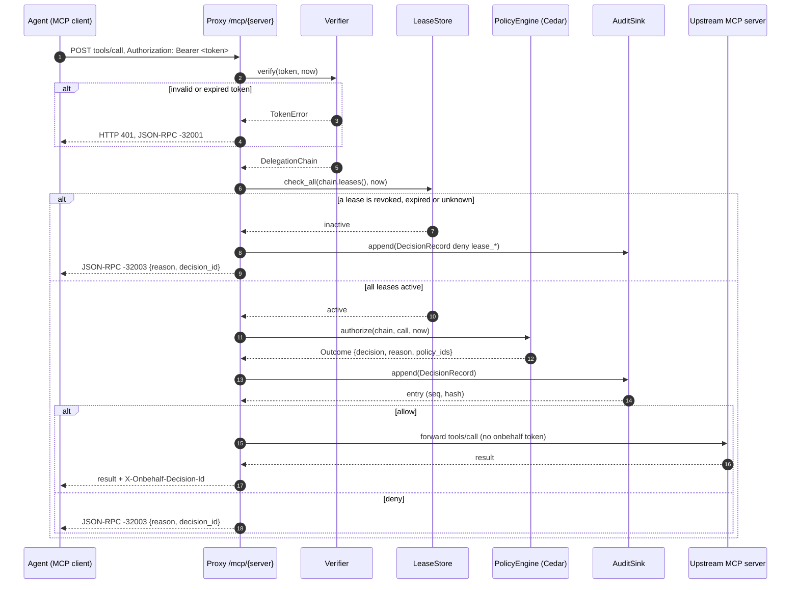
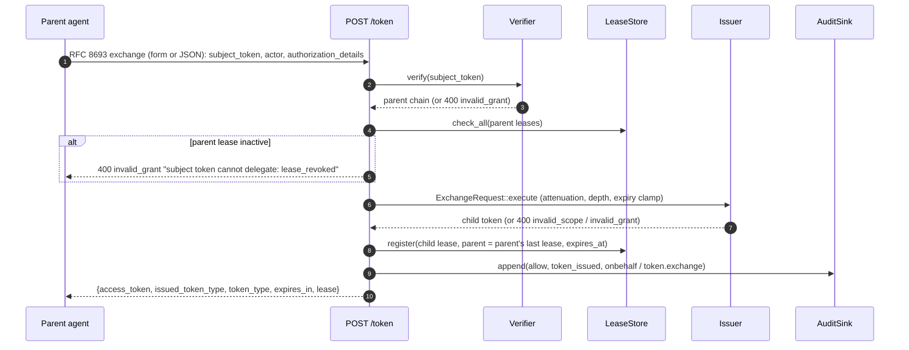

# onbehalf-server: request pipeline

- Status: implemented (v0)
- Crate: `crates/onbehalf-server`
- Related: [RFC-0001](../spec/rfc-0001-onbehalf.md) §4–§7, [ADR-0004](../decisions/0004-rust-workspace-layout.md)

The server is wiring. It holds no authorization logic of its own: tokens come from `onbehalf-token`, decisions from `onbehalf-policy`, leases and the audit log from `onbehalf-audit`, MCP framing from `onbehalf-proxy`. The one piece of composition that matters for security is `authz::Pipeline`, and both enforcement paths go through it.

## Components in the process

| Piece | Type | Shared as |
|---|---|---|
| Issuer and verifier | `onbehalf_token::Issuer`, `Verifier` | one Ed25519 key, loaded from or generated at `issuer.private_key_pem_path` |
| Policy engine | `onbehalf_policy::PolicyEngine` | `Arc<RwLock<_>>`, swapped in place by `POST /admin/policies/reload` |
| Lease registry | `onbehalf_audit::SqliteLeaseStore` | `Arc`, same SQLite file as the log |
| Audit log | `onbehalf_audit::SqliteAudit` | `Arc` |
| Pipeline | `authz::Pipeline` | `Arc`, used by the proxy's `ServerAuthorizer` and by the AuthZEN handler |
| Proxy | `onbehalf_proxy::router` | mounted at `/mcp/{server}` |

## The decision pipeline

`Pipeline::decide(chain, call, now)` runs these steps for every `tools/call` and every AuthZEN evaluation. The chain has already been verified (token signature, originating-user signature, structure, expiry) by the caller.

1. **Leases.** `LeaseStore::check_all(chain.leases(), now)`. Every hop's lease must be known, unrevoked and unexpired. If not, the decision is deny, with reason `lease_revoked`, `lease_expired` or `lease_unknown` (checked in that order), or `lease_error` if the store cannot be read.
2. **Policy.** `PolicyEngine::authorize`: the capability stage (`capability_denied`), then Cedar (`policy_allow`, `policy_deny`, `policy_error`).
3. **Audit.** `DecisionRecord::new(now, decision, reason, chain, call, policy_ids)` is appended to the hash-chained log, and its id becomes the decision id the client sees (`X-Onbehalf-Decision-Id`, the JSON-RPC error's `data.decision_id`, or AuthZEN `context.decision_id`). If the append fails, the decision becomes deny with reason `audit_error`: an action that cannot be recorded does not happen.

Lease and audit failures fail closed. Revocation reaches the next call: there is no lease cache in v0, so the TTL-bounded cache in RFC-0001 §6 is a later optimisation.

`POST /access/v1/evaluation` takes the same path from step 3 onward. With a bearer token, the chain comes from the verified token (a chain also present in the body must match it). Without one, the chain in `subject.properties.chain` is taken as asserted by the calling PEP, checked structurally, and still has to pass the lease check, so a chain this server never issued is denied with `lease_unknown`. The body chain carries no signatures, so the endpoint should only be reachable by trusted PEPs unless they send the bearer.

## Token issuance

Because the child lease is registered under the parent's, revoking any lease revokes every lease delegated from it, and the child's next call fails the lease step. Even without the cascade, the child's chain lists every ancestor lease, so a revoked ancestor is caught directly.

### Audit convention for issuance

The audit crate stores decision records only. An issuance is recorded as a decision record with:

| Field | Value |
|---|---|
| `decision` | `allow` |
| `reason` | `token_issued` |
| `server` | `onbehalf` |
| `tool` | `token.exchange` for `/token`, `token.root` for the dev root mint |
| chain fields | the **new** chain, so `agents` and `leases` include the new hop |
| `arguments_digest` | digest of `{actor, requested, parent_lease}` (root: `{agent, requested}`) |

If that append fails, the new lease is revoked before the error is returned, so an unrecorded token is unusable. Failed exchanges are not audited in v0.

## Hop 0: the dev root mint

RFC-0001 §4 has hop 0 minted from a verified IdP credential (OIDC ID token or ID-JAG). That intake is not built yet. `POST /admin/root-token` (module `routes::dev_root`) stands in for it: the admin bearer asserts the user and agent, nothing about the user is verified, and when `[[root_grants]]` is configured the request must match a grant and stay within its capabilities. Replace it before any real deployment.

## Errors

Non-MCP endpoints answer errors as `{"error": "<code>", "detail": "<text>"}` with a matching status. `/token` uses OAuth codes (`invalid_request`, `unsupported_grant_type`, `invalid_grant`, `invalid_scope`). Admin endpoints answer 401 without the admin bearer and 403 `admin_disabled` when no admin token is configured. MCP routes keep the proxy's JSON-RPC errors (`-32001` unauthenticated, `-32003` denied).

## Known limits (v0)

- Admin authentication is one static bearer.
- The `actor` in an exchange is asserted, not authenticated (`actor_token` is not checked).
- No `kid` in token headers; the JWKS has one key and rotation is manual.
- SQLite calls run on the async worker threads; fine at demo load, to be moved to `spawn_blocking` or a pool.
- `tools/list` and other non-`tools/call` methods are not lease-checked; a revoked token can still list tools.
- Lease renewal (`/lease/{id}/renew`) is not implemented; leases live as long as the hop.
