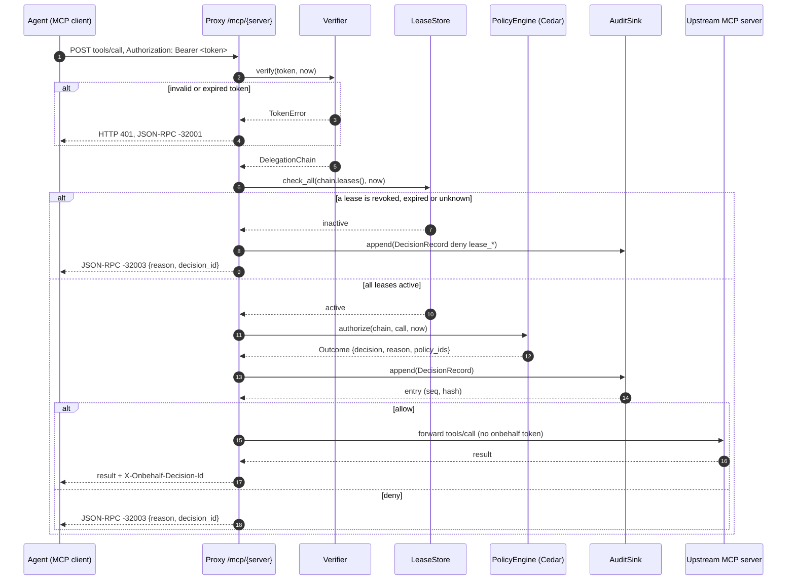
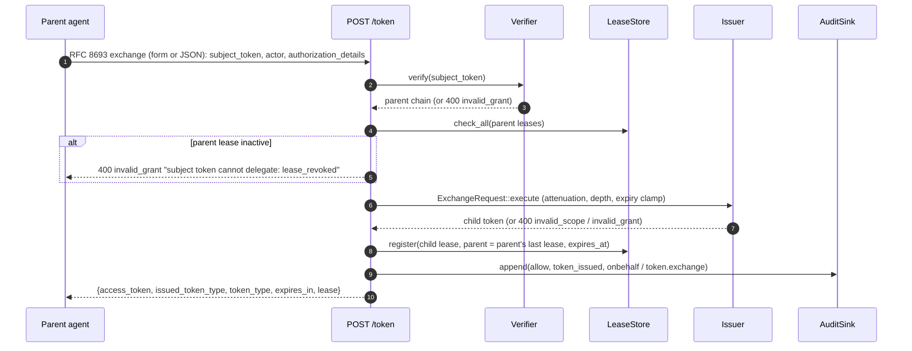

# onbehalf-server: request pipeline

- Status: implemented (v0)
- Crate: `crates/onbehalf-server`
- Related: [RFC-0001](../spec/rfc-0001-onbehalf.md) §4–§7, [ADR-0004](../decisions/0004-rust-workspace-layout.md)

The server is wiring. It holds no authorization logic of its own: tokens come from `onbehalf-token`, decisions from `onbehalf-policy`, leases and the audit log from `onbehalf-audit`, MCP framing from `onbehalf-proxy`. The one piece of composition that matters for security is `authz::Pipeline`, and both enforcement paths go through it.

## Components in the process

| Piece | Type | Shared as |
|---|---|---|
| Issuer and verifier | `onbehalf_token::Issuer`, `Verifier` | one Ed25519 key, loaded from or generated at `issuer.private_key_pem_path` |
| Policy engine | `onbehalf_policy::PolicyEngine` | `Arc<RwLock<_>>`, swapped in place by `POST /admin/policies/reload` |
| Lease registry | `onbehalf_audit::SqliteLeaseStore` | `Arc`, same SQLite file as the log |
| Audit log | `onbehalf_audit::SqliteAudit` | `Arc` |
| Pipeline | `authz::Pipeline` | `Arc`, used by the proxy's `ServerAuthorizer` and by the AuthZEN handler |
| Proxy | `onbehalf_proxy::router` | mounted at `/mcp/{server}` |
| IdP registry | `idp::IdpRegistry` | one `JwksCache` per `[[idps]]` entry, behind a `tokio::sync::Mutex` |

## The decision pipeline

`Pipeline::decide(chain, call, now)` runs these steps for every `tools/call` and every AuthZEN evaluation. The chain has already been verified (token signature, originating-user signature, structure, expiry) by the caller.

1. **Leases.** `LeaseStore::check_all(chain.leases(), now)`. Every hop's lease must be known, unrevoked and unexpired. If not, the decision is deny, with reason `lease_revoked`, `lease_expired` or `lease_unknown` (checked in that order), or `lease_error` if the store cannot be read.
2. **Policy.** `PolicyEngine::authorize`: the capability stage (`capability_denied`), then Cedar (`policy_allow`, `policy_deny`, `policy_error`).
3. **Audit.** `DecisionRecord::new(now, decision, reason, chain, call, policy_ids)` is appended to the hash-chained log, and its id becomes the decision id the client sees (`X-Onbehalf-Decision-Id`, the JSON-RPC error's `data.decision_id`, or AuthZEN `context.decision_id`). If the append fails, the decision becomes deny with reason `audit_error`: an action that cannot be recorded does not happen.

Lease and audit failures fail closed. Revocation reaches the next call: there is no lease cache in v0, so the TTL-bounded cache in RFC-0001 §6 is a later optimisation.



`POST /access/v1/evaluation` takes the same path from step 3 onward. With a bearer token, the chain comes from the verified token (a chain also present in the body must match it). Without one, the chain in `subject.properties.chain` is taken as asserted by the calling PEP, checked structurally, and still has to pass the lease check, so a chain this server never issued is denied with `lease_unknown`. The body chain carries no signatures, so the endpoint should only be reachable by trusted PEPs unless they send the bearer.

## Token issuance



Because the child lease is registered under the parent's, revoking any lease revokes every lease delegated from it, and the child's next call fails the lease step. Even without the cascade, the child's chain lists every ancestor lease, so a revoked ancestor is caught directly.

### Audit convention for issuance

The audit crate stores decision records only. An issuance is recorded as a decision record with:

| Field | Value |
|---|---|
| `decision` | `allow` |
| `reason` | `token_issued` |
| `server` | `onbehalf` |
| `tool` | `token.exchange` for a hop n+1 exchange, `token.root` for hop 0 (IdP intake or the dev root mint) |
| chain fields | the **new** chain, so `agents` and `leases` include the new hop |
| `arguments_digest` | digest of `{actor, requested, parent_lease}`; IdP intake: `{agent, requested, credential, idp}`; dev mint: `{agent, requested}` |

If that append fails, the new lease is revoked before the error is returned, so an unrecorded token is unusable. Failed exchanges are not audited in v0.

## Hop 0: intake from an identity provider

The root token of every chain is minted at `POST /token` from a user credential issued by a trusted IdP (module `idp`). The handler recognises intake by `subject_token_type` and runs, in this order:

1. **Agent authentication.** `client_id`/`client_secret` in the form, or HTTP Basic (not both), checked against `[[agents]] { id, secret_sha256 }` by SHA-256 and a constant-time compare. Failure is `401 invalid_client`, before the credential is looked at, so an unauthenticated caller cannot make the server fetch anything. An empty `[[agents]]` rejects all intake. `actor`, if sent, must equal the client id.
2. **Requested capabilities**, from `authorization_details` or `scope`, must be non-empty.
3. **Credential verification** (`IdpRegistry::verify`). The header `typ` is checked first: an ID-JAG must be `oauth-id-jag+jwt`, and an ID token must not carry any other explicit `…+jwt` type. The unverified `iss` selects the `[[idps]]` entry (unknown issuer: rejected without a network call). `alg` must be one of the entry's `allowed_algs` (RS256, ES256 and EdDSA by default; HMAC is refused at config load). The key comes from the entry's JWKS cache by `kid`. Then the signature, and `iss`, `aud`, `exp`, `iat`, `nbf` and `sub` against the request time with `clock_skew_seconds` (60) of leeway. `aud` is `[[idps]] audience` for an ID token and `[issuer] issuer` for an ID-JAG.
4. **ID-JAG claims** (`idp::claims::map_id_jag`, the one place that depends on the draft's claim names): `client_id` is required and must be the authenticated agent.
5. **Originating user** (`idp::claims::originating_user`): `subject` = `sub`, `issuer` = `iss`, `authenticated_at` = `auth_time`, else `iat`; `attributes` = the claims listed in `attribute_claims` (default `email`, `groups`, `amr`) plus `mfa: bool`, true when `amr` contains `mfa`, `otp`, `hwk` or `swk` (RFC 8176 values for a second factor or a key; `pwd`, `sms` and the rest do not count on their own).
6. **Root grant.** The `[[root_grants]]` entry for (issuer, agent), preferring one whose `subject` equals `sub`, is the ceiling; `CapabilitySet::attenuate(requested)` must succeed. No entry: `invalid_scope` / `no_root_grant`. Wider than the entry: `invalid_scope` / `scope_exceeds_grant`.
7. **Issue, register, audit**: `Issuer::issue_root`, a lease with no parent, and an audit record `token.root` / `token_issued`. If the audit append fails the lease is revoked and the request fails.

`nonce` is ignored on purpose: it binds an ID token to the browser session that requested it, and the agent presenting it here is not that session. What stops someone who has only a leaked ID token is step 1; what limits an agent that has one is step 6.

```mermaid
sequenceDiagram
    autonumber
    participant A as Agent (client)
    participant T as POST /token
    participant R as IdpRegistry
    participant J as JWKS cache
    participant D as IdP (discovery, JWKS)
    participant I as Issuer
    participant G as Audit / leases

    A->>T: token exchange: subject_token=<ID token or ID-JAG>, client_id/secret, scope
    T->>T: authenticate agent ([[agents]])
    alt unknown agent or wrong secret
        T-->>A: 401 invalid_client
    end
    T->>R: verify(token, kind, now)
    R->>R: typ, iss -> [[idps]] entry, alg
    R->>J: key_for(kid, alg)
    opt cache empty, stale, or kid unknown (once per 30 s)
        J->>D: GET /.well-known/openid-configuration, GET jwks_uri
        D-->>J: keys
    end
    J-->>R: key (or unknown_kid)
    R->>R: signature, iss, aud, exp, iat, nbf, sub
    R-->>T: verified claims (or 400 invalid_grant + error_description)
    T->>T: OriginatingUser; root grant; attenuate (or 400 invalid_scope)
    T->>I: issue_root(user, agent, capabilities)
    T->>G: register lease; append token.root
    T-->>A: {access_token, issued_token_type, token_type, expires_in, lease}
```

### JWKS cache

One cache per IdP. The JWKS location is `jwks_url`, or `jwks_uri` from `<issuer>/.well-known/openid-configuration`, whose `issuer` must equal the configured one. A fetched set is used for `jwks_ttl_seconds` (300). A `kid` that is not in the set causes one refetch, then `unknown_kid`; a second unknown `kid` within 30 seconds does not refetch. Bodies over 256 KiB are refused, at most 32 keys are kept, and symmetric keys, encryption keys and unparseable keys are skipped. Fetches time out after 5 seconds. If a refresh fails, the old keys are dropped and the request fails with `503 temporarily_unavailable` / `jwks_unavailable`: no stale keys.

### Error codes

| `error` | Status | `error_description` |
|---|---|---|
| `invalid_client` | 401 | `client_auth_missing`, `client_authentication_failed`, `malformed_client_auth`, `no_agents_configured` |
| `invalid_request` | 400 | `actor_mismatch`, `multiple_client_auth`, `no_capabilities_requested`, `unsupported_token_type`, `malformed_request` |
| `invalid_grant` | 400 | `malformed_token`, `typ_mismatch`, `untrusted_issuer`, `unsupported_alg`, `missing_kid`, `unknown_kid`, `bad_signature`, `audience_mismatch`, `expired`, `not_yet_valid`, `missing_claim`, `client_id_mismatch` |
| `invalid_scope` | 400 | `no_root_grant`, `scope_exceeds_grant` |
| `temporarily_unavailable` | 503 | `jwks_unavailable` |

These codes are stable; `detail` is prose and may change.

### The dev root mint

`POST /admin/root-token` (module `routes::dev_root`) mints a root token for a user the admin asserts; nothing about the user is verified. It is mounted only when `[dev] allow_root_mint = true` (default `false`, so the route answers 404), the server logs a warning at startup when it is, and it still needs the admin bearer and, when `[[root_grants]]` is non-empty, a matching grant. It exists for local trials and for the end-to-end tests of later hops.

## Errors

Non-MCP endpoints answer errors as `{"error": "<code>", "detail": "<text>"}` with a matching status. `/token` uses OAuth codes (`invalid_request`, `unsupported_grant_type`, `invalid_client`, `invalid_grant`, `invalid_scope`, `temporarily_unavailable`); hop-0 intake errors add a stable `error_description` (table above). Admin endpoints answer 401 without the admin bearer and 403 `admin_disabled` when no admin token is configured. MCP routes keep the proxy's JSON-RPC errors (`-32001` unauthenticated, `-32003` denied).

## Known limits (v0)

- Admin authentication is one static bearer.
- Agents authenticate at hop 0 with a static client secret; no `private_key_jwt` or mTLS.
- No `jti` replay cache: an ID token (or ID-JAG) can be exchanged again by the same agent until it expires, each time minting a new root.
- The root token's lifetime is the server's TTL, not bounded by the ID token's `exp`.
- The user block does not record which credential it came from (`evidence`, RFC-0001 §3.1); the audit record's argument digest covers the credential type and IdP.
- ID-JAG follows draft -04; claim mapping is isolated in `idp::claims::map_id_jag` for when the draft changes. The draft's `resource` and `scope` claims are not used.
- The `actor` in an exchange is asserted, not authenticated (`actor_token` is not checked).
- No `kid` in token headers; the JWKS has one key and rotation is manual.
- SQLite calls run on the async worker threads; fine at demo load, to be moved to `spawn_blocking` or a pool.
- `tools/list` and other non-`tools/call` methods are not lease-checked; a revoked token can still list tools.
- Lease renewal (`/lease/{id}/renew`) is not implemented; leases live as long as the hop.
