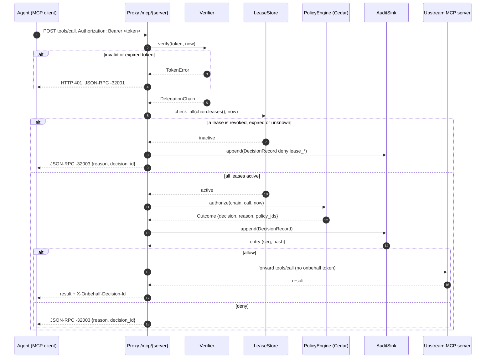
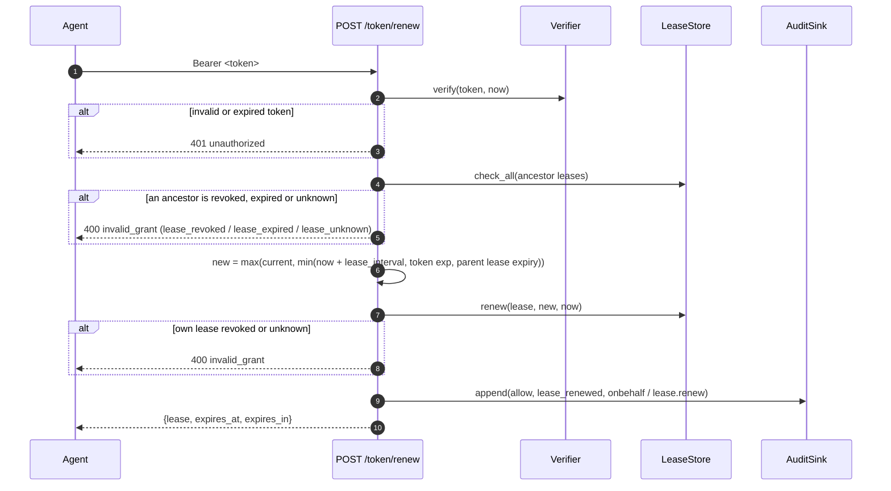

# onbehalf-server: request pipeline

- Status: implemented (v0)
- Crate: `crates/onbehalf-server`
- Related: [RFC-0001](../spec/rfc-0001-onbehalf.md) §4–§7, [ADR-0004](../decisions/0004-rust-workspace-layout.md)

The server is wiring. It holds no authorization logic of its own: tokens come from `onbehalf-token`, decisions from `onbehalf-policy`, leases and the audit log from `onbehalf-audit`, MCP framing from `onbehalf-proxy`. The one piece of composition that matters for security is `authz::Pipeline`, and both enforcement paths go through it.

## Components in the process

| Piece | Type | Shared as |
|---|---|---|
| Issuer and verifier | `onbehalf_token::Issuer`, `Verifier` | one signing Ed25519 key, loaded from or generated at `issuer.private_key_pem_path`, plus verify-only `issuer.previous_key_paths`; tokens carry a `kid` |
| Metrics | `metrics::Metrics` | `Arc`, incremented by the pipeline and token routes, served on `[metrics] listen` |
| Policy engine | `onbehalf_policy::PolicyEngine` | `Arc<RwLock<_>>`, swapped in place by `POST /admin/policies/reload` |
| Lease registry | `onbehalf_audit::SqliteLeaseStore` | `Arc`, same SQLite file as the log |
| Audit log | `onbehalf_audit::SqliteAudit` | `Arc`; signs checkpoints with the issuer key (`Issuer::detached_signer`) |
| Pipeline | `authz::Pipeline` | `Arc`, used by the proxy's `ServerAuthorizer` and by the AuthZEN handler |
| Proxy | `onbehalf_proxy::router` | mounted at `/mcp/{server}` |
| IdP registry | `idp::IdpRegistry` | one `JwksCache` per `[[idps]]` entry, behind a `tokio::sync::Mutex` |

## The decision pipeline

`Pipeline::decide(chain, call, now)` runs these steps for every `tools/call` and every AuthZEN evaluation. The chain has already been verified (token signature, originating-user signature, structure, expiry) by the caller.

1. **Leases.** `LeaseStore::check_all(chain.leases(), now)`. Every hop's lease must be known, unrevoked and `expires_at > now`, so a lease that its holder stopped renewing denies the call while the JWT is still valid. If not, the decision is deny, with reason `lease_revoked`, `lease_expired` or `lease_unknown` (checked in that order), or `lease_error` if the store cannot be read.
2. **Policy.** `PolicyEngine::authorize`: the capability stage (`capability_denied`), then Cedar (`policy_allow`, `policy_deny`, `policy_error`).
3. **Audit.** `DecisionRecord::new(now, decision, reason, chain, call, policy_ids)` is appended to the hash-chained log, and its id becomes the decision id the client sees (`X-Onbehalf-Decision-Id`, the JSON-RPC error's `data.decision_id`, or AuthZEN `context.decision_id`). If the append fails, the decision becomes deny with reason `audit_error`: an action that cannot be recorded does not happen.

**Blocking I/O.** SQLite calls are synchronous and take a lock, so they never run on an async worker. Handlers run their store-touching work through `AppState::blocking` (`tokio::task::spawn_blocking`), and `ServerAuthorizer` runs `Pipeline::decide`, `check_leases` and `record_rejection` the same way. Concurrent callers queue on the audit store's mutex inside an `IMMEDIATE` transaction that reads the head and inserts the next row, so appends stay strictly sequential and the chain cannot fork; the pool only decides which waiting caller goes next. This closes SR-22.

Lease and audit failures fail closed. Revocation reaches the next request: there is no lease cache in v0, so the TTL-bounded cache in RFC-0001 §6 is a later optimisation. Requests that carry no per-call decision (`tools/list`, `initialize`, `ping`, the other allowlisted methods, `GET`/`DELETE` session requests) run the same lease check through `Authorizer::check_active` and get HTTP 401 (JSON-RPC `-32001`, message ending in the reason, for example `lease inactive: lease_revoked`) instead of a decision. Those checks are not audited, since no call was decided.

Revocation also reaches responses that are still streaming (SR-28). The `GET` listen stream and a `POST` whose upstream answers with a streamed body (normally SSE, for example a long `tools/call` with progress notifications) are re-checked every `[proxy] stream_recheck_seconds` (default 2): the proxy compares the earliest `expires_at` of the chain's hops with the clock and calls `Authorizer::check_active`. At the first failure it ends the stream and drops the upstream connection. An SSE stream gets one last `message` event first, a JSON-RPC error with `id: null`, code `-32001` and `data.reason` `token_expired`, `lease_revoked`, `lease_expired` or `lease_unknown`; any other streamed body ends with a transport error, so a truncated JSON body cannot pass for a complete one. To be able to append that event, the proxy relays SSE bodies event by event (bytes unchanged), dropping a final event that has no terminating blank line and failing on an event over `[proxy] max_upstream_body_bytes` (default 16 MiB), as list filtering does. A revoked stream therefore ends within one interval of the revocation, and a stream never outlives its token by more than one interval. The re-checks are not audited.

`Mcp-Session-Id` is bound to the principal it was assigned to (SR-11). When an upstream response carries a session id, the proxy records it against the caller's originating user (subject and issuer) and root lease, in an in-memory, bounded registry (`[proxy] session_ttl_seconds`, default one hour idle; `max_sessions`, default 100,000). The registry keeps an index ordered by last use, so expired bindings are reclaimed oldest first as new ones arrive, without scanning. When every slot holds a live binding, the response that would bind a new session is replaced by HTTP 503, JSON-RPC `-32006`, reason `session_registry_full`, with `Retry-After: 30`; no live binding is evicted to make room, so one principal opening sessions cannot push other users out of theirs (SR-36). The upstream's session is left to its own idle timeout. Every agent of one delegation run shares the root lease and so the session; another user, or another run of the same user, does not. A `POST`, `GET` (listen stream) or `DELETE` carrying a session id bound to someone else gets HTTP 403, JSON-RPC `-32003` with reason `session_mismatch`, and a `deny` record (tool `http.POST`, `http.GET` or `http.DELETE`) through `Authorizer::record_rejection`. An unknown or expired id gets 404, which MCP clients answer by starting a new session; a proxy restart therefore ends every session. A successful `DELETE` ends the binding, and a response that names a session id bound to another principal has the header removed. The gate and the upstream must see the same id (SR-27): a request with more than one `Mcp-Session-Id` header, or one whose value is not visible ASCII (`0x21`-`0x7E`, the spec's charset), gets HTTP 400 (`-32600`) on `POST`, `GET` and `DELETE`, and the proxy never copies the client's session header: it inserts the single value it checked. An upstream response with more than one session id, or an invalid one, has the header removed and binds nothing, so a client never sees two. Logs, policy context and decision records carry a 12-hex-digit SHA-256 prefix of the id instead of the id.

## MCP method coverage

The proxy turns every request that can read data or cause an effect into a `ToolCall` and sends it through `Pipeline::decide`, so capabilities, Cedar policy and the audit log treat a resource read like a tool call. `server` is always the `/mcp/{server}` name.

| JSON-RPC method | `ToolCall.tool` | `ToolCall.arguments` |
|---|---|---|
| `tools/call` | `params.name` | `params.arguments` (or `{}`) |
| `resources/read` | `resources/read` | `{ "uri": params.uri }` |
| `resources/subscribe` | `resources/subscribe` | `{ "uri": params.uri }` |
| `prompts/get` | `prompts/get` | `{ "name": params.name, "arguments": params.arguments or {} }` |
| `completion/complete` | `completion/complete` | `params` as sent |
| any other method outside the allowlist | the method name | `params` as sent (or `{}`) |

Forwarded after authentication and the lease check, with no decision: `initialize`, `ping`, `tools/list`, `resources/list`, `resources/templates/list` and `prompts/list` (the four list responses are filtered, below), `logging/setLevel`, `notifications/*`, and messages without a `method` (client replies to server requests). The default is deny: an unknown method such as `sampling/createMessage` or `resources/unsubscribe` passes only if a capability and the policy permit a tool named after it. A request missing `params.name` or `params.uri` where the mapping needs one is answered with `-32602` and is not forwarded.

A capability grants these like a tool: `github:resources/read` with constraint `uri` prefix `file:///public/` allows reads under that prefix; `github:prompts/get` allows prompts. A broad `github:*` capability covers all of them, which is a reason to prefer narrow grants. The Cedar action is the server and the method name, `Action::"github/resources/read"`, so catalog entries use the method name as the tool (`[policy.catalog.github."resources/read"]`).

### List filtering

A list result only shows what the chain could ever be permitted to use. Each entry is mapped to the request that would use it, exactly as the table above maps requests, and kept when some capability in `chain.effective_capabilities()` could permit that request. A chain with no capabilities lists nothing.

| List method | Result member | Entry key | Kept when a capability matches server and tool pattern... | and its constraint on... (if any) accepts the key |
|---|---|---|---|---|
| `tools/list` | `tools` | `name` | the tool name | none (arguments unknown) |
| `resources/list` | `resources` | `uri` | `resources/read` | `uri` |
| `resources/templates/list` | `resourceTemplates` | `uriTemplate` | `resources/read` | none (a template is not a URI) |
| `prompts/list` | `prompts` | `name` | `prompts/get` | `name` |

Constraints on any other argument are ignored, as they are for tools: the question is "could this ever be allowed", not "is this call allowed". An entry without its key is dropped. Cedar policy is not consulted (it needs a concrete call and writes an audit record); a listed entry can still be denied when used. `nextCursor` and every other member pass through unchanged, and the request's `cursor` is forwarded as sent. A page can therefore be empty and still carry a `nextCursor`, which clients must follow ([MCP pagination](https://modelcontextprotocol.io/specification/2025-06-18/server/utilities/pagination): a missing `nextCursor` marks the end, page size is the server's choice).

The filter applies wherever the response arrives ([Streamable HTTP, 2025-06-18](https://modelcontextprotocol.io/specification/2025-06-18/basic/transports)): in an `application/json` body, in a JSON-RPC batch response (the 2025-03-26 revision allows batches, 2025-06-18 removed them; the proxy accepts them), and in a `text/event-stream` body, where the proxy parses events incrementally (LF, CRLF and CR line ends, multi-line `data:`, events split across reads) and re-serializes every event that carries JSON, whether it holds one message or a batch. The server may put requests and notifications before the response on the stream; those are forwarded as they are. Only a message with no `method` and an `id` that matches a list request of this HTTP request is treated as a list response, so a notification or request carrying a `result` member never is. Fail closed: a list request answered with a body that is neither JSON nor SSE (other than `202`/`204`), with JSON that does not parse, or with an SSE event that is oversized (16 MiB) or not UTF-8 gets `502` or a broken stream, and a final SSE event with no terminating blank line is dropped, as a client would drop it.

`notifications/tools/list_changed`, `notifications/resources/list_changed`, `notifications/prompts/list_changed` and `notifications/resources/updated` carry no list data and pass through (`202`, no body). Clients re-list after one and get a filtered list.

Every decided call also has to name a `(server, tool)` pair that is in the tool catalog. `[policy] unknown_tools` sets what happens otherwise: `"deny"` (the default) denies after the capability stage with reason `tool_not_in_catalog`, recorded in the audit log like any decision; `"sensitive"` evaluates the call with `resource.sensitive = true`, so MFA-style `forbid` rules apply; `"allow"` evaluates it with default attributes, which is how v0 behaved and lets `forbid ... when { resource.sensitive }` fail open (SR-12). Methods decided as tools (`resources/read`, `prompts/get` and the rest) need catalog entries under their method name too. Names follow one rule (`onbehalf_core::names`): a server name, or a tool name as `tools/call` carries it, is 1 to 128 ASCII letters, digits, `_`, `.` or `-`; a decided method name is such segments joined by `/`. With no `/` in a server name, the Cedar ids `Action::"<server>/<tool>"` and `Tool::"<server>/<tool>"` split one way (SR-13), and a permit for `github`'s `read_file` does not match another upstream's. The server refuses to start when an upstream, catalog entry or root grant breaks the rule; the engine denies a call that does with reason `invalid_name`.

Before the decision the proxy checks the `tools/call` name itself (SR-25). A name outside the rule is denied with reason `invalid_name`; this also keeps a tool named `resources/read` from posing as that method. With `[proxy] require_listed_tools` (default on), a name that the upstream never returned from `tools/list` and the catalog does not hold (`Authorizer::knows_tool`) is denied with reason `tool_not_listed`. The proxy learns names from every `tools/list` result that passes through it, JSON or SSE, before filtering, across sessions (up to 10,000 per upstream). Names are compared exactly and never normalized, so against an upstream that resolves `Delete_Repo` to `delete_repo`, the variant is refused instead of reaching a decision that looks at a different name. Both refusals are `deny` records through `Authorizer::record_rejection`.

Bodies are bounded (SR-36): a request body over `[proxy] max_request_body_bytes` (default 4 MiB, read only after authentication) gets 413 with reason `request_too_large`; an upstream JSON body the proxy must buffer over `max_upstream_body_bytes` (default 16 MiB) gets 502, JSON-RPC `-32005`, reason `upstream_body_too_large`. Bodies the proxy relays without inspecting are streamed and not buffered.



`POST /access/v1/evaluations` takes a list: top-level `subject`, `action`, `resource` and `context` are defaults, each entry of `evaluations` overrides what it names, and each entry is decided and audited like a single evaluation. More than `[authzen] max_batch` entries (default 64) is refused with 400 `batch_too_large` before anything is decided, so an oversized batch cannot flood the audit log (SR-22); only the `execute_all` semantic is supported. `POST /access/v1/evaluation` takes the same path from step 3 onward. By default it requires a bearer token, and the chain comes from the verified token (a chain also present in the body must match it); without a bearer the answer is 401. With `[authzen] allow_unsigned_chain = true`, a request without a bearer may carry the chain in `subject.properties.chain` if it authenticates as a `[[peps]]` entry (HTTP Basic, or `pep_id`/`pep_secret`). Such a chain is checked structurally (`validate_at`) and then hop by hop against what was issued: at issuance every lease is bound to the digest of the chain up to its hop (`LeaseStore::bind`), and each hop of the body chain must reproduce that digest. A mismatch is a 403 `chain_not_issued` and writes no audit record, so lease ids, which every token prints, are not enough to forge a user, attributes, capabilities or an agent (SR-08).

## Token issuance

```mermaid
sequenceDiagram
    autonumber
    participant C as Parent agent
    participant T as POST /token
    participant V as Verifier
    participant L as LeaseStore
    participant I as Issuer
    participant G as AuditSink

    C->>T: RFC 8693 exchange (form or JSON): subject_token, actor, authorization_details, client credentials and/or actor_token
    T->>T: verify actor_token against [[actor_trust]] (JWKS); mapped agent must equal actor
    T->>T: authenticate client against [[agents]]; client id must equal actor
    alt no or wrong credentials / bad actor_token / other actor
        T-->>C: 401 invalid_client, or 400 invalid_request actor_mismatch / actor_token_*
    end
    T->>V: verify(subject_token)
    V-->>T: parent chain (or 400 invalid_grant)
    T->>L: check_all(parent leases)
    alt parent lease inactive
        T-->>C: 400 invalid_grant "subject token cannot delegate: lease_revoked"
    end
    T->>T: actor already in the parent chain? 400 invalid_request duplicate_actor
    T->>I: ExchangeRequest::execute_until (may_act, attenuation, depth, expiry clamp to parent and actor token)
    I-->>T: child token (or 400 invalid_scope / invalid_grant / invalid_request actor_not_permitted)
    T->>T: replay cache: actor token used before? (parent jti, actor) used before? 400 invalid_grant replayed, child dropped
    T->>L: register(child lease, parent = parent's last lease, expires_at), bind(child lease, chain digest)
    T->>G: append(allow, token_issued, onbehalf / token.exchange)
    T-->>C: {access_token, issued_token_type, token_type, expires_in, lease}
```

### Actor authentication

`[token] actor_auth` picks the accepted methods: `secret` (`[[agents]]` client credentials), `actor_token` (a JWT from an `[[actor_trust]]` issuer) or `either` (default; when both are sent, both are checked). With `require_actor_auth = true` one accepted method is mandatory.

An actor token is checked in this order (module `actor`): the header `typ` must not name another kind of token (`onbehalf+jwt`, `oauth-id-jag+jwt`, `at+jwt`); the unverified `iss` and `sub` select the `[[actor_trust]]` entry (an entry with `issuer` needs that `iss`, an entry with `spiffe_trust_domain` needs `sub` in that trust domain), so unknown issuers are refused before any network call; `alg` must be allowed; the key is looked up by `kid` in the entry's JWKS (the same cache as for `[[idps]]`, reading `jwks_url` or the SPIRE bundle endpoint, never discovered); then the signature, `iss`, `aud`, `exp` (required), `nbf` and `iat`, all with the entry's clock skew; `sub` (a strictly parsed SPIFFE ID for a trust-domain entry); and `subject_to_agent` maps `sub` to the agent id that must equal `actor`. The token is used once (replay key: entry and `jti`, or the SHA-256 of the signing input) and the child's expiry is capped at its `exp`. A parent token that carries `may_act` can only be exchanged by an actor it lists.

Because the child lease is registered under the parent's, revoking any lease revokes every lease delegated from it, and the child's next call fails the lease step. Even without the cascade, the child's chain lists every ancestor lease, so a revoked ancestor is caught directly.

### Checkpoints, export and verification

`SqliteAudit::with_checkpointing(signer, every)` makes `append` sign `(seq, head_hash)` and insert a row into `checkpoints` inside the append's transaction whenever `seq` is a multiple of `every`, so a checkpoint never refers to a head that was not committed. `lib::spawn_checkpointer` (started by `serve` when `[audit] checkpoint_interval_seconds` is positive) calls `checkpoint_if_new` on a timer, which signs the head only if it moved past the newest checkpoint. `checkpoint_signed` backs `GET /admin/audit/checkpoint`: it returns the existing checkpoint for an unchanged head and refuses to sign when a stored checkpoint at that `seq` disagrees with the log.

The signed bytes are `len(context) as u32 big-endian || "onbehalf-checkpoint-v1" || JSON [seq, head_hash, at, kid]`, signed by `onbehalf_token::DetachedSigner` and checked by `onbehalf_token::verify_detached`. `onbehalf_audit::CheckpointKeys::from_jwks` turns the published JWKS into the verifier. `verify_chain_signed` (the body of `GET /admin/audit/verify`) walks the chain once, remembers the entry hash at each checkpointed `seq`, then checks every checkpoint's signature and head hash. The report keeps `entries`, `ok` and `first_bad_seq` and adds `checkpoints`, `last_signed_seq`, `unsigned_tail` and `bad_checkpoints`.

`GET /admin/audit/export?from&to` streams `application/x-ndjson`: a header line, the entries in pages of 500 (each page on the blocking pool), then the checkpoints in range. `onbehalf_audit::export` parses that format (or the single-object JSON form) and `verify_export` checks it offline: the same walk with the first entry as the anchor for a window, plus a check that the file covers the range its header names.

### Audit convention for issuance

The audit crate stores decision records only. An issuance is recorded as a decision record with:

| Field | Value |
|---|---|
| `decision` | `allow` |
| `reason` | `token_issued` |
| `server` | `onbehalf` |
| `tool` | `token.exchange` for a hop n+1 exchange, `token.root` for hop 0 (IdP intake or the dev root mint) |
| chain fields | the **new** chain, so `agents` and `leases` include the new hop |
| `arguments_digest` | digest of `{actor, requested, parent_lease}`; IdP intake: `{agent, requested, credential, idp}`; dev mint: `{agent, requested}` |

If that append fails, the new lease is revoked before the error is returned, so an unrecorded token is unusable. Failed exchanges are not audited in v0.

## Hop 0: intake from an identity provider

The root token of every chain is minted at `POST /token` from a user credential issued by a trusted IdP (module `idp`). The handler recognises intake by `subject_token_type` and runs, in this order:

1. **Agent authentication.** `client_id`/`client_secret` in the form, or HTTP Basic (not both), checked against `[[agents]] { id, secret_sha256 }` by SHA-256 and a constant-time compare. Failure is `401 invalid_client`, before the credential is looked at, so an unauthenticated caller cannot make the server fetch anything. An empty `[[agents]]` rejects all intake. `actor`, if sent, must equal the client id.
2. **Requested capabilities**, from `authorization_details` or `scope`, must be non-empty.
3. **Credential verification** (`IdpRegistry::verify`). The header `typ` is checked first: an ID-JAG must be `oauth-id-jag+jwt`, and an ID token must not carry any other explicit `…+jwt` type. The unverified `iss` selects the `[[idps]]` entry (unknown issuer: rejected without a network call). `alg` must be one of the entry's `allowed_algs` (RS256, ES256 and EdDSA by default; HMAC is refused at config load). The key comes from the entry's JWKS cache by `kid`. Then the signature, and `iss`, `aud`, `exp`, `iat`, `nbf` and `sub` against the request time with `clock_skew_seconds` (60) of leeway. `aud` is checked against the presenting agent's `[[idps]] client_ids` entry for an ID token (SR-37; `azp` too when `aud` has several values) and is `[issuer] issuer` for an ID-JAG.
4. **ID-JAG claims** (`idp::claims::map_id_jag`, the one place that depends on the draft's claim names): `client_id` is required and must be the authenticated agent.
5. **Originating user** (`idp::claims::originating_user`): `subject` = `sub`, `issuer` = `iss`, `authenticated_at` = `auth_time`, else `iat`; `attributes` = the claims listed in `attribute_claims` (default `email`, `groups`, `amr`) plus `mfa: bool`, true when `amr` contains `mfa`, `otp`, `hwk` or `swk` (RFC 8176 values for a second factor or a key; `pwd`, `sms` and the rest do not count on their own).
6. **Root grant.** The `[[root_grants]]` entry for (issuer, agent), preferring one whose `subject` equals `sub`, is the ceiling; `CapabilitySet::attenuate(requested)` must succeed. No entry: `invalid_scope` / `no_root_grant`. Wider than the entry: `invalid_scope` / `scope_exceeds_grant`.
7. **Lifetime and one-time use.** The root token's TTL (requested, else the issuer default) is capped at the credential's remaining lifetime, `exp - now`; a credential inside the clock skew after its `exp` has none left and gets `invalid_grant` / `credential_expired`. Once the root token is minted, the credential is recorded in the replay cache (module `replay`) under (`iss`, `jti`), or the SHA-256 of the credential when it has no `jti`, until `exp` plus the skew; a request refused earlier does not use the credential up. A second presentation, by any agent, is `invalid_grant` / `replayed`, and the token minted for it is dropped before its lease is registered.
8. **Issue, register, audit**: `Issuer::issue_root`, a lease with no parent, and an audit record `token.root` / `token_issued`. If the audit append fails the lease is revoked and the request fails.

`nonce` is ignored on purpose: it binds an ID token to the browser session that requested it, and the agent presenting it here is not that session. What stops someone who has only a leaked ID token is step 1; what limits an agent that has one is steps 6 and 7.

The replay cache also covers exchanges: a parent token delegates to a given actor once, keyed by (parent `jti`, actor) until the parent's `exp`. Delegating to another agent is unaffected; a holder that wants a child to live longer renews its lease instead of exchanging again. The cache is in memory and bounded (100 000 live entries): expired entries are dropped first, and when it is still full, issuance fails closed with `503 temporarily_unavailable` / `replay_cache_full`. It is per process, so a restart, or a second replica, forgets what was used.

```mermaid
sequenceDiagram
    autonumber
    participant A as Agent (client)
    participant T as POST /token
    participant R as IdpRegistry
    participant J as JWKS cache
    participant D as IdP (discovery, JWKS)
    participant I as Issuer
    participant G as Audit / leases

    A->>T: token exchange: subject_token=<ID token or ID-JAG>, client_id/secret, scope
    T->>T: authenticate agent ([[agents]])
    alt unknown agent or wrong secret
        T-->>A: 401 invalid_client
    end
    T->>R: verify(token, kind, now)
    R->>R: typ, iss -> [[idps]] entry, alg
    R->>J: key_for(kid, alg)
    opt cache empty, stale, or kid unknown (once per 30 s)
        J->>D: GET /.well-known/openid-configuration, GET jwks_uri
        D-->>J: keys
    end
    J-->>R: key (or unknown_kid)
    R->>R: signature, iss, aud, exp, iat, nbf, sub
    R-->>T: verified claims (or 400 invalid_grant + error_description)
    T->>T: OriginatingUser; root grant; attenuate (or 400 invalid_scope)
    T->>I: issue_root(user, agent, capabilities)
    T->>G: register lease; append token.root
    T-->>A: {access_token, issued_token_type, token_type, expires_in, lease}
```

### JWKS cache

One cache per IdP (and per `[[actor_trust]]` entry, which uses the same code with an explicit URL and no discovery; SPIFFE bundle keys with `use` = `jwt-svid` are kept). The JWKS location is `jwks_url`, or `jwks_uri` from `<issuer>/.well-known/openid-configuration`, whose `issuer` must equal the configured one. A fetched set is used for `jwks_ttl_seconds` (300). A `kid` that is not in the set causes one refetch, then `unknown_kid`; a second unknown `kid` within 30 seconds does not refetch. Bodies over 256 KiB are refused, at most 32 keys are kept, and symmetric keys, encryption keys and unparseable keys are skipped. Fetches time out after 5 seconds. If a refresh fails, the old keys are dropped and the request fails with `503 temporarily_unavailable` / `jwks_unavailable`: no stale keys.

### Error codes

| `error` | Status | `error_description` |
|---|---|---|
| `invalid_client` | 401 | `client_auth_missing`, `client_authentication_failed`, `malformed_client_auth`, `no_agents_configured` |
| `invalid_grant` | 400 | `malformed_token`, `typ_mismatch`, `untrusted_issuer`, `unsupported_alg`, `missing_kid`, `unknown_kid`, `bad_signature`, `audience_mismatch` (ID-JAG), `credential_audience_mismatch` (ID token not issued to the presenting agent), `expired`, `not_yet_valid`, `missing_claim`, `client_id_mismatch`, `credential_expired`, `replayed` (also for a repeated exchange or a reused actor token), `reserved_subject` (the user's `sub` starts with `urn:onbehalf:`, kept for the server's own audit records) |
| `invalid_request` | 400 | `actor_mismatch`, `duplicate_actor` (exchange), `reserved_agent` (an exchange `actor` of `onbehalf`, SR-45), `multiple_client_auth`, `no_capabilities_requested`, `unsupported_token_type`, `malformed_request`, `may_act_exceeds_grant` |
| `invalid_request` | 400 | Exchange actor authentication: `actor_not_permitted` (parent's `may_act`), `actor_token_required`, `actor_token_not_accepted`, `client_auth_not_accepted`, `actor_token_type_unsupported`, `actor_token_malformed`, `actor_token_typ_mismatch`, `actor_token_untrusted_issuer`, `actor_token_unsupported_alg`, `actor_token_missing_kid`, `actor_token_unknown_kid`, `actor_token_bad_signature`, `actor_token_audience_mismatch`, `actor_token_expired`, `actor_token_not_yet_valid`, `actor_token_missing_claim`, `actor_token_invalid_spiffe_id`, `actor_token_unmapped_subject` |
| `invalid_scope` | 400 | `no_root_grant`, `scope_exceeds_grant` |
| `dpop_required` | 401 | `dpop_required`: a bound subject token without a proof, an exchange that would not bind the child of a bound parent, a new key for the child without `subject_token_dpop`, or `[token] dpop = "required"` and no proof (SR-24) |
| `invalid_dpop_proof` | 401 | `invalid_dpop_proof`: a `DPoP` header or `subject_token_dpop` that fails a check (signature, `typ`, `alg`, `htm`, `htu`, `iat`, `ath`, key, replayed `jti`, several headers), or a `subject_token_dpop` whose `child_jkt` and `child_actor` do not name the new key and `actor` (SR-40) |
| `temporarily_unavailable` | 503 | `jwks_unavailable` (IdP or `[[actor_trust]]` keys), `replay_cache_full`, `dpop_replay_cache_full` |
| `server_error` | 500 | none. `detail` is always "internal error; the details are in the server log": a storage or I/O error, which can name a file, is logged and never returned (SR-43) |

These codes are stable; `detail` is prose and may change.

### The dev root mint

`POST /admin/root-token` (module `routes::dev_root`) mints a root token for a user the admin asserts; nothing about the user is verified. It is mounted only when `[dev] allow_root_mint = true` (default `false`, so the route answers 404), the server logs a warning at startup when it is, and it still needs the admin bearer and, when `[[root_grants]]` is non-empty, a matching grant. It exists for local trials and for the end-to-end tests of later hops.

## Lease renewal

`POST /token/renew` with `Authorization: Bearer <delegation token>` and no body extends the lease of the token's last hop.



Own-lease expiry is not an error: a lapsed but unrevoked lease is revived, provided the token has not expired and the ancestors are live. If the audit append fails the previous expiry is restored and the call fails. `[issuer] lease_interval_seconds` (default 300, must be positive) sets the interval used at issuance and renewal. Agents should renew at a fraction of it, for example every interval / 3.

## Operations

- **Shutdown.** `serve` waits for SIGINT or SIGTERM, stops accepting connections, and gives in-flight requests `DRAIN_TIMEOUT` (10 s) to finish before it returns and the process exits.
- **Readiness.** `GET /readyz` reads `AuditSink::head` and one `SqliteLeaseStore::get`. Both ok: 200 `{"ready":true,"checks":{"audit":"ok","leases":"ok"}}`; otherwise 503 with `"ready":false` and `"error"` on the failing check. The storage error text goes to the log only (SR-38). `GET /healthz` never touches storage.
- **Metrics.** `metrics::Metrics` holds atomics and two small maps (decisions by `(decision, reason)`, HTTP by `(route template, status)`) and two fixed-bucket histograms and renders Prometheus text format 0.0.4. `Pipeline::decide` records the decision, its duration and audit append failures; every audit append (`Metrics::time_audit_append`) feeds `audit_append_duration_seconds`; each checkpoint the log signs feeds `audit_checkpoints_total` through `SqliteAudit::with_checkpoint_hook`; `audit_issuance` records tokens issued (`kind` root for `token.root`, else exchange); the admin revoke handler adds the number of leases changed. A middleware on the whole router counts responses by `MatchedPath`. The endpoint is served only by a second listener (`[metrics] enabled`, `listen`), with no authentication.
- **Key rotation.** `Issuer` signs with one key and sets the JWT header `kid` to base64url of the first 16 bytes of SHA-256 over the key's SPKI DER. `Verifier` holds a list of trusted keys: a `kid` selects one key (unknown: `UnknownKeyId`), no `kid` tries all. `ou_sig` (v2, bound to `iss` and the root hop) must verify under the trusted key its `ou_kid` claim names, which can be a retired key, because a child minted after rotation copies its parent's `ou_sig` and `ou_kid`. `[issuer] previous_key_paths` (private or public PEM) adds verify-only keys, also published in the JWKS.
- **User attributes.** `[policy] user_attributes` is parsed with `ArgType::from_str` and passed to `PolicyEngineBuilder::with_user_attr`, extending the generated `UserAttributes` record.

## Errors

Non-MCP endpoints answer errors as `{"error": "<code>", "detail": "<text>"}` with a matching status. `/token` uses OAuth codes (`invalid_request`, `unsupported_grant_type`, `invalid_client`, `invalid_grant`, `invalid_scope`, `temporarily_unavailable`); hop-0 intake errors add a stable `error_description` (table above). Admin endpoints answer 401 without the admin bearer and 403 `admin_disabled` when no admin token is configured. MCP routes keep the proxy's JSON-RPC errors (`-32001` unauthenticated, `-32003` denied).

## Known limits (v0)

- Admin authentication is one static bearer (`[admin] token`, or `ONBEHALF_ADMIN_TOKEN`, which overrides it). Off a loopback `listen` address the server refuses to start when it is missing, shorter than 32 bytes or a published placeholder; on loopback it warns. Admin actions are audited with `originating_subject` = `urn:onbehalf:admin` (a subject no user can have: IdP intake and the dev root mint refuse subjects under `urn:onbehalf:`, SR-34), no agents, server `onbehalf` and tool `admin.lease.revoke`, `admin.policies.reload` (a rejected policy file is recorded as `deny` / `policy_invalid`) or `admin.root_token` (next to the `token.root` issuance record).
- Agents authenticate at hop 0 with a static client secret; no `private_key_jwt` or mTLS.
- The replay cache is in memory: it does not survive a restart and is not shared between replicas.
- The user block does not record which credential it came from (`evidence`, RFC-0001 §3.1); the audit record's argument digest covers the credential type and IdP.
- ID-JAG follows draft -04; claim mapping is isolated in `idp::claims::map_id_jag` for when the draft changes. The draft's `resource` and `scope` claims are not used.
- The `actor` of an exchange authenticates with its `[[agents]]` client secret or an `actor_token` from `[[actor_trust]]` (`[token] actor_auth`). Hop 0 still uses the client secret. Hop tokens are bearer tokens: the actor token proves who asked for the child, but the child is not bound to that workload (`cnf`, RFC-0001 §9).
- Key rotation is manual (edit the config, restart) but has an overlap: see `previous_key_paths` below.
- SQLite calls run on tokio's blocking pool, serialised by one connection per store behind a mutex. That is correct and keeps the chain linear, but write throughput is that of a single SQLite writer; a dedicated writer thread with group commit would batch fsyncs and is not built.
- Checkpoints are signed by the key the server holds. They detect truncation and rewrites by anyone who does not control the server process; copy them off the host for the rest.
- No lease cache and no push channel: every request reads the registry, and external PEPs using the AuthZEN endpoint learn of revocation only by asking.
- Failed renewals are not audited (only successful ones).
- List filtering does not cover the `GET` listen stream. The spec lets a server send a response on it when resuming a stream (`Last-Event-ID`), and such a replayed list response is passed through unfiltered. Not seen in practice; fixing it means tracking which request ids are in flight per session.
- List filtering is by capability only, not by Cedar policy; and a resource template is listed whenever any `resources/read` capability for the server exists, even if every `uri` constraint would exclude what the template expands to.
