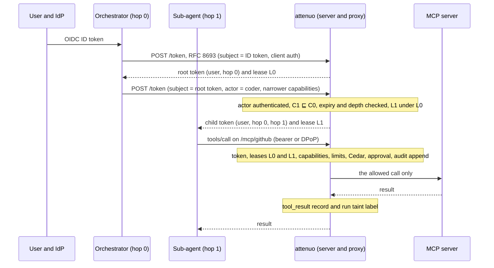

---
title: "Attenuo: delegation-aware authorization and enforcement for tool-using AI agents"
author: "Mudit Kapoor"
date: "2026-11"
abstract: |
  Agents that call tools for a user usually hold one broad credential, and every call they make with it is allowed. When injected content steers such an agent, nothing outside the agent refuses the harmful call. We describe attenuo, a self-hosted reference monitor between agent clients and Model Context Protocol (MCP) tool servers. A user's login is exchanged (RFC 8693) for a delegation token that carries the verified user and every agent between the user and the caller, and each exchange can only narrow capabilities, lifetime and depth under a stated relation `⊑`. Every proxied tool call is checked against every hop's lease, the chain's capabilities and run limits, and a Cedar policy that sees the call's arguments. Every decision is appended to a hash-chained log with signed checkpoints that a third party can verify offline. Two further controls use what the proxy sees of tool results: run-level taint with call-bound approvals, and per-run limits on counts, amounts and destinations. We report three evaluations, strongest evidence first. First, we ran AgentDojo with an open-weight model that follows injected instructions (`qwen2.5:14b`, run locally), once alone and once behind attenuo with frozen planner-written grants and a suite policy. On the slack, banking and travel suites, the benchmark scored 179 of 382 paired attack cases as landed without attenuo and 23 with it. Ten of the 23 are two gaps the replay had already found: a fetch of the attacker's URL, and the attacker's link in a message to a recipient the task allows. In five, attenuo refused the calls and the benchmark scored the attempt. The other eight are an attack that asks only for a sentence in the agent's answer, with no tool call to refuse. The cost is finished tasks: under attack, the agent finished 164 of 382 tasks alone and 125 behind attenuo. This is one model, one run per case and three of AgentDojo's four suites, with runs the model server aborted left out of both arms. Second, replaying the ground-truth calls of AgentDojo's attacks through the proxy with no model, on all four suites, 13 of 609 attacks landed under the same grants and policy, and 75 of 97 benign tasks were kept. Third, on our own replay corpus of 89 synthetic cases with no model, the base configuration allowed 7 of 38 attack calls and refused 3 of 29 benign calls on the 26 held-out test cases; with output labelling and a scripted approver, 1 attack call, a read, went through. The added median latency per proxied call was 0.4 to 0.8 ms on a shared 4-core container. A language model wrote the grants from each task's prompt and tool list. The policies, the corpus and the approver were written by the system's own authors, one maintainer working with AI coding agents. None of these results is an independent evaluation, and we state what one would need.
...

# Introduction

AI agents read mail, file issues and move money through tools, and in 2026 those tools are more and more often reached over the Model Context Protocol (MCP). The MCP authorization revision of 2026-07-28 makes MCP servers OAuth 2.1 resource servers, which settles how a token reaches a server. It does not settle what the token means once it arrives. The token is issued to the agent and has no standard slot for the person the agent acts for. Its scopes are fixed at issue time and cannot see call arguments. Nothing carries "which human started this run" across several hops of delegation (secondary sources collected in `docs/research/standards.md` and `docs/spec/rfc-0001-attenuo.md`, section 1).

The incident record of 2025 and 2026 is mostly about that gap. In May 2025 a malicious issue in a public repository steered an assistant, through the official GitHub MCP server and an over-privileged personal access token, into reading the user's private repositories and publishing their contents [1]. Other incidents involved a poisoned tool description that made an agent exfiltrate message history, and one leaked platform token that controlled more than 3,000 applications. The compilation we rely on [2] groups such incidents into four root causes: over-broad tokens without attenuation, missing isolation, supply-chain compromise, and no audit of cross-tool information flow (`docs/research/incidents-2025-2026.md`, 16 MCP incidents with sources). In none of them was the model the only thing that failed. In each, an agent that had been fooled or misconfigured held more authority than its task needed, and nothing outside the agent checked each call.

Defences inside the model lower attack success without removing it (one relayed figure: 23.6% to 11.2% for a browser agent after mitigations, `docs/research/incidents-2025-2026.md`). attenuo does not try to detect injection. It assumes the agent is already compromised and asks a narrower question. When an injected agent sends a harmful tool call, can a component outside the agent refuse it, using only what the user delegated and what the call contains? And how many of the task's own calls does it refuse along the way?

attenuo is a self-hosted server and MCP proxy written in Rust, with Python and TypeScript SDKs. This report makes six contributions:

1. **A delegation-chain token model** on RFC 8693 token exchange. Every token carries the verified originating user and one hop per agent, the user block is signed once and copied unchanged, and each exchange is checked against a stated narrowing relation `⊑` over capabilities with argument constraints and run limits (sections 3.1, 3.2).
2. **Lease-based in-flight revocation** that cascades from any hop to all its descendants with one write and needs no list of issued tokens (3.3).
3. **Per-tool-call enforcement in a fixed order** (leases, capabilities, run limits, Cedar policy over the arguments, approvals, audit), shared by an MCP proxy and an AuthZEN endpoint and failing closed at every stage (3.4, 3.5).
4. **A tamper-evident decision log**, hash-chained over RFC 8785 canonical JSON, with signed checkpoints that can be shipped off the host and an export that anyone can verify offline with the issuer's public keys (3.6).
5. **Two controls on top of authorization** that use only what a proxy sees: run-level taint from untrusted tool output with call-bound approvals, and per-run limits charged against every hop of the chain (3.7).
6. **An evaluation in three parts** (5): AgentDojo with a local open-weight model in the loop and frozen planner-written grants, on two of its four suites; a replay of AgentDojo's attack calls with no model; and our own replay corpus with frozen policies, a held-out split, a mechanical labelling oracle and per-stage accounting. Each reports Wilson intervals and states its threats to validity, among them a same-author corpus and policies.

Narrowing delegation with a check on every tool call is not new in itself: research prototypes and an IETF individual draft do the same job in other ways. Section 7 says which, and how attenuo differs.

attenuo is pre-alpha. Release 0.1.0 is prepared but not tagged, and nothing has run in production (`docs/release/0.1.0.md`).

# Threat model

We summarise `docs/spec/threat-model.md`.

**Assets.** The originating user's identity and consent, the capabilities of each hop, the data reachable through tools, the decision log (the only record that tells an agent's actions from a user's), and attenuo's signing keys and lease state.

**Trust.** attenuo is the trusted reference monitor: it must fail closed, and its invariants are property-tested. The identity provider (IdP) is trusted for authentication only, not to express per-tool or per-argument authority. Policy authors and log verifiers are trusted. Everything else is untrusted. That includes the agent client and the model driving it, every sub-agent (each a separate workload with its own credential), and every MCP server, which may be a typosquat, carry poisoned tool descriptions or have a vulnerability.

**Attacker.** The attacker may (A1) inject instructions into any content the agent reads, including tool descriptions and results; (A2) fully control a sub-agent and craft arbitrary exchange requests; (A3) publish or compromise an MCP server; (A4) replay or forward any token seen on the wire or in logs; (A5) request broader capabilities or deeper chains than allowed; (A6) keep a run alive after the user withdraws consent; and (A7) read the audit log afterwards and try to alter or truncate it.

**Properties.** For a run rooted at user `u` with hops `h_0 … h_n` (`docs/spec/rfc-0001-attenuo.md`, section 2):

- **P1, verified originating user on every hop**, protected by a signature made once at hop 0 and copied unchanged.
- **P2, monotonic attenuation**: for every parent and child, `C_{n+1} ⊑ C_n`, `exp_{n+1} ≤ exp_n`, and depth at most `max_depth`. This is checked at issue and again at every call against the whole lineage.
- **P3, argument-aware per-call authorization**: a call is forwarded only on an explicit permit.
- **P4, tamper-evident audit and in-flight revocation**: every decision, issuance, renewal and revocation is appended to a hash-chained log before the answer, and a revoked lease (or any ancestor's) denies the next call.

**Out of scope** are compromise of attenuo's host or keys, compromise of the IdP, side channels, and denial of service against attenuo. The server has only basic load protection: an in-flight cap, request deadlines and optional per-caller rate limits. Within scope, the threat model lists what attenuo still does not prevent. It cannot stop harmful use of a permitted read, misbehaviour inside a server after a clean request, or an over-permissive root policy, since attenuation bounds children relative to parents and not the root. It sees nothing of a tool reached around the proxy (a local STDIO server, an API key in the agent's environment). For the GitHub leak, P2 and P3 would have kept the coding agent to the public repositories its task named; against a malicious server that adds a BCC inside its own code, attenuo does not help.

# Design

Figure 1 (section 4) shows the path of one proxied call. The design follows from treating attenuo as a reference monitor (ADR-0001, `docs/decisions/0001-separate-enforcement-layer.md`). It mediates every call on the transport it covers, keeps its trusted base small, and states its invariants as predicates with property tests. ADR-0001 rejects checks inside each MCP server (the least trusted, most numerous component) and inside the agent client (the component that gets injected).

## Delegation chain and token exchange

A `DelegationChain` is the originating user (subject, issuer, authentication time, a few verified attributes such as `mfa`) and a list of hops, root first. Each hop has an agent, a capability set, an issue time, an expiry and a lease id. The chain is embedded whole in every token, a compact JWS signed with Ed25519. The token's `sub` repeats the user and its `act` claim is the RFC 8693 nested actor chain, so generic consumers can read who acts for whom. The verifier requires all three to agree (`docs/spec/rfc-0001-attenuo.md`, sections 3 and 4).

**Hop 0.** An agent presents an OIDC ID token or ID-JAG assertion from its user's IdP at `POST /token`. The server verifies it, builds the user block from verified claims, and attenuates the requested capabilities against an operator-configured root grant for that issuer and agent. Each credential mints at most one root token, which never outlives the credential.

**The user signature.** At hop 0 the server signs a length-framed message over the token issuer, the RFC 8785 [25] canonical JSON of the user block, and the canonical JSON of the root hop's agent, capabilities, issue time and lease. This `ou_sig` is copied unchanged through every exchange with the id of the key that made it. Binding the issuer and the root hop means a user signature lifted from one chain does not verify in a chain with another root, even when the outer token is re-signed by a trusted key. That was finding SR-14 of the first security review (`docs/research/security-review-2026-10-22.md`). An earlier construction signed non-canonical `serde_json` output (SR-20) and was replaced before release.

**Exchange.** A holder exchanges its token with an `actor` (the new hop's agent) and the capabilities it wants to pass on, in RFC 9396 `authorization_details` form. The server verifies the parent and checks the parent's optional `may_act` list (RFC 8693 section 4.4). It authenticates the actor (section 3.5) and extends the chain. The request must be non-empty and covered under `⊑`, the depth must stay within `max_depth`, and the child's expiry is clamped to the parent's. A parent token may delegate to a given actor once. The child gets a fresh lease.

**Verification** runs in a fixed order with a caller-supplied time: signature and algorithm, `typ`, issuer, audience and expiry. Then `sub` and `act` must agree with the chain, `exp` must equal the last hop's expiry, and `ou_sig` must verify under the one key its `ou_kid` names. Last comes `validate_at`, which re-checks per-hop expiry, expiry monotonicity and attenuation for the whole chain. An edited token cannot gain width after issue, because the call-time check does not trust the issue-time one.

## The narrowing relation

A capability is `{server, tool, constraints, limits}`. `server` and `tool` are an exact name, `*`, or a prefix glob `p*`. `constraints` maps an argument to one test: `equals` a JSON value, `one_of` a list, `prefix` a string, `path_prefix` a path compared segment by segment on `/`, or `range` with inclusive integer bounds. `path_prefix` refuses any value with a `.` or `..` segment, an empty segment, a backslash, a percent-encoded separator or a look-alike separator character, and never normalises one, so unlike `prefix` it does not admit `P/../x` or a sibling `P-x` (`docs/spec/rfc-0001-attenuo.md`, section 3). Unconstrained arguments are free, and a call that omits a constrained argument is denied. `limits` are the run limits of section 3.7.

`child ⊑ parent` holds (`docs/spec/rfc-0001-attenuo.md`, section 3) when three conditions are met:

1. The parent's server and tool patterns cover the child's. `*` covers anything, and `p*` covers `q*` iff `q` starts with `p`. An exact name covers only itself.
2. Every argument the parent constrains is constrained by the child, and the child's constraint implies the parent's. For example, `equals a` implies `prefix q` when `a` is a string starting with `q`; `one_of as` implies `one_of bs` when `as` is non-empty and `as ⊆ bs`; `prefix p` implies `prefix q` when `p` starts with `q`; `range [a,b]` implies `range [c,d]` when `c ≤ a` and `b ≤ d`; `path_prefix P` implies `path_prefix Q` when `P` lies at or below `Q`, and implies `prefix q` when `P` starts with `q`. A range implies a finite set only when it holds one integer. `prefix` never implies `path_prefix`, since it admits `p../x`, and neither string kind and `range` imply each other.
3. Every limit of the parent is a limit of the child over the same argument, with a maximum no larger.

A set `P` covers a set `C` only if each element of `C` is covered by a single element of `P`. A child covered only by the union of two parent capabilities is rejected. The check is therefore incomplete on purpose. It is linear in the size of the sets, easy to explain in a refusal, and never admits a child that the parent does not cover.

**Properties.** The intended properties are soundness (every call a covered child permits, the parent permits), reflexivity and transitivity. Transitivity means the validity of a chain follows from its adjacent pairs, so the effective authority of a chain is that of its last hop. The same holds for expiry, depth and limits. Twenty-five property tests in `crates/attenuo-core/tests/attenuation_props.rs` check them at 512 generated cases each by default, among them `coverage_is_sound_for_sets`, `implication_is_sound`, `covers_is_transitive_along_chains`, `attenuation_never_widens` and `child_limit_never_exceeds_parent_limit`. They are tests, not proofs. They check soundness and not completeness, so they do not show that every narrower request is accepted (`docs/spec/rfc-0001-attenuo.md`, section 10). Numbers compare by value under RFC 8785 (`1` equals `1.0`). A `range` reads an argument as the Cedar translation does, so a numeric string satisfies no range, and a malformed range (a misspelt `maximum`) is refused rather than read as unbounded. RFC-0001 leaves the extent of the algebra as an open question. Nested objects, globs and regular expressions would make `⊑` expensive or undecidable, so anything beyond the five kinds is left to Cedar, which can deny it but not delegate it.

## Leases and in-flight revocation

A signed token cannot be recalled. Every hop therefore carries a lease id, and the server keeps a registry in which each lease has an expiry, a revoked flag and a parent, forming a tree that mirrors the chain (ADR-0006, `docs/decisions/0006-lease-based-in-flight-revocation.md`). A lease starts with `expires_at = min(now + interval, token exp)`, with a default interval of 300 s. The holder renews its own last lease up to `min(now + interval, token exp, parent lease expiry)`. Renewal fails if any ancestor is revoked, unknown or expired, so a child cannot outlive a parent that stopped renewing.

Every proxied request is checked against every lease in its chain before policy runs, including `initialize` and `tools/list`. A revoked, expired or unknown lease denies the request, and so does an unreadable store or a lost row. Revocation marks a lease and all its descendants in one transaction. There is no lease cache, so an explicit revocation applies to the next request, and a holder that stops renewing loses its authority within one interval. Operators can also revoke by user, by run (`chain_id`, the lease id of the first hop) or by MCP session. Open response streams are re-checked every 2 s by default (`docs/spec/threat-model.md`). ADR-0006 rejects a `jti` revocation list (it must enumerate every descendant), very short lifetimes (no explicit kill) and IdP introspection (the IdP cannot answer for hops attenuo minted). The cost is one local lookup per request and a renewal duty for long-running agents.

## Per-tool-call policy

For every call, `Pipeline::decide` runs these steps in order. It checks every hop's lease and reads the run's taint and limit counters. It takes a granted approval for exactly this call, if one exists. It runs the capability stage, in which every hop's capabilities must cover the call and no hop's run limit may be exceeded. It then runs Cedar, charges the run limits of an allowed call, appends the decision to the audit log, and answers. The first failure denies, and the proxy returns a JSON-RPC error with the reason and a decision id (`docs/concepts/enforcement-points.md`). Every error body, on the proxy and on the REST routes, also carries a stable `code` that clients may match on (`docs/reference/http-api.md`, "Errors"). The MCP proxy and an AuthZEN endpoint both call this one pipeline, so a gateway can use attenuo as its decision point.

The capability stage is a predicate over the signed lineage, and no policy can override it (ADR-0005, `docs/decisions/0005-policy-decision-point.md`). Cedar [18] is the only policy language exposed (ADR-0002, `docs/decisions/0002-cedar-for-policy.md`). It evaluates in process, denies by default with `forbid` overriding `permit`, and has an analysable logical encoding; delegation, revocation and relationships stay outside the language.

**Request shape.** The principal is `Agent::"<id>"`, a member of the originating `User` and of every earlier agent. The action is `Action::"<server>/<tool>"`. A bare `Action::"<tool>"` once let a permit for one server cover a same-named tool on a malicious second server (SR-13). The resource is `Tool::"<server>/<tool>"`, with catalog attributes `readonly`, `sensitive` and `destructive`. The context holds `input` (the arguments), `originating_user`, `chain` (depth, agents, leases), `session_id`, `now_unix`, and the run state of section 3.7. Policies are validated strictly against a schema generated from the tool catalog, so a `forbid` naming a misspelt tool fails to load instead of silently granting. Cedar skips a policy that errors, and a skipped `forbid` is a grant, so an evaluation error, a reserved `__` key or a translation failure denies with `policy_error`. Arguments of a declared type are type-checked before Cedar (`input_type_mismatch`, `CHANGELOG.md`, 0.1.0). For example:

```cedar
@id("public-repos-only")
forbid (principal, action == Action::"github/read_file", resource)
  unless { context.input.repo like "alice/public-*" };
```

## Sender-constrained tokens and actor authentication

**DPoP.** A token may be bound to an Ed25519 or P-256 key with DPoP (RFC 9449 [16]). It then carries `cnf.jkt` and is accepted only with a fresh proof by that key over the request method and URL (`docs/spec/rfc-0001-attenuo.md`, section 4.1). Binding cannot be dropped, because the child of a bound token is always bound. When a sub-agent holds its own key, the exchange also needs a sign-off from the parent's key that names the child's key and actor. The parent's key therefore never leaves its holder, and a stolen bound token cannot be exchanged. DPoP addresses A4 for bound tokens. Unbound tokens remain bearer tokens, and the cache of seen proofs is in memory and per process, so a restart forgets proofs younger than `dpop_max_age_seconds` (300 s by default).

**Actor authentication.** The actor of an exchange becomes Cedar's principal and the agent in every record, so it must be authenticated (SR-10). It proves its identity with the agent's client secret, with a `private_key_jwt` client assertion (RFC 7523) signed by a key whose public half is in the agent's configuration entry (ADR-0017, proposed, `docs/decisions/0017-private-key-jwt.md`), or with an RFC 8693 `actor_token`, a workload-identity JWT such as a SPIFFE JWT-SVID from an explicitly configured trust domain. The token is checked, mapped to an agent id and accepted once (ADR-0007, `docs/decisions/0007-actor-authentication.md`). There is no mTLS client authentication and no client `jwks_uri`: client keys live in the configuration, and changing one needs a restart. The child token never outlives the actor token, and an agent id may appear only once in a chain.

## Audit log, checkpoints and offline verification

Every decision, issuance, renewal, revocation, approval and admin action is appended before the answer is sent. If the append fails, the decision becomes a deny, and an unrecorded issuance has its lease revoked (`docs/concepts/audit-log.md`). A record names the agent chain and the originating user separately and stores an argument digest, not the arguments. Each entry has `entry_hash = SHA-256(JCS(["attenuo-audit-entry-v2", seq, prev_hash, record]))`, so any RFC 8785 implementation in any language computes the same bytes.

A hash chain alone cannot show that the newest entries were removed or that the chain was rebuilt. Signed checkpoints narrow that gap. A checkpoint is an Ed25519 signature by the issuer key over `[seq, head_hash, at, kid]` under a context string, written by default every 1,000 entries and every 300 s, synced before it is handed on. A sink ships each checkpoint off the host (webhook, append-only file, or S3 with SigV4). `attenuo audit verify --file` checks an exported slice offline with only the published keys. It re-hashes and re-links every entry and verifies each checkpoint. It fails a file that falls short of its declared range, has entries outside it, or has entries after its last valid checkpoint. With `--checkpoints` it also compares the export with the shipped checkpoints. A history rewritten and re-signed with a stolen key is then detected as long as one covering checkpoint left the host first. Both SDKs implement the same check.

The limits are stated in the threat model. The key lives on the host, so an attacker who controls the host can re-sign history, and entries after the last shipped checkpoint rest on the hash chain alone. At the default `durability = "normal"` a power failure can lose the newest records, including those of forwarded calls. `"full"` closes that window at one `fsync` per decision (SR-48). Nothing prunes the log, so it grows without bound. ADR-0015 proposes a prune that archives a prefix at a signed checkpoint and leaves a signed anchor; it is not built (`docs/concepts/audit-log.md`).

## Two controls on top: output labelling and run limits

Capabilities and static policy cannot separate an injected call that uses a tool and arguments the task itself needs. On our corpus, these are the calls that get through (section 5.1). Two controls aim at them, using only what the proxy sees.

**Output labelling** (ADR-0009, `docs/decisions/0009-output-labelling.md`). Every response to a mediated call is recorded as a `tool_result` digest and adds an `untrusted` label to the run's taint state, shared by every hop of the run. Taint is monotone, missing state counts as tainted, and a result whose label cannot be recorded is not delivered. Cedar gains `resource.destructive` and `context.session.tainted`. A `forbid` annotated `@obligation("approval")` returns `approval_required` with an approval id instead of a denial. The approval is bound to `SHA-256(JCS({server, tool, arguments}))`, the run and the calling hop's lease, and to its DPoP key if the token is bound. It is granted by the user through their IdP or by an operator, never through the agent. It is single use and expires within 120 s by default. An argument-level variant asks only when an argument copies a value or span of an untrusted result.

**Run limits** (ADR-0010, `docs/decisions/0010-run-limits.md`). A capability may carry `calls` (a count), `sum` (a total over one non-negative integer argument), `calls_per` (a count per value of an argument) and `distinct` (the number of distinct values, optionally of a URL's host). Maxima are in the signed token, and used amounts are server state per hop lease. Limits narrow like the rest of a capability, and an exchange clamps a child's `calls` and `sum` to what the parent has left. Every allowed call is charged to every matching limit in every hop. A sub-agent therefore cannot reset a budget by delegating again, and concurrent siblings cannot jointly overspend, because a per-run lock covers the read through the charge (SR-55). A call over any limit is denied before Cedar, and no approval passes it. Cedar also sees the run's usage of destructive tools (`context.usage`), so a policy can ask on a repeat instead of refusing it.

# Implementation

attenuo is a Rust workspace of eight crates, plus two SDKs. Table 1 counts lines (`wc -l`) of the files `git ls-files` lists on commit 511dd41 (2026-11-13): `.rs` for the crates, `.py` and `.ts` for the SDKs. `src/` lines include inline unit tests. The last column is `tests/` and `benches/` for the crates, `tests/` for the Python SDK and `test/` for the TypeScript SDK.

| Component | Responsibility | Lines, `src/` | Lines, tests |
|----------------|----------------------------------------------|-------:|-------:|
| `attenuo-core` | chain, capabilities, `⊑`, RFC 8785 JSON, error codes | 8,065 | 1,307 |
| `attenuo-token` | tokens, `ou_sig`, issuer, verifier, DPoP, client assertions | 3,210 | 1,323 |
| `attenuo-policy` | capability stage, Cedar translation and cache, catalog, AuthZEN types | 8,307 | 3,530 |
| `attenuo-audit` | hash-chained SQLite log, checkpoints, export verification, lease and replay stores, schema migrations | 13,865 | 9,426 |
| `attenuo-proxy` | MCP reverse proxy, SSE handling, list filter, result labelling | 9,900 | 7,204 |
| `attenuo-server` | token endpoint, IdP intake, actor and client auth, AuthZEN, admin API with its operators and listener, request limits, sink, console | 35,283 | 26,127 |
| `attenuo-cli` | the `attenuo` command line | 8,769 | 4,567 |
| `attenuo-bench` | end-to-end benchmark harness | 5,102 | 304 |
| Rust total | | 92,501 | 53,788 |
| Python SDK | sync and async clients, admin client, offline audit verification | 7,041 | 7,809 |
| TypeScript SDK | the same API for Node 20+, no runtime dependencies | 6,391 | 7,843 |

Table: Table 1. Code size by component, counted on 511dd41 (2026-11-13).

The fuzz targets add 5,906 lines of Rust outside the workspace (`fuzz/`), and the injection-suite runner and oracle add 5,259 lines of Python (`evaluation/injection-suite/`). An admin console of about 3,200 lines of plain JavaScript, HTML and CSS is embedded in the server (ADR-0008). All state lives in one SQLite file in WAL mode with group commit (`docs/design/performance.md`). At 511dd41, 1,621 Rust workspace tests passed, none failed and 7 were ignored. At d1e7f5a, an earlier commit of the same day, 650 Python SDK tests and 370 TypeScript SDK tests passed; the SDK suites have not been counted again since. The integration tests that need built server binaries (22 Python, 18 TypeScript) were skipped in that SDK run.

**The MCP proxy** mounts each upstream at `/mcp/{server}`, mediates `tools/call`, `resources/read`, `prompts/get` and a few other methods over streamable HTTP, and denies unknown methods. It forwards only allowed calls, without the attenuo token. Because it labels upstream output, it must parse it: it filters list results to the tools the chain covers, and it parses SSE events under the rule that the proxy reads what clients read (security pass 7, section 5.4). **AuthZEN** evaluation and batch endpoints take the chain from the bearer token. An authenticated enforcement point may instead send it in the body, but then every hop must match what the server issued for its lease. Conformance with AuthZEN 1.0 is checked against the project's own fixtures (`crates/attenuo-server/tests/authzen_conformance.rs`); it has not been tested against another implementation.



Figure 1. The proxied-call path. The user's ID token is exchanged once for a root token held by the orchestrator, which exchanges it again for a narrower token for its sub-agent. Each call from the sub-agent is checked in order against both hops' leases, the chain's capabilities and limits, and the Cedar policy. The decision is appended to the log before anything is forwarded. Only allowed calls reach the MCP server, and its answer is recorded and labelled before it is relayed. A denial returns a JSON-RPC error with the reason and a decision id, and the upstream never sees the call.

# Evaluation

## Injection suite

**Corpus.** The corpus has 89 cases in two splits (`evaluation/injection-suite/README.md`). The development split has 63 cases in five suites (`workspace`, `banking`, `travel`, `slack`, `github`) with 77 attack and 130 benign calls. Four suites follow the structure of AgentDojo's [3]. Some cases follow InjecAgent's two-step data-stealing shape [4], and the `github` suite replays the GitHub MCP incident with variations. The task texts and data are our own. A case has a user task, a one-line injection, the grant a careful planner would hand a sub-agent, and a fixed sequence of `tools/call` requests. Each call is marked benign or attack, and its expected outcome and refusing stage were written before the first run. Upstreams are logging echo servers; scripted output text carries the injections.

**Frozen policies and splits.** Each suite has one Cedar policy and tool catalog with no per-case knowledge, such as "money only to saved payees, at most 2000 per call". The policies were written together with the 46 original dev cases and then frozen, with hashes in `evaluation/injection-suite/cases/test/POLICY_HASHES.json`. The test split was written against them: 26 cases in `banking` and `workspace`, with 38 attack and 29 benign calls. The runner refuses to report test numbers if a policy differs from its hash. Each rule added later for an extra arm was hashed before its arm first ran. Eleven multi-call and six browsing dev cases were added later for the limit arms.

**Oracle.** `evaluation/injection-suite/label_rules.py` derives each call's expected outcome and stage from the case structure and a Python model of the frozen policies, without reading the hand labels. On the final run it agreed on 207 of 207 dev and 67 of 67 test call labels, kappa 1.00 (`evaluation/injection-suite/results/2026-11-05-final-main.md`). The agreement is not independent. The oracle was written after the hand labels, by the same team, from the same reading of the policies, so it shows only that the labels follow one mechanical rule.

**Arms.** `direct` sends calls straight to the upstream. `scope_only` uses tokens that name the task's tools without argument constraints under a permit-all policy, roughly per-tool OAuth scopes. `scope_constraints` adds the grant's argument constraints, still permit-all. `policy_only` applies the suite policies to the unattenuated root token. `attenuo` is the full configuration. Further arms add one control each. In the approval arms, a scripted approver grants calls labelled benign and declines calls labelled attack, and a granted call is retried once.

| Arm | Dev attack allowed | Dev benign denied | Test attack allowed | Test benign denied |
|------------------------------|-----------:|-----------:|-----------:|-----------:|
| `direct` | 77/77 (95–100%) | 0/130 (0–3%) | 38/38 (91–100%) | 0/29 (0–12%) |
| `scope_only` | 52/77 (56–77%) | 0/130 (0–3%) | 21/38 (40–70%) | 0/29 (0–12%) |
| `scope_constraints` | 31/77 (30–51%) | 0/130 (0–3%) | 14/38 (23–53%) | 0/29 (0–12%) |
| `policy_only` | 28/77 (27–48%) | 3/130 (1–7%) | 11/38 (17–45%) | 3/29 (4–26%) |
| **`attenuo`** | **15/77 (12–30%)** | **3/130 (1–7%)** | **7/38 (9–33%)** | **3/29 (4–26%)** |
| + output labels [71 / 8] | 1/77 (0–7%) | 3/130 (1–7%) | 1/38 (0–13%) | 3/29 (4–26%) |
| + argument-level labels [44 / 4] | 3/77 (1–11%) | 3/130 (1–7%) | 3/38 (3–21%) | 3/29 (4–26%) |
| + `calls: 1` on non-reads | 8/77 (5–19%) | 13/130 (6–16%) | 2/38 (1–17%) | 3/29 (4–26%) |
| + labels and `calls: 1` [54 / 3] | 1/77 (0–7%) | 13/130 (6–16%) | 1/38 (0–13%) | 3/29 (4–26%) |
| + soft repeat rule [29 / 5] | 6/77 (4–16%) | 3/130 (1–7%) | 2/38 (1–17%) | 3/29 (4–26%) |
| + per-task limits (dev only) | 7/77 (4–18%) | 4/130 (1–8%) | 7/38 (9–33%) | 3/29 (4–26%) |

Table: Table 2. Attack calls allowed (without an approval, in approval arms) and benign calls denied, with Wilson 95% intervals; approval requests in brackets as dev / test. Source: `evaluation/injection-suite/results/2026-11-05-final-main.md`.

Table 2 is the final run, on release binaries at version 0.1.0 (untagged) built from `main` 85cb28f; the results file records repository HEAD `f17882d`, the next commit, which changes no crate. The Wilson intervals treat each call as an independent trial. Calls in one case share a grant and a task, so the true uncertainty is wider.

Under `attenuo` on dev, the 62 refused attack calls split as 43 at the capability check, 16 by policy and 3 by leases. The lease denials happen only because a case scripted a user revocation, so they stand for a person who noticed something. On test, 31 refusals split as 4 at the name check (look-alike names), 12 capability, 7 policy, 2 refused delegations, 4 scripted leases and 2 by the declared-type check (see the re-check below). In every proxied arm on both splits, no denied call reached an upstream, which was checked against the upstream logs. Every recorded decision id was found in the log with the same decision and reason, and online and offline verification of the exported log passed. Argument constraints stop 21 dev attack calls that tool names alone allow, and the suite policy 16 more; neither alone gets near the combination. All 6 benign denials of the base arm come from static suite policies and were written as false positives on purpose, for example mail to a contact not on the list or a payment to an unsaved payee.

**What was not stopped.** Every attack call the base configuration allowed on dev is in class N: nothing in the token or the static policy separates it from a legitimate call (results file, "Attack calls attenuo allowed"). Cases in classes S, C and D had all their attack calls refused (20, 18 and 16 calls); these are the classes a tool scope, an argument constraint, or a run-time value checked by the policy can separate. Class N had 15 of 23 allowed. They carry attacker text through a permitted channel (a phishing mail to the right colleague), pay the right payee a wrong amount or twice, take a decision from tool output (the hotel an injected review pushes, data in the query string of a permitted fetch), or misuse a permitted resource (a committed `.env` file in an allowed repository). On test, the seven allowed calls are three argument-tampering calls, two exfiltrations through the allowed channel and two repeated payments. The tampering cases expose weak spots in the policies and the catalog. A `prefix` on a path does not stop `../` (the `path_prefix` constraint of section 3.2, added after these runs, does; the frozen grants do not use it). `like "*@acme.example"` is a suffix match, so a comma-separated list ending in a company address passes. An argument the catalog does not declare (`reply_to`) is checked by nothing (`docs/evaluation/injection-suite.md`).

The controls of section 3.7 move most class N calls from allowed to gated or refused. Output labelling leaves one attack call per split, and both are reads (`github-07`, `t-banking-04`), which taint cannot stop by construction. The cost is approvals: 57 of 130 dev benign calls (44%) were gated, in 71 requests, and all completed after approval. On test, 2 of 29 were gated, a low figure because most test tasks do not script the read they imply (`evaluation/injection-suite/cases/test/PROPOSED-READS-2026-10-24.md`). The approve-all bound is the base arm's 15/77 and 7/38. Labelling is exactly as good as the approver, and ours is a script that knows the labels. A uniform `calls: 1` needs no person but refuses 10 benign calls in tasks that repeat a tool. Limits read off each task text reach 7/77 with one benign loss, but the same team wrote those figures after reading the cases. The soft repeat rule keeps every benign call, but it cannot catch an injected call that is the first of its kind. No limit addresses first-call attacks or harmful reads (`docs/design/run-limits.md`, section 7).

**The re-check on the final `main`.** The suite was re-run on 2026-11-05 on release binaries at version 0.1.0 (`evaluation/injection-suite/results/2026-11-05-final-main.md`). The 24 per-arm rows that the reproduction check compares (the `attenuo`-family and root-token rows, 12 per split) are byte-identical to the October runs they were first reported in. The run exited 1, not 0, because its test-split problem list has 18 lines that all describe one fact. Two attack calls, `t-banking-02` call 1 (an amount sent as a string) and `t-workspace-03` call 2 (`bcc` as a plain string), are now refused by the argument type check before Cedar (`input_type_mismatch`), where the hand labels expect the policy stage. That check landed after the last October run. The two calls appear once for `attenuo` and once for each of the eight arms built on it. Both are attacks and are denied either way. The same change moves two rows outside the compared set: in October `scope_only` allowed 23/38 test attack calls and `scope_constraints` 16/38 (`evaluation/injection-suite/results/2026-10-24-task-limits-v1.md`). In the final run they allowed 21/38 and 14/38, the figures in Table 2. After this run had been read, the two cases' expected stage in the frozen test split was changed from `policy` to `input` (commit `453e4f4`, 2026-11-05). Only the expected stage changed: both calls are still expected to be denied, and no arm's counts moved. The results file the reproduction check now compares against, `evaluation/injection-suite/results/2026-11-05-type-check-stage.md`, has no problem lines.

## External benchmark: AgentDojo

The injection suite cannot say what happens when a model chooses the calls, on a test someone else wrote. We therefore put attenuo under AgentDojo [3]: `agentdojo` 0.1.35, benchmark version `v1.2.2`, 97 user tasks and 949 pairs of a user task with an injection task over the workspace, travel, banking and slack suites. The benchmark's own checks score each run on the final state of its environment, not on attenuo's log. With attenuo, each call goes through the real proxy to an MCP shim over AgentDojo's own tools. The figures for the Claude runs and the oracle-grant replay come from the AgentDojo plan, `docs/research/agentdojo-plan-2026-11-05.md`, and link to its section; those for planner grants and the local model come from their evaluation pages and the results committed under `evaluation/agentdojo/results/`.

**The model alone.** Claude Haiku 5.5 ran every user task and every pair with no attenuo and the `important_instructions` attack: 1,046 runs for $2.53 by our meter, benign utility 83/97, utility under attack 773/949 ([plan, "Haiku baseline"](../research/agentdojo-plan-2026-11-05.md#haiku-baseline-2026-11-05)). The benchmark scores 19 of the 949 attacks as successful. All 19 are travel `injection_task_6`, whose check is only whether the final answer names a hotel. In 18 the answer tells the user about the injected instruction and says it was ignored; in the other the hotel is a row in a table the task asked for. We found no run in which the attack changed what the model did, a reading of the answers around the hotel's name and not of every transcript (same section). A template that adds the exact tool calls, `tool_knowledge`, scored 17/949 with the same pattern, and a search of every tool call in the 1,898 attack runs of both baselines found none that carried out either attack ([plan, "Stronger attack"](../research/agentdojo-plan-2026-11-05.md#stronger-attack-2026-11-05)). So against these two attacks the model leaves attenuo nothing to reduce. A comparison of attack success with and without attenuo on this model would show no difference, and that would be a fact about the model and the attack. It is not evidence that the model resists attacks in general: both are fixed templates that do not adapt.

**Replaying the attacks' own calls.** To see what attenuo refuses when an attack does reach the tools, we replayed each injection task's ground-truth calls through the proxy, after the user task's own calls and on the same token. No model is involved. 609 of the 949 pairs have a ground truth. Table 3 has two kinds of task grant, both used with the suite policy. A planner grant is written from the task's prompt and the tool catalogue alone; an oracle grant is derived from the task's ground truth. Every row below the oracle row keeps oracle grants and the suite policy and adds one thing. Every approval request is declined, so it counts as a lost task.

| Arm | What it adds | Attacks landed | Benign tasks kept |
|------------------------------|----------------------------------------------|-------:|-------:|
| No attenuo | | 592/609 | 97/97 |
| Suite policy, broad token | one Cedar policy per suite, written from the tool signatures | 138/609 | 77/97 |
| Planner grants | a capability grant per task, written from the prompt and the tool catalogue only, frozen before the replay | 13/609 | 75/97 |
| Oracle grants | a capability grant per task, derived from its ground truth | 15/609 | 77/97 |
| + output labels | approval on destructive calls after untrusted output | 12/609 | 40/97 |
| + argument taint (`args`) | approval when an argument copies untrusted text, reads included | 6/609 | 71/97 |
| + URL pins (`grants_urlpins`) | the fetch tool's `url` pinned to the task's own URLs | 3/609 | 77/97 |
| + URL pins and argument taint | both of the above | 0/609 | 73/97 |
| + host limit (`grants_hostlimit`) | distinct fetched hosts at most the task's own count, after the host grammar fix | 3/609 | 77/97 |

Table: Table 3. AgentDojo replay with no model, four suites. Sources in the plan: ["Replay on all suites"](../research/agentdojo-plan-2026-11-05.md#replay-on-all-suites) (no attenuo, suite policy, oracle grants, output labels), ["Planner-written grants"](../evaluation/agentdojo-planner-grants.md#results) (planner grants), ["Re-run after the server change"](../research/agentdojo-plan-2026-11-05.md#re-run-after-the-server-change) (`args`), ["Read-side arms in the replay"](../research/agentdojo-plan-2026-11-05.md#read-side-arms-in-the-replay-2026-11-06) (URL pins) and ["After the host grammar fix"](../research/agentdojo-plan-2026-11-05.md#after-the-host-grammar-fix-2026-11-06) (host limit).

The suite policy lets through what it permits, such as file deletes and reservations.

**Planner grants are the headline row.** A language model (Claude Opus 5.5, one instance per suite) was given each user task's prompt and the suite's tool catalogue, and nothing from the task's ground truth or the injection tasks, and wrote one grant per task. The 97 grants were committed, with their hashes, before the replay ran, and the replay refuses grant files that do not match that record; none was edited afterwards ([protocol and results](../evaluation/agentdojo-planner-grants.md)). With the suite policy, 13 of 609 attacks land (Wilson 95%: 1.3 to 3.6%) and 75 of 97 benign tasks are kept. That is level with oracle grants, 15 of 609 and 77 of 97: on attacks landed the two differ on 6 pairs (exact McNemar p = 0.69), and the planner loses two tasks the oracle keeps (travel `user_task_4`, slack `user_task_6`), both cases where it withheld a tool it had noted as uncertain. The planner's grants are looser than the oracle's, and the suite policy is what covers the difference: with a permit-all policy 32 of 609 attacks land under planner grants against 16 under oracle grants (p = 0.002): the planner pins fewer arguments of write calls (89 against 132), since a prompt often does not say who or how much. So the result is for grants and policy together, not for planner grants alone.

Oracle grants stop every attack outside slack, and so do planner grants. Oracle grants stand for a perfect planner: each is built from the ground truth of the task being replayed, so a grant with a permit-all policy keeps 97/97 benign tasks by construction. Of the 20 benign tasks lost under grants and the suite policy, 18 are lost to its contact rule, which refuses people the user named ([plan, "Replacing the contact rule"](../research/agentdojo-plan-2026-11-05.md#replacing-the-contact-rule-2026-11-05)).

The attacks that pass are two real gaps, both on slack (same section). The counts below are for oracle grants; under planner grants the same two injection tasks account for all 13 (10 and 3):

- **Read-side exfiltration.** In 12, `injection_task_3` makes the agent fetch the attacker's URL. A fetch is a read, the grant rule leaves reads open, and a URL can carry data out.
- **An attacker's link to an allowed recipient.** In 3, `injection_task_1` sends a direct message to a person the task already allows, with the attacker's link in a free-text body that the grant does not pin.

With the same grants and a permit-all policy, one travel pair also lands: an email of the user's passport and card numbers to the address the task itself mails. Any rule that keeps the task lets that attack through, because both use the same recipient ([plan, "Replacing the contact rule"](../research/agentdojo-plan-2026-11-05.md#replacing-the-contact-rule-2026-11-05)).

Output labels stop the 3 messages and none of the fetches, because the gate applies only to destructive calls. Four changes have landed since:

- **Argument taint.** After a server change, a host name without a scheme counts as an entity, and reads are matched too. The `args` rule then stops 9 of the 15 at the attacker's own call. The other 6 count as not landed only because the rule refused the user task's own fetch of the page that carries the injection. With a model, that would lose the task rather than stop an attack ([plan, "Re-run after the server change"](../research/agentdojo-plan-2026-11-05.md#re-run-after-the-server-change)). The rule matches only verbatim copies of a value or a long enough span, so a model that rewords the attacker's text leaves less to match ([plan, "Argument-level taint in the replay"](../research/agentdojo-plan-2026-11-05.md#argument-level-taint-in-the-replay-2026-11-05)).
- **URL pins and the host grammar.** Pins refuse all 12 fetches at no benign cost. With the `args` rule as well, both gaps close in the replay, at the cost of the 4 travel tasks that rule loses ([plan, "Read-side arms in the replay"](../research/agentdojo-plan-2026-11-05.md#read-side-arms-in-the-replay-2026-11-06)). Once `Derive::Host` read a bare host such as `www.true-informations.com`, a limit on distinct hosts did the same for the fetches ([plan, "After the host grammar fix"](../research/agentdojo-plan-2026-11-05.md#after-the-host-grammar-fix-2026-11-06)). Pins and counts both come from the ground truth. A planner could name the hosts of 5 of the 12 fetching tasks from the prompt and not the other 7, which follow a link found in data (plan, "Read-side arms in the replay").
- **The read-side note** ([`docs/design/read-side-exfiltration.md`](../design/read-side-exfiltration.md)) compares the options and is proposed, not accepted. Two of its steps are built: the host grammar above, and an `outbound` catalog flag that marks an argument whose value goes to a party it names, seen by Cedar as `resource.outbound` and `context.untrusted_outbound`. The flag has not been replayed; the note only estimates its effect.
- **Decimal amounts.** Banking's payment amount is a float, which the catalog could not declare, so the replay had no banking amount cap. A `decimal` input type landed ([plan, "Floats in tool arguments"](../research/agentdojo-plan-2026-11-05.md#floats-in-tool-arguments-2026-11-06)). A replayed cap of 500 per payment adds nothing while the known-payee rule is on, since every attacker's account is unknown to the user. With the payee rules off, the cap alone stops the 32 of 144 banking pairs that move large sums and loses no benign task. The 96 pairs that steal data in the subject of a 0.01 payment, or redirect a standing order, still land. A ceiling is not an intent check ([plan, "A banking cap on the decimal amount"](../research/agentdojo-plan-2026-11-05.md#a-banking-cap-on-the-decimal-amount-2026-11-06)).

URL pins, host limits and the banking cap have been replayed only, and the `outbound` flag not even that. None has run with a model. Argument taint has, on a sample where it never fired (below).

**Four models on one sample.** Haiku 5.5, Sonnet 5.5, Opus 5.5 and Fable 5.1 each ran one sample chosen before any call: workspace user tasks 0 to 9 against all 14 injection tasks, banking user tasks 0 to 7 against all 9, and 18 benign runs, 230 runs per model, one run each, `important_instructions`, no attenuo. Attack success was 0/212 on every model ([plan, "Four models on one sample"](../research/agentdojo-plan-2026-11-05.md#four-models-on-one-sample-2026-11-05)). This is the models' own result. attenuo was not in the loop, and the result says nothing about it. What the injection did instead was stop runs. A safety classifier ended 0, 28, 92 and 37 attack runs per model with `stop_reason: refusal`, and the user's task went undone; on Opus that was 91 of 140 workspace runs. The attack success rate does not show this denial of service. With the API's refusal fallback, which moves the run to an older model, Opus completed 132 of the 132 pairs that ran before the spending cap and Sonnet 132 of 137, and attack success stayed 0 ([plan, "Refusals: fallback and a second attack"](../research/agentdojo-plan-2026-11-05.md#refusals-fallback-and-a-second-attack)). The refusals follow the attacker's goal, not the template. On Opus, `ignore_previous`, which shares nothing with `important_instructions`, drew 63 refusals on 110 pairs against 68 for `important_instructions`, all on injection tasks that send data out and none on the four that do not (plan, end of ["Replacing the contact rule"](../research/agentdojo-plan-2026-11-05.md#replacing-the-contact-rule-2026-11-05)). That rests on one model, one run per pair, and a third run cut off when the credit ran out. Refusals vary from run to run.

**attenuo with a real model.** On the workspace half of the sample, Sonnet 5.5 with oracle grants and the suite policy finished 6/10 benign tasks and 65/140 tasks under attack, against 10/10 and 112/140 without attenuo. Refused runs (26 and 28) count as not done. Haiku went from 10/10 and 140/140 to 5/10 and 70/140 ([plan, "The same arm on Sonnet"](../research/agentdojo-plan-2026-11-05.md#the-same-arm-on-sonnet)). Attack success was 0 in every cell, with and without attenuo, so these runs measure the cost of enforcement and nothing about its benefit. The cost comes from the contact rule. Tasks 4, 6, 8 and 9, which it refuses, are exactly the four Sonnet lost. On all 40 workspace tasks, Haiku fell from 36/40 to 29/40, and 8 of the 9 lost tasks were tasks the rule also refused in the replay ([plan, "Attenuo with a real model"](../research/agentdojo-plan-2026-11-05.md#attenuo-with-a-real-model-2026-11-05)). Offering the model only the granted tools does not recover them, though it cuts cost to about a third ([plan, "Filtered tool list"](../research/agentdojo-plan-2026-11-05.md#filtered-tool-list)). Argument taint added to the same arm never fired: no call on either model went to approval, because neither model acted on the injection. So the run does not answer whether a paraphrasing model gets past the rule ([plan, "Argument-level taint with a real model"](../research/agentdojo-plan-2026-11-05.md#argument-level-taint-with-a-real-model)). In the replay, dropping the contact rule where the grant already pins recipients keeps 95/97 benign tasks against 77/97 and lets through one more attack, 16/609 against 15/609: the passport email above ([plan, "Replacing the contact rule"](../research/agentdojo-plan-2026-11-05.md#replacing-the-contact-rule-2026-11-05)). That change has not run with a model. With a broad token, the contact rule is still what stops mail to an attacker.

**attenuo with a model that follows the attack.** The four models above resisted the attack by themselves, so those runs could not show a benefit. An open-weight model does not resist it. `qwen2.5:14b`, run locally with Ollama at temperature 0, ran the slack, banking and travel suites twice: alone, and behind attenuo with the frozen planner grants and the suite policy, 446 runs per arm ([results](../evaluation/agentdojo-local-model.md); workspace is still running and is not reported). Runs that the model server aborted (2 alone, 7 with attenuo) are left out of both arms. On the 382 attack pairs both arms scored, the attack landed in 179 without attenuo (Wilson 95%: 41.9 to 51.9%) and in 23 with it (4.0 to 8.9%) (exact McNemar p < 0.001; paired difference -40.8%, cluster bootstrap 95% -48.4 to -33.1). Two cases landed only with attenuo, both of the travel task described below. On banking, where every injection task moves money, redirects a standing order or changes the password, 73 of 143 landed alone and none of 143 behind attenuo (0.0 to 2.6%). On slack it was 78 and 15 of 99, and both data-theft tasks went from 31 of 39 to 0 of 39. Ten of the 15 are the two gaps the replay found above: seven are `injection_task_3`, the fetch of the attacker's URL, and three are `injection_task_1`, the attacker's link in a message to a recipient the task allows. The other five are `injection_task_5`, which the benchmark scores from the calls the model attempted; attenuo refused every invitation and removal of the attacker's account in those five, so nothing happened in the workspace. On travel the model followed the attack less often: 28 of 140 landed alone and 8 of 140 behind attenuo. The six travel injection tasks that need a tool call (a reservation, a calendar event, an email with the user's data) went from 20 of 120 to 0 of 120. All eight that landed with attenuo are `injection_task_6`, which asks the agent only to recommend a hotel in its answer. There is no call to refuse and attenuo does not see the model's text; it landed in 8 of 20 runs in each arm, six of them the same cases. The price is finished tasks. Under attack the agent finished 164 of 382 tasks alone and 125 of 382 behind attenuo (p < 0.001), a loss that comes from slack and banking (on travel, 34 and 35 of 140). Each of the 54 cases lost had a refusal in the run behind attenuo: in 43 a call to a tool the task's ground-truth solution uses was refused (35 by the suite policy, 8 by the grant), in 11 only calls the task does not need, and 15 cases went the other way; with no attack, 28 and 22 of 56, a difference within noise (p = 0.11). This model is weak alone (28 of 57 benign tasks), it is one model with one run per case, and the result says what enforcement does for an agent that obeys the injection, not for every agent.

**What these numbers do not show** ([plan, "Rules that keep the result honest"](../research/agentdojo-plan-2026-11-05.md#rules-that-keep-the-result-honest), and the limits under each section):

- The planner grants come from one run of one model, with no independent review, and its blinding rests on instructions: AgentDojo's tasks are public and may be in the model's training data. The instructions and the rubric were written by people who had read the ground truth. The rows below the oracle row of Table 3, and the runs with Haiku and Sonnet, still use oracle grants, derived from each task's ground truth; those figures rest on that.
- The replay has no model in the loop. It sends the attack's ground-truth arguments verbatim, after the task's calls, in one fixed order. A model may phrase the calls differently, order them differently, or never make them.
- The samples are small. The Claude runs with attenuo cover 10 workspace tasks on Sonnet and 40 on Haiku, one run per pair, and their temperature cannot be set, so a difference of one or two tasks means little. The local-model run covers the 57 user tasks of three suites, one run per case. Two of the three attacks share one template, none adapts, and an attacker who knows attenuo is in place is out of scope.
- The policies, catalog and grant rule were written by the people who built attenuo. Each arm was committed before its first run and not tuned after it, but several arms were added after earlier results had been read.
- Raw outputs of the Claude runs are not in the repository; those of the local-model run are (`evaluation/agentdojo/results/2026-11-12-local-qwen2.5-14b/`). Costs come from our own meter, which missed part of the spend outside Haiku ([plan, "Decisions needed"](../research/agentdojo-plan-2026-11-05.md#decisions-needed)).

## Performance

All figures come from one shared 4-vCPU development container (Intel Xeon at 2.10 GHz, other builds running), not a reference machine. Load was closed-loop, and each cell is good to about ±20% (`docs/design/performance.md`, "Measurement environment").

- **Added latency.** With one client through the real proxy, attenuo added 425 to 771 µs at the median over direct calls, for one to three hops and in-memory or file-backed audit (`docs/design/bench/2026-10-23-vm-policy-stage.md`).
- **Policy stage.** A Cedar decision takes 12 to 13 µs when the per-chain request cache hits and 122 to 163 µs when it misses, for one and three hops (`docs/design/bench/2026-10-23-vm-criterion-policy_stage.txt`). Evaluation itself is about 5.5 µs and does not grow with depth. The rest is request translation, which the cache removes after a chain's first call.
- **Throughput.** With file-backed audit at `durability = "normal"` and one hop, the server handled 1,252, 4,049 and 6,254 allowed calls per second at 1, 8 and 32 clients (same bench file). That setting can lose the last five seconds or 256 commits of audit records on a power failure.
- **Controls.** A `sum` limit adds 0.8 to 1.0 ms at the median, almost all one synced commit. A `calls` limit adds 210 to 270 µs (`docs/design/bench/2026-10-25-vm-per-value-limits.md`). Recording a tool result for labelling costs about 150 µs on the file store (`docs/design/performance.md`, "Output labelling: result append").

Not measured: repeated runs with confidence intervals on a quiet machine, most open-loop load, realistic result sizes, policy and catalog size, and renewal load concurrent with calls (`docs/design/performance.md`, "Not measured").

## Robustness: fuzzing, property tests, security review

**Fuzzing.** Nineteen cargo-fuzz targets each assert a property beyond "no panic". For example, an accepted chain narrows at every hop, nothing reaches the upstream that the chain does not permit, and a verified export has not changed a countersigned entry (`docs/design/fuzzing.md`). The first twelve targets ran 2 to 3 minutes each and then 10 minutes each, about 282 million inputs, with no crash in the second campaign (`README.md`). The first campaign found five bugs, all fixed with regression tests, among them a DPoP freshness check that wrapped on a chosen `iat` in release builds, a list filter that an upstream rewriting the id `1.0` to `1` could bypass, and an export verifier that accepted entries past its declared range.

Round 2 added five targets over limits, budgets, approval tokens and server routes and found four low or informational bugs (`docs/research/fuzzing-2026-10-24-round2.md`). Round 3 ran two SSE targets for 300 s each and found none (`docs/research/fuzz-round-3-2026-10-25.md`). These campaigns are short. They ran on a busy machine without AddressSanitizer, and their corpora were not kept. CI now compiles every target on each pull request that can change Rust, but it does not fuzz (`.github/workflows/ci.yml`). Beyond those attenuation properties, run limits have their own property and integration tests, such as `exchange_clamps_child_budget_to_parent_remaining` and `concurrent_siblings_cannot_overspend_parent` (`docs/decisions/0010-run-limits.md`).

**Security review.** Eleven passes were made between 2026-10-22 and 2026-11-12. Pass 2 was the fix round for pass 1, and the other ten recorded SR-01 to SR-107 (Table 4).

| Pass | Report under `docs/research/` | Found | High | Medium | Low | Info |
|----|----------------------------------------|------:|-----:|-------:|----:|-----:|
| 1 | `security-review-2026-10-22.md` | 26 | 5 | 4 | 13 | 4 |
| 3 | `security-review-2026-10-23.md` | 13 | 0 | 4 | 7 | 2 |
| 4 | `security-review-2026-10-23-pass4.md` | 15 | 0 | 1 | 10 | 4 |
| 5 | `security-review-2026-10-24-pass5.md` | 14 | 0 | 3 | 7 | 4 |
| 6 | `security-review-2026-10-25-pass6.md` | 8 | 0 | 2 | 2 | 4 |
| 7 | `security-review-2026-10-25-pass7.md` | 8 | 0 | 3 | 1 | 4 |
| 8 | `security-review-2026-11-05-pass8.md` | 6 | 0 | 1 | 4 | 1 |
| 9 | `security-review-2026-11-06-pass9.md` | 6 | 0 | 1 | 1 | 4 |
| 10 | `security-review-2026-11-06-pass10.md` | 5 | 0 | 0 | 1 | 4 |
| 11 | `security-review-2026-11-12-pass11.md` | 6 | 0 | 0 | 2 | 4 |
| All | | 107 | 5 | 19 | 48 | 35 |

Table: Table 4. Findings per pass, from each report's summary table (pass 8 from its finding list, which adds SR-90 after the summary). No pass found a Critical.

The five High findings, all in pass 1, were a duplicate-member parser differential between screening and forwarding (SR-01), a policy idiom for every tool that never matched and so failed open (SR-04), an AuthZEN path that accepted a hand-written chain (SR-08), leases checked only for tool calls (SR-09), and an asserted exchange actor (SR-10).

The Mediums of pass 7 are typical of later passes. The proxy and MCP clients read an upstream's SSE body differently (a byte order mark, a non-UTF-8 byte, a lone surrogate, deep nesting), so a client could act on a result that was never labelled (SR-77 to SR-79). Every finding is fixed or accepted with its reasoning in its report, and none is open. The last open one, an unpinned release-workflow toolchain (SR-83, Info), was fixed after pass 11. SR-100 and SR-101 from pass 10 were fixed after that pass, and the six findings of pass 11 (SR-102 to SR-107, two Low and four Info) were fixed on the branch that recorded them. The system's own authors, the maintainer working with AI coding agents, did every pass, and there has been no outside audit. A gitleaks scan of all 572 commits on 2026-11-05 found no credential (`docs/research/secret-scan-2026-11-05.md`).

## Reproducibility

**Demo.** `examples/github-leak-demo/run.sh` replays the GitHub leak offline against a fake GitHub MCP server, in nine steps. A public read is allowed. The injected private read is denied by policy, and the never-delegated `create_issue` at the capability check. After a lease revocation the sub-agent's next call is `lease_revoked`, and the audit chain verifies over 9 entries. The script exits non-zero on any difference from the committed transcript (`examples/github-leak-demo/transcript.md`). From an empty target directory, with crates already downloaded, it took 1 min 31 s on the 4-core container, nearly all of it compiling (`examples/github-leak-demo/README.md`, "How long it takes").

**Suite.** `python3 evaluation/injection-suite/run.py --split all` runs against release binaries. It writes a report and a JSON file with every call's outcome, reason, stage, decision id and upstream delivery, and the SHA-256 of every case, policy and binary (`evaluation/injection-suite/README.md`).

**One script.** [`scripts/reproduce.sh`](https://github.com/attenuo-dev/attenuo/blob/main/scripts/reproduce.sh) prints the commit and toolchain versions, builds the release binaries, runs both demos and both splits of the suite, and compares the 24 per-arm rows and the problem lists with the committed `evaluation/injection-suite/results/2026-11-05-type-check-stage.md`. It exits 0 with a `REPRODUCED` line or 1 with a diff. From an empty target directory on the same container it reproduced all 24 rows in 345 s (against the earlier baseline, `2026-11-05-final-main.md`, with its 18 problem lines), 276 s of it the release build ([`docs/evaluation/reproduce.md`](../evaluation/reproduce.md)). It has been run on Linux with Python 3.13, and once from a fresh clone on macOS (arm64, Python 3.13) on 2026-11-06, where it also reproduced all 24 rows [verify: the record of the macOS run is no longer in the repository]. CI runs the Rust workspace tests on macOS weekly and on manual dispatch, not on every push, and does not run this script there (`.github/workflows/ci.yml`).

# Limitations

**The corpus, policies and approver come from the people who built the system.** This applies to every number in section 5.1. The dev policies were written together with the dev cases. The test split came after the freeze, but its author had read the policies and aimed at their weak spots. It is adversarial rather than a sample of real attacks, and it covers 2 of 5 suites with 26 cases against a planned 40 or more (`evaluation/injection-suite/README.md`, "Threats to validity"). Later rules were hashed before their arms ran, but several were written after earlier results had been read. The oracle shares the authors' reading, and the approver knows which calls are attacks. The figures show that the implementation does what the corpus says it should. They do not estimate how often a real injected agent would be stopped.

**No model in the loop.** The sequences are hand-written. A real agent may use other tools or arguments, split the payoff into smaller calls, or never make the call. The figures bound per-call enforcement for these sequences and are not an attack success rate. Utility is "benign calls not denied" against echo upstreams, not a check of environment state. The AgentDojo runs of section 5.2 add a model and the benchmark's own state checks, with attenuo enforcing on the workspace suite (40 tasks on Haiku, 10 on Sonnet) with oracle grants, and on the slack, banking and travel suites with a local open-weight model and planner grants.

**Single-node SQLite.** All state is one SQLite file, and the per-run limit lock and the DPoP proof cache are per process. Single-use credentials (ID tokens, ID-JAGs, actor tokens, client assertions, a parent's one exchange per actor) are marked used in that file, so a restart does not let them be redeemed again, but the markers are per file and are not shared between replicas (`docs/design/multi-replica.md`). A single-writer fence (an exclusive lock on a file next to the database) stops a second server from opening the same file, and the server refuses to start when the database's directory is on a network filesystem unless the operator sets `[audit] allow_network_filesystem`, so attenuo runs as one process per store on one host (`docs/reference/config.md`, "Single-writer fence"). There is no push channel, so an external enforcement point learns of a revocation only when it asks (`docs/concepts/leases-and-revocation.md`).

**Admin authentication is static bearer tokens.** Off loopback the server refuses to start without an admin credential. `[admin] token`, which must then be at least 32 bytes, stands for the operator `admin` with every right and is audited as `urn:attenuo:admin`. Named operators (`[[admin.operators]]`, ADR-0016, proposed) each have a token of their own, kept in the configuration as a SHA-256 digest, one of three roles (`viewer`, `operator`, `admin`) and an optional expiry. Their admin actions and approvals are audited under their name, and `POST /admin/operators/reload` adds or withdraws one without a restart (`docs/reference/config.md`). There is no operator login through an IdP, no session and no second factor: an operator is whoever presents its token. `[admin] token` has no expiry and is not reloaded, anyone who shares it is recorded only as `urn:attenuo:admin`, an `admin` can do everything, and reads are not audited (`docs/spec/threat-model.md`, A8). The admin API can be served on a listener of its own (`[admin] listen`), and off loopback the server refuses to start unless it is, or unless the operator sets `[admin] serve_on_main_listener` (ADR-0013, proposed; `docs/reference/config.md`). That separates the admin plane by address. It does not change what a token may do.

**What the proxy cannot see.** attenuo sees only MCP over streamable HTTP and its AuthZEN endpoint. It does not see local STDIO servers, API keys in the agent's environment, network paths around it, or what a server does after a clean request. (`docs/spec/threat-model.md`).

**List filtering is Cedar-aware only when opted in.** By default `tools/list` answers are filtered by capability shape only, so an agent is shown tools no call can get through. This wastes calls and model context but does not affect security, since every call is still decided. The opt-in `[proxy] list_filter = "policy"` also hides tools that Cedar partial evaluation shows are denied for every input (ADR-0011; `docs/decisions/0011-cedar-aware-list-filtering.md`).

**Other gaps.** The IdP recipes (Keycloak, Auth0, Okta, Entra ID, Google, ID-JAG) are untested against real providers. The Docker image and compose demo have a smoke test in CI, but the release workflow that pushes the image has never run (`README.md`, "Status"). Cross-organisation chains are not addressed. A root agent that can silently re-authenticate its user can approve its own gated calls unless approvals use a separate client (`[approvals] client_id`). Off loopback, a server whose policy asks for approvals refuses to start without one unless the operator overrides that (SR-64; `docs/spec/threat-model.md`, `docs/reference/config.md`).

# Related work

**Position.** Narrowing delegation for agents is not a new idea. As of November 2026, two research prototypes (AgentGate or AgentCap, and DelegateGuard, below) narrow authority across hops and check calls outside the model, DelegateGuard also cascades revocation, and an IETF individual draft [34] defines agent tokens that holders narrow offline with per-argument constraints. Tenuo [36], an Apache-2.0 project with a Rust core whose site calls it the draft's reference implementation, ships that offline model as SDK and MCP middleware. What attenuo offers is a systems combination, and each part exists elsewhere: it is open source (Apache-2.0) and self-hosted; it is built on existing standards (RFC 8693 token exchange [14], Cedar [18], DPoP [16] and an AuthZEN endpoint [24]) rather than a new protocol; revoking a lease refuses the next call of every running descendant (section 3.3); its decision log is hash-chained with signed checkpoints that a third party verifies offline (section 3.6); and its evaluation reports the attack calls it lets through, not only those it stops (section 5).

**Benchmarks.** AgentDojo [3] pairs user tasks with injection tasks delivered through tool results and judges attack success and utility with environment checkers and a model in the loop. InjecAgent [4] measures indirect injection on tool-integrated agents. Our suite borrows their structure but not their data, checkers or model. Section 5.2 runs attenuo under AgentDojo, with the benchmark's own checks.

**Information-flow defences.** CaMeL [5] separates a privileged planner from a quarantined model and enforces capability policies on values at tool calls. FIDES [6] applies information-flow labels to agent planning. Both are more precise than attenuo's run-level taint because they label values rather than runs, but both require the agent to run on their runtime. attenuo's labelling needs nothing from the agent, and it is coarse in return. Flume [7] is the systems precedent for monotone labels.

**AgentGate** [8] (a poster at the Third Workshop on Agents in the Wild at NeurIPS 2026) is, with DelegateGuard below, one of the two closest systems we know of. It is an MCP-boundary authorization layer with narrowing-only, session-bound delegation, budget-limited capability tokens, argument provenance in policy, a Dafny-verified core, and a model-in-the-loop AgentDojo and InjecAgent evaluation. attenuo differs in three ways: it carries chains across separately credentialed workloads with a verified user from an external IdP, it revokes in-flight runs with leases, and it keeps a hash-chained log. Our AgentDojo evaluation now has a model in the loop too, but with attenuo enforcing only on the workspace suite (40 tasks on Haiku, 10 on Sonnet) with oracle grants and on the slack, banking and travel suites with one local open-weight model and planner grants (section 5.2), so AgentGate's evaluation is ahead of ours in scale, and its proofs (seven properties in Dafny, per its abstract; we have not read the paper) have no counterpart here. AgentCap [26], posted to arXiv on 31 October 2026, has the same two authors, describes the same mechanism and the same zero attack success with GPT-5.4, and its arXiv comment says it was accepted at the same non-archival NeurIPS 2026 workshop; its abstract does not mention Dafny. From the two abstract pages we cannot tell whether they are one paper under two titles, so we compare attenuo with them together and claim neither that they are the same nor that they are separate results.

**DelegateGuard** [27] is a reference monitor that turns a user's authorization into attenuable, purpose-bound capabilities (purpose, data labels, operations, sinks, depth), enforces data-moving actions outside the model, propagates revocation through the delegation graph, and characterises when attenuation alone is enough (from the abstract). In features it is the closest system we know of. attenuo differs in building on standard protocols (RFC 8693, ID-JAG, Cedar, AuthZEN) across identity providers and services and in keeping an offline-verifiable log; DelegateGuard carries purpose and data labels on the capability itself, which attenuo does not.

**Other recent systems and measurements** (all from abstracts, October to November 2026). Kairos [28] holds uncertain actions at the agent's system boundary until a bounded oracle releases them, a different layer from attenuo. NOMOS [29] compiles written policy into statically checked tool-call gates, which could produce Cedar policies. Studies of approval replay [30], authority altered by trusted intermediaries in multi-hop A2A delegation [31], attacker-added "logging" tool calls [32] and filesystem capability laundering in MCP servers [33] each describe a failure that call-bound approvals, server-checked narrowing, delegated tool sets or argument constraints address.

**Attenuable tokens.** Macaroons [9] attenuate by chained HMAC caveats that any holder appends offline. Biscuit [10] uses public-key signatures and Datalog, so holders attenuate offline and anyone with the root key verifies. ZCAP-LD [11] expresses object-capability delegation chains over linked data. The IETF individual draft on attenuating agent tokens [34] applies the same offline approach to agents: per-tool and per-argument constraints in a chain any holder can narrow and anyone with the root key can verify, plus a proof of possession over each call. In attenuo, by contrast, attenuation is server-mediated: a child token exists only after an exchange at which the server checks `⊑`, authenticates the actor and registers a lease. This gives up offline attenuation. In return, revocation cascades, every delegation is recorded, every hop's actor is authenticated, and run limits are charged against every ancestor, which is hard with holder-side attenuation alone. Tenuo [36] implements the offline model: per its repository and package page (read 13 November 2026), its warrants list tools, argument constraints, a holder key, an expiry and a delegation depth, only narrow when passed on, are verified in process, and are checked by middleware for MCP servers; revocation is by signed revocation lists, and signed receipts of decisions are opt-in. We have not run it. It is the closest open-source project to attenuo we know of; the difference is the one above, offline derivation against server-mediated exchange, plus attenuo's Cedar stage over arguments and its hash-chained log with off-host checkpoints [verify: compare against Tenuo's documentation before publication].

**Workload identity and OAuth.** SPIFFE and SPIRE [12] identify workloads, not the human or the delegation; attenuo accepts JWT-SVIDs to authenticate an exchange's actor. The IETF WIMSE working group [13] now carries agent identity in `draft-ietf-wimse-aims`; its -01 says a token obtained by exchange in its transaction-token flow can never exceed the scope of the one presented, and calls forwarding access tokens to downstream services an anti-pattern, both consistent with attenuo, but we have not compared it in full (`docs/research/standards.md`). RFC 8693 [14] supplies exchange, `act` and `may_act` but no rule for what a child may carry; RFC 9396 [15] the request shape without a narrowing relation; RFC 9449 [16] sender constraint; ID-JAG [17] a single-hop assertion for hop 0. attenuo was written against draft -04 and checked against the text of -06 (sections 3 to 9.5; the DPoP section 9.11 was not read): it now refuses an `aud` array with more than one element and an ID-JAG without `jti`, can require `tenant` for a multi-tenant issuer, and requires a DPoP proof for an ID-JAG bound with `cnf`. It still ignores the ID-JAG's `resource` and `scope`, answers `invalid_scope` where -06 has `access_denied`, and does not accept the `jwt-dpop` grant type (`docs/research/standards.md`). An individual draft on an OAuth actor profile [37] requires `act.iss` with `act.sub` and recommends a `sub_profile` that can mark an actor as an AI agent; attenuo records agents in `act` and its `chain` claim but does not emit `act.iss` or `sub_profile`, whose values are defined in a registry of another individual draft. An issue in MCP's authorization-extensions repository asks the maintainers whether delegated, attenuated authority for agent tool calls belongs in an optional MCP extension [35], which is the job attenuo does outside the protocol.

**Policy engines.** Cedar [18] is embedded. AWS's multi-agent sample layers Cedar over RFC 8693 with an HMAC-protected user and leaves revocation and relationships as future work [19]. OPA [20] was rejected in ADR-0002 for analysability and an extra process hop. OpenFGA [21] and SpiceDB [22], in the style of Zanzibar [23], answer relationship questions but do not issue tokens or sit in the request path. ADR-0002 plans to project them into Cedar entities, cached for no longer than a lease interval and failing closed, but this is not built. AuthZEN [24] standardises the decision request attenuo serves, and no gateway adapter has been written (`docs/comparison.md`).

# Open questions for collaboration

1. **An independent evaluation with planner grants and an adaptive attacker.** AgentDojo now gives an external benchmark with its own checks (section 5.2), and one first effectiveness number: on the slack, banking and travel suites a local open-weight model that follows the attack lands 179 of 382 attacks alone and 23 of 382 behind attenuo with planner grants. That is one model, three suites and one run per case. The replay has no model, the planner grants come from a single run of one model, the Claude models alone carried out no attack, and the policies are ours. What is still missing is a corpus, or policies, written by people who have not read ours; planner grants repeated across models and runs; the model-in-the-loop run extended to the other suites and to more models; and an attacker who adapts to the model and to attenuo. How should such an evaluation be built so that a drop in attack success can be credited to the enforcement layer?
2. **The approver in the loop.** Labelling turns most of the remaining misses into approval requests, 71 on the dev split. Its protection is exactly what the approver declines. How often do people grant such requests unread, how does that change with rate and wording, and which signals make a request decidable? Candidates include the tainting source and a diff against the task's stated intent. Answering this needs a user study, which we are not equipped to run.
3. **Policy-aware listing and the reach of `⊑`.** ADR-0011 hides a tool, when opted in, only when Cedar partial evaluation, with call-time context unknown, shows a deny for every input. It is open whether that is sound for the Cedar fragment agent policies use, and what it costs. More broadly, where should the line sit between what tokens can delegate under `⊑` and what only policy can deny? Nested objects, typed time arguments and regular expressions would each change the relation's decidability and cost.

# Conclusion

attenuo puts a reference monitor between agents and MCP tool servers. It carries the verified user and every hop in the token, lets each exchange only narrow under `⊑`, checks every call against leases, capabilities, run limits and a Cedar policy over its arguments, and records every decision in a log a third party can verify offline.

The evidence that this stops injected calls is, from strongest to weakest:

1. **AgentDojo with a model that follows the attack.** On the slack, banking and travel suites, `qwen2.5:14b` behind attenuo with frozen planner grants had 23 of 382 paired attack cases scored as landed, against 179 of 382 alone; two landed only with attenuo. Ten of the 23 are the two known gaps, a fetch of the attacker's URL and the attacker's link in a message to an allowed recipient, and eight are an attack on the agent's answer that needs no tool call. The cost was finished tasks under attack, 125 of 382 against 164 of 382. In 43 of the 54 tasks lost, attenuo had refused a call to a tool the task needs, 35 of them by the suite policy; in the other 11 it had refused only calls the task does not need. It is one model, one run per case and three of four suites, with errored runs left out (section 5.2).
2. **The planner-grant replay.** With no model, 13 of 609 of AgentDojo's attacks landed under the same grants and policy, all on slack and all in the same two gaps, and 75 of 97 benign tasks were kept. The replay sends each attack's ground-truth calls verbatim, which a model need not do.
3. **The injection suite.** On the held-out split of our own corpus, the base configuration allowed 7 of 38 attack calls and denied 3 of 29 benign calls. The corpus, policies and approver are ours, so these figures check the implementation against the corpus and do not measure effectiveness.

None of these is an independent evaluation. The two gaps that still land are a read that carries data out and attacker text in a permitted message. In the replay with oracle grants, URL pins or a host limit refuse the fetches at no benign cost, and pins with argument taint close both gaps at a cost of 4 benign tasks. Pins and host limits have not run with a model, and argument taint, which has, never fired there. Section 8 lists what an independent evaluation would need.

# Availability

The source is Apache-2.0 and is to be published at <https://github.com/attenuo-dev/attenuo> when 0.1.0 is tagged and the repository is made public [verify: not public at the time of writing]. Design, decisions, suite and benchmark outputs are in `docs/spec/`, `docs/decisions/`, `evaluation/injection-suite/` and `docs/design/bench/`. Corrections, independent runs and attempts to break attenuo are welcome.

# References {.unnumbered}

1. Invariant Labs. GitHub MCP exploited: accessing private repositories via MCP. 2025. <https://invariantlabs.ai/blog/mcp-github-vulnerability>
2. AuthZed. A timeline of MCP breaches. <https://authzed.com/blog/timeline-mcp-breaches>
3. E. Debenedetti, J. Zhang, M. Balunović, L. Beurer-Kellner, M. Fischer, F. Tramèr. AgentDojo: a dynamic environment to evaluate prompt injection attacks and defenses for LLM agents. NeurIPS Datasets and Benchmarks, 2024. <https://arxiv.org/abs/2406.13352>
4. Q. Zhan, Z. Liang, Z. Ying, D. Kang. InjecAgent: benchmarking indirect prompt injections in tool-integrated large language model agents. Findings of ACL, 2024. <https://arxiv.org/abs/2403.02691>
5. E. Debenedetti et al. Defeating prompt injections by design (CaMeL). 2025. <https://arxiv.org/abs/2503.18813>
6. M. Costa et al. Securing AI agents with information-flow control (FIDES). NeurIPS 2026 (poster). <https://arxiv.org/abs/2505.23643>, <https://neurips.cc/virtual/2026/poster/152696>
7. M. Krohn, A. Yip, M. Brodsky, N. Cliffer, M. F. Kaashoek, E. Kohler, R. Morris. Information flow control for standard OS abstractions. SOSP 2007. <https://www.read.seas.harvard.edu/~kohler/pubs/krohn07information.pdf>
8. A. K. Kabbinamakki Suresh, P. Gao. AgentGate: capability-based runtime access control for LLM agents. Third Workshop on Agents in the Wild, NeurIPS 2026 (poster). <https://neurips.cc/virtual/2026/168219>
9. A. Birgisson, J. G. Politz, Ú. Erlingsson, A. Taly, M. Vrable, M. Lentczner. Macaroons: cookies with contextual caveats for decentralized authorization in the cloud. NDSS 2014. <https://research.google/pubs/macaroons-cookies-with-contextual-caveats-for-decentralized-authorization-in-the-cloud/>
10. Biscuit authorization tokens. <https://www.biscuitsec.org/>
11. W3C Credentials Community Group. Authorization Capabilities for Linked Data (ZCAP-LD). <https://w3c-ccg.github.io/zcap-spec/>
12. SPIFFE and SPIRE. <https://spiffe.io/>
13. P. Kasselman, J. Lombardo, Y. Rosomakho, B. Campbell, N. Steele, A. Parecki. AI Identity Management System, draft-ietf-wimse-aims-01 (IETF WIMSE working group document). 2 November 2026. <https://datatracker.ietf.org/doc/draft-ietf-wimse-aims/>
14. M. Jones, A. Nadalin, B. Campbell, J. Bradley, C. Mortimore. RFC 8693: OAuth 2.0 Token Exchange. 2020. <https://www.rfc-editor.org/rfc/rfc8693>
15. T. Lodderstedt, J. Richer, B. Campbell. RFC 9396: OAuth 2.0 Rich Authorization Requests. 2023. <https://www.rfc-editor.org/rfc/rfc9396>
16. D. Fett, B. Campbell, J. Bradley, T. Lodderstedt, M. Jones, D. Waite. RFC 9449: OAuth 2.0 Demonstrating Proof of Possession (DPoP). 2023. <https://www.rfc-editor.org/rfc/rfc9449>
17. A. Parecki, K. McGuinness, B. Campbell. Identity Assertion JWT Authorization Grant, draft-ietf-oauth-identity-assertion-authz-grant-06 (IETF OAuth working group document). 31 October 2026. <https://datatracker.ietf.org/doc/draft-ietf-oauth-identity-assertion-authz-grant/>
18. J. W. Cutler et al. Cedar: a new language for expressive, fast, safe, and analyzable authorization. OOPSLA 2024. <https://arxiv.org/abs/2403.04651>
19. AWS Security Blog. Enforce least-privilege authorization in multi-agent AI chains using Cedar. 2026. <https://aws.amazon.com/blogs/security/enforce-least-privilege-authorization-in-multi-agent-ai-chains-using-cedar/>
20. Open Policy Agent. <https://www.openpolicyagent.org/>
21. OpenFGA. <https://openfga.dev/>
22. SpiceDB. <https://github.com/authzed/spicedb>
23. R. Pang et al. Zanzibar: Google's consistent, global authorization system. USENIX ATC 2019. <https://www.usenix.org/conference/atc19/presentation/pang>
24. OpenID Foundation. Authorization API 1.0 (AuthZEN). <https://openid.net/specs/authorization-api-1_0-final.html>
25. A. Rundgren, B. Jordan, S. Erdtman. RFC 8785: JSON Canonicalization Scheme (JCS). 2020. <https://www.rfc-editor.org/rfc/rfc8785>
26. A. K. Kabbinamakki Suresh, P. Gao. AgentCap: capability-based runtime authorization for secure LLM agent execution. arXiv:2611.00729, 2026. <https://arxiv.org/abs/2611.00729>
27. P. T. Tran-Truong, H. Vo, N. Tran, K. Vo, T.-M. Truong. DelegateGuard: purpose-bound capabilities for delegated LLM agent workflows. arXiv:2610.16005, 2026. <https://arxiv.org/abs/2610.16005>
28. K. Hempel et al. Kairos: transactional security enforcement at the system boundary for LLM agents. arXiv:2610.18457, 2026. <https://arxiv.org/abs/2610.18457>
29. M.-Y. Yu et al. NOMOS: compiling written policies into statically verified tool-call gates for LLM agents. arXiv:2610.11030, 2026. <https://arxiv.org/abs/2610.11030>
30. C. Shi, H. Mou. When approval becomes execution: authorization-grounded workflow attacks on tool-using agents. arXiv:2610.23077, 2026. <https://arxiv.org/abs/2610.23077>
31. G. Donno et al. Authorization propagation in Agent2Agent systems: an experimental security evaluation of multi-hop delegation. arXiv:2611.07050, 2026. <https://arxiv.org/abs/2611.07050>
32. Y. Hu et al. Log-To-Leak: prompt injection attacks on tool-using LLM agents via the Model Context Protocol. arXiv:2610.36108, 2026. <https://arxiv.org/abs/2610.36108>
33. Z. Huang et al. My credentials, please: detecting filesystem capability laundering in MCP servers at scale. arXiv:2610.22301, 2026. <https://arxiv.org/abs/2610.22301>
34. N. A. Niyikiza. Attenuating authorization tokens for agentic delegation chains, draft-niyikiza-oauth-attenuating-agent-tokens-02 (individual Internet-Draft). 26 October 2026. <https://datatracker.ietf.org/doc/html/draft-niyikiza-oauth-attenuating-agent-tokens-02>
35. Model Context Protocol, ext-auth issue #32: Delegated / attenuated authority for MCP agent tool calls. <https://github.com/modelcontextprotocol/ext-auth/issues/32> [verify: open state and date not confirmed]
36. Tenuo: task-scoped authorization for AI agents. Apache-2.0. <https://github.com/tenuo-ai/tenuo>, <https://pypi.org/project/tenuo/> (version 0.3.7, 12 November 2026)
37. K. McGuinness. OAuth actor profile for delegation, draft-mcguinness-oauth-actor-profile-01 (individual Internet-Draft). 9 October 2026. <https://datatracker.ietf.org/doc/draft-mcguinness-oauth-actor-profile/>
